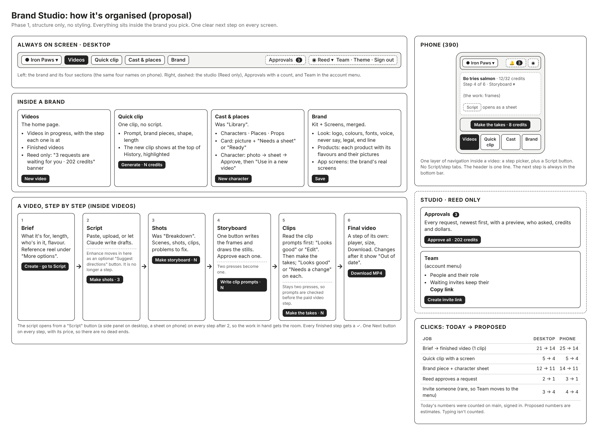

# Redesign, phase 1: how the app is organised

Structure only, no styling. **Approved by Reed on 2026-10-24**, with one change: clip prompts stay a separate step before the paid takes (item 5).

**How this was checked.** I used every job for real on current main (35bbb7a), at phone width (390) and desktop (1440), with the free stand-in providers (`BS_FAKE_PROVIDERS=true`, paid generation off). Nothing was charged. Clicks were counted from a signed-in start; typing isn't counted.

| Job | Clicks today (desktop / phone) | Proposed |
|---|---|---|
| Brief → finished video (one clip) | 21 / 25 | 14 / 14 |
| Quick clip with a brand screen | 5 / 5 | 4 / 4 |
| Add a product screen and a character with an approved sheet | 12 / 14 | 11 / 11 |
| Reed approves a request | 2 / 3 | 1 / 1 |
| Invite someone (Reed) + they join | 3 / 4, then 1 | 4 / 4, then 1 |

## Top 10 changes, and why

1. **One menu, the same on phone and desktop.**
   - Pick a brand at the top left, then four sections: **Videos · Quick clip · Cast & places · Brand**.
   - *Why:* today the desktop row mixes brand pages with studio pages (Team, Approvals). The phone uses different names for the same pages: "Clip", "Brand kit", "Brand screens".
2. **Studio pages move to Reed's corner.**
   - **Approvals** sits top right with a count; on a phone it's a bell.
   - **Team** moves into the account menu.
   - *Why:* only Reed uses them, and Team is rarely needed. On a phone both are hidden today under More.
3. **A video has six steps: Brief → Script → Shots → Storyboard → Clips → Final video.**
   - Enhance becomes an optional "Suggest directions" button inside Script.
   - The finished video gets its own step, with a clear "done" moment.
   - *Why:* the Enhance step is a dead end today, with no Next button. On a phone you have to find the stage list to leave it.
   - *Also:* the finished video is a card at the bottom of Clips, and Enhance and Storyboard never get a tick, even when done.
4. **One Next button on every step, always in the same place, with its price.**
   - On desktop it's top right; on a phone, a fixed bottom bar.
   - *Why:* after "Create project", the phone opens on the Script tab, so "Next: Script" is hidden. Four of the 25 phone clicks only switch between the Script tab and the step tab.
5. **One fewer "make" press, and clip prompts stay checkable.**
   - "Make storyboard" writes the frames *and* draws the stills. Both are cheap, and today they're always pressed together.
   - Clips stays two presses, as Reed decided:
     - **Write clip prompts** shows each prompt with "Looks good / Edit", and the app's prompt checks can flag problems.
     - Then one priced **Make the takes · N credits** button.
     - This way nobody pays for video before the prompts have been read.
   - *Why:* today there are eight separate presses and waits.
6. **The script steps aside after the Script step.**
   - From Shots on, it opens from a **Script** button: a side panel on desktop, a sheet on a phone.
   - *Why:* today the script keeps half the screen on every step, so frames, takes and the final video are squeezed into the other half.
7. **A phone shows one layer of navigation inside a video.**
   - A one-line header (title · credits), a step picker, and a Script button. The Script/step tabs go.
   - *Why:* today a stage dropdown *and* tabs sit under about 230px of header, before any work shows.
8. **Brand is one page: Look · Products · App screens.**
   - Look is logo, colours, fonts, voice, never say, legal and end line.
   - Products lists each product with its flavours and their pictures.
   - *Why:* today Kit and Screens are separate pages. Products exist only as two free-text fields on a screen, so you can't see "Bag: Chicken, Peanut butter, Salmon" anywhere.
9. **A shorter New video form.**
   - Required items first: title, what it's for, length, who's in it, flavour.
   - The reference reel moves under "More options", as a compact list.
   - *Why:* the 12 reference reels fill about 3 phone screens today, and each card repeats its description as its title.
   - *Also, Cast & places:* after a sheet is approved, offer "Use in a new video", and drop the "v3" version labels from cards.
10. **Reed sees requests where he already is, and plain numbers everywhere.**
    - The Videos home shows "3 requests are waiting for you · 202 credits", with **Approve all**.
    - Waiting invites keep **Copy link**.
    - Credits show as whole numbers: today it's "67.5 credits" and "202.5 of 150".
    - Quick clip History stops showing the model's internal prompt ("[Image1] is the first frame…").
    - New clips appear at the top of History, highlighted.

## Bugs seen on the way (for Builder-Screens now, separate from the redesign)
- Desktop Quick clip: the sticky Generate bar covers the form (the brand-piece picker, then the allowance line and Quality).
- Phone: text fields are about 40px tall (target 44), and the breakdown's inline "Edit" links are small.

## Rules this keeps
- Editors see credits, never dollars. Only Approvals (Reed) shows dollars.
- Everything stays inside a brand. The fomo and Iron Paws flows were the ones walked.
- Web only: nothing here needs a server, API or database change.
  - Merging the Storyboard presses calls the same two steps one after the other.
  - The final-video step is a new screen over the existing video data.
