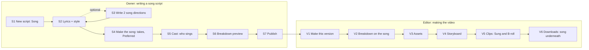

# Brand Studio Next: the flow map

Every flow, step by step, with every state. Nothing on Next is built before its flow is here, and every PR into `next` names the flows it touches (by their ids, e.g. **S3**) and what it changes for later steps. Flow-QA walks this file on the test site.

Sources: the spec (`docs/research/starpop-2026-10-28/spec.md`), Reed's changes (`ops/NEXT.md`), the Current rules (`ops/DECISIONS.md`). Where this file decides something the spec left open, it says **Decided here** and the Producer can overturn it.

## How to read a step

Each step has a table of states. Every state says **what the person sees** and **the one press that moves them on** (rule 22: never a dead end; editing a raw prompt is never the only way out). The states every step is checked for:

| Code | State | Meaning |
|---|---|---|
| E | Empty | Nothing made yet |
| L | Loading | The page is reading what exists |
| Q | Waiting | Pressed, not started yet (in the queue) |
| R | Running | Being made |
| F | Failed | The service didn't finish it |
| X | Refused | The model said no (safety, policy, a name it won't use) |
| B | Over budget | Over the video's budget, the editor's week, or the $75 cap |
| O/Ed | Owner vs editor | What differs by role (owner sees dollars only in Usage; editors see credits, rule 4) |
| P | Phone | 390 wide: no sideways scroll, controls at least 44px, the one amber button in the bottom bar |
| U | Back / Undo | Going back a step, undoing, deleting |
| S | Out of date | An earlier step changed after this one was made |

Words in "quotes" are what the screen says. They are a starting point for Next-Screens; keep the meaning, polish the words.

Shared behaviour (as today, so not repeated in every table):
- **Loading** shows the step's outline with grey placeholders, never a blank page and never a count read before the step opened (#725).
- **Waiting** shows "Waiting to start" with a timer. After 10 minutes: "This hasn't started yet: the service that makes it isn't taking work right now. It's charged only if it runs." Press: **Cancel** (only before it starts).
- **Leaving the page** never stops anything: jobs run on the server, and the step shows the result when the person comes back.
- **Failed** always says "Nothing was charged" (or "credits returned") and offers **Try again** on the same screen.
- **Undo** sits in the toast for 8 seconds after any delete, replace, pick or Approve all.
- **Price first:** every paid button shows its price ("· 4 credits", or "free").
- **Over budget, editor:** the paid button is disabled with the reason as its label ("That's more than this video's budget."); the free alternatives on the screen stay pressable. Past the week: "You've used this week's N credits. It resets on Monday." Never "Ask Reed".
- **The cap** ($75, 729 credits) stops everyone, owner included: "This video would go over its limit."

---

# 1. Song ads (build first)

**The idea in one line.** The owner pastes lyrics (or picks one of 2 AI directions), makes the song, picks the preferred take, and publishes. An editor makes the video: the breakdown is timed to the real song, most shots are B-roll under the song, and only the shots marked **Sung** lip-sync. The final video lays the whole song underneath.

**The lyrics are the script** (rules 19 and 31). The AI never changes them. They change only when the owner types, or presses a button that says it replaces them (picking a direction).

## Map

Owner steps on a song script: **Lyrics → Song → Cast → Breakdown → Publish**. Directions are inside Lyrics (a button, not a step). Variations are not offered on a song script (they would rewrite the words); to try other lyrics, the owner duplicates the script. **Decided here.**

Editor steps: the same five as a story video (**Breakdown → Assets → Storyboard → Clips → Downloads**).

## S1. New script: choosing Song

Where: Script Library → **New script**.

| State | What they see | The one press |
|---|---|---|
| E | Two choices: **Story** (as today) and **Song** ("Your lyrics, sung word for word over a music video"). | **Song** → a new draft opens on Lyrics. |
| O/Ed | Both roles see it. An editor's song script is their own script: everything paid on it counts against their week (rule 5). | — |
| P | The two choices stacked, full width. | — |
| U | Back leaves an untouched draft behind? No: an empty draft is not saved until the first word is typed (as today). | Browser back returns to the Library. |
| Library | Song scripts carry a **Song** tag in the Library list and a "Song" filter chip. | Tapping one opens it on its first unfinished step. |

Out for now: Bulk create and reel import make Story scripts only. A pasted reel that is a song ad is imported as a Story (its words become the script). **Decided here**; reel-to-song is a later item.

## S2. Lyrics and style

Two boxes and one button.

- **Lyrics.** Paste or type. `[Verse]`, `[Chorus]`, `[Bridge]`, `[Outro]` tags are fine; they are not sung and don't count. Under the box, live: "About 30 s sung · 75 words" (2.5 words a second, Starpop's rule).
- **Style.** One line: genre, voice, tempo, mood, sound. Pre-filled from the brand's music style (spec item 3). Until brand setup exists, it starts empty with an example placeholder: "pop, female lead, 120 BPM, upbeat, modern polished".
- **"Write 2 song directions for me · about 3 credits"** (S3).

| State | What they see | The one press |
|---|---|---|
| E | Both boxes empty; Next is disabled with "Paste your lyrics or pick a direction first". | Type, or **Write 2 song directions for me**. |
| L | The boxes with placeholders. | — |
| Typing | "Saved" after each pause, as on the Story script step. Leaving with unsaved words: "Leave without saving? The lyrics you changed are not saved." Stay / Leave. | **Next** (Song). |
| Style empty | Next stays allowed. The song step will use the placeholder style; Advice under the box: "No style yet: the song will be pop by default." | — |
| Advice: long style | Over 25 words: "Music models follow short styles better. Keep it under 25 words." Advice only. | **Shorten it** (free, cuts in code to the first 25 words, Undo). |
| Advice: long song | Over about 150 words: "About 70 s sung. That's a long ad: the video will be about that long too." Advice only. | — |
| Advice: no end line (rule 18) | The lyrics don't name the brand or where to find it: "The song doesn't say fomo or where to find it." Advice only. | **Add the end line** (free: adds the brand's end line as a last `[Outro]` line; the owner can edit it; Undo). |
| B (too long for the cap) | The sung length would make a video over 729 credits: "A song this long would go over the video limit. Cut it to about N words." This blocks **Make the song** only. | The owner cuts words; the count updates live. |
| O/Ed | Same for both. An editor's own script: the price lines show their week ("This week: U of A"). | — |
| P | Boxes full width, the Lyrics box grows with its text; the word count stays visible above the bottom bar. | — |
| U: lyrics changed after a song exists | See **Effects of changes** below: takes that sing other words are marked "Sings older words". | — |
| Published | Read only, with "Published · final". | — |

## S3. Write 2 song directions (optional)

Pressed on S2. Uses the brand, the product and anything already typed (as a brief, not as lyrics to keep).

| State | What they see | The one press |
|---|---|---|
| Q/R | "Writing 2 directions…" with a timer. "It shows here when it's ready. You can leave this page." | Cancel (before it starts). |
| Done | Two cards side by side (stacked on a phone): title, concept, lyrics, style, visual concept. One is marked **Recommended**. | **Use this one** on a card. |
| Use this one, boxes empty | Its lyrics and style fill the boxes. Toast: "Option B's lyrics are in. They're yours now: the AI won't change them." Undo. | **Next**. |
| Use this one, boxes have words | Confirm: "Replace your lyrics with option B's? Your words are kept in Undo." Not yet / Replace. | **Replace**. |
| Neither fits | Under the cards: **Write 2 more · about 3 credits** and "Or write your own above." | Either. |
| F | "The directions didn't finish. Nothing was charged." | **Try again**. |
| X | Claude refuses (e.g. a health claim): "Claude won't write this: [its reason, one line]." | **Try again** with the reason's free repair when there is one, else the owner types their own. |
| B | Editor past the week: the button says why and is disabled. Typing lyrics is always free. | Type the lyrics. |
| U | The directions stay on the page (collapsed under "Directions") until the owner deletes them; they're never used without **Use this one**. | — |

Rule 19 holds: directions are suggestions. Nothing the AI writes reaches the lyrics without **Use this one**, and once in, only the owner changes them.

## S4. Make the song

| State | What they see | The one press |
|---|---|---|
| Locked | Step label: "Write the lyrics first". | Goes to Lyrics. |
| E | "Make 2 takes · N credits". Under it: "Each take is a full song. The song sets the video's length." | **Make 2 takes**. |
| Q/R | Two player placeholders: "Making the song…" with a timer. | Cancel (before it starts). |
| Reading timing | After a take arrives, free, on the local lane: "Reading the song's timing…" on that take. The player already plays. | — |
| Done | Two players. Each shows its length ("0:31") and **Preferred** on one (the first to finish, until the owner picks). | **Next** (Cast), or **Make this the preferred one**, or **Make 2 more · N credits**. |
| Timing failed | "Couldn't read this take's timing. Nothing was charged." The take can still be played, but not be Preferred until timing is read. | **Try again** (free). |
| Advice: words off | Timing found lines the singer skipped or slurred: "The singer skips 'every single bowl' at 0:12." Advice only (rule 19 binds us, not the singer). | **Make 2 more**, or keep it. |
| Advice: instrumental intro | Over 2 s before the first word: "This take starts with 4 s of music before the singing." Advice. At the stitch the head is trimmed to 0.5 s automatically (free). | — |
| Advice: length | A take is over the limit-safe length (from S2's cap): "This take is 1:12; the video would cost about N credits." Only blocks if it's over the cap: then it can't be Preferred, with the reason. | **Make the other one preferred**, or cut the lyrics. |
| F | Per take: "This take didn't finish. Credits returned." | **Try again** (makes that take again at its price). |
| X | The music model refused: "The music model won't sing this: [reason]". The common one is an artist's name in the style line: "Music models refuse artists' names. Describe the sound instead." | **Use the brand's style instead** (free, swaps the style line for the brand's music style or the default, Undo, then Make 2 takes again at its price). |
| B | Owner: only the cap stops them. Editor's own script: the week. | Disabled button with the reason; the existing takes stay playable and pickable. |
| O/Ed | The same; dollars never shown. | — |
| P | Players stacked, full width; each has a 44px play button and its Preferred toggle as a full-width row under it. | — |
| U: delete a take | **Delete** on a take; Undo. Deleting the preferred take makes the other the preferred one (said in the toast). Deleting the last take returns to E. | — |
| U: change Preferred | Moves Preferred; a breakdown preview made on the other take goes out of date (S). | — |
| S | A take made before the lyrics or style changed: grey label "Sings older words" (or "Older style"). It can't be Preferred. | **Make 2 takes** for the new words. The old ones stay playable, and deletable. |
| Published | Read only; the preferred take is fixed. Other takes are hidden from editors. | — |

**Decided here:** a take is tied to the exact lyrics and style it was made from. Only a take that sings the current lyrics can be Preferred. That keeps rule 19 true all the way to the final cut.

## S5. Cast: who sings

As today's Cast step, with one addition: **the Singer**.

| State | What they see | The one press |
|---|---|---|
| Locked | "Make the song first" (no preferred take yet). | Goes to Song. |
| E / reading | The cast read runs on the lyrics and the visual concept (free reading as today). Roles named in the lyrics or concept appear. | — |
| Singer | A card on top: "Who sings on camera?" with the roles, the brand's default cast, or **Nobody on camera** (all shots B-roll). Pre-picked: the hero from the visual concept, else the brand's default cast's first character. | Pick, then **Next**. |
| Nobody on camera | Advice: "No shot will lip-sync. The song plays over B-roll only." | — |
| Rest | Exactly as today's Cast (lock to a library look, or "made at Assets"). | — |
| U | Changing the Singer after a breakdown preview marks it out of date (S6 S). | — |
| P | As today. | — |

## S6. Breakdown preview (owner, optional as today)

Same step as the editor's Breakdown (V2), made by the owner from the preferred take. If the owner skips it, it runs when the editor starts (as today), using the published preferred take.

| State | What they see | The one press |
|---|---|---|
| Locked | "Make the song first". | Goes to Song. |
| S | The lyrics, style, preferred take or Singer changed after it was made: "Out of date: the song changed." | **Make it again · N credits** (as today). |
| Everything else | As V2. | — |

## S7. Publish

| State | What they see | The one press |
|---|---|---|
| Locked | "Make the song first" / "Pick the preferred take first" (a take exists, none singing the current words). | Goes to Song. |
| Ready | The version card lists: Lyrics, Style, **Song: take 2 · 0:31** (a small player), Singer, Cast, Breakdown. Note: "Publishing makes this ready to make. After that the lyrics and song can't change. To change them, duplicate the script." | **Publish**. |
| Confirm | "Publish {title}? Its lyrics and song become final." Not yet / Publish. | **Publish**. |
| Published | "Published · final". Only **Duplicate script** (copies lyrics, style and all takes, Preferred kept). The owner can still edit title, about and notes (rule 31). | — |

## V1. Make this version (editor)

As today. The price includes the song's Sung clips; the song is already paid.

| State | What they see | The one press |
|---|---|---|
| Ready | "Make this version · free" (breakdown saved) or "· N credits". Under it: "About N credits to make · 0:31 song". | **Make this version** → Breakdown. |
| B | "That's more than this week's N free credits…" (own script) or the video budget reason. | — |
| Taken | "{name} is making this version." | — |

## V2. Breakdown on the song

The shots are built from the preferred take's word timings. Each shot covers a stretch of the song, from one word boundary to another (never mid-word), and is marked **Sung** or **B-roll**. Default: the hook (first line or two) and the last chorus are Sung, everything else B-roll. Instrumental stretches get B-roll shots of their own ("Music · 0:12–0:16"). The shots cover the song from its first word to its end with no gaps.

Desktop: the song's waveform across the top, the shots as blocks under it, a play head. Phone: the waveform fits the width (no sideways scroll), and the shots are a list under it; tapping a shot plays its stretch.

| State | What they see | The one press |
|---|---|---|
| E | "No shots yet". | **Make shots · N credits**. |
| R | "Planning shots to the song…" with a timer. | — |
| Done | Shot rows: time range ("0:00–0:04"), the sung words, **Sung** or **B-roll** badge, who's in it, where. | **Next** (Assets). |
| Flip | Each row has a **Sung / B-roll** switch. Sung needs the Singer in the shot: flipping a shot without the Singer adds the Singer to it (said in the toast, Undo). | — |
| Edit timing | No free dragging. A row has **Split here** (at a line or word gap the owner picks from the words) and **Join with next**. The times follow the song. | — |
| Problems | As today ("Fix the N problems in Breakdown first"), each with its one-click fix. New ones: "This shot crosses a place change" (rule 29) with **Split at the change** (free); "A Sung shot is longer than one clip can be" with **Split it** (free). | The fix. |
| Advice | "No shot is Sung" (when the Singer exists). "The last chorus isn't Sung." Advice only. | — |
| F | "The shots didn't finish. Nothing was charged." | **Try again**. |
| X | Claude refuses: the reason, plus **Try again**. | — |
| B | As today. | — |
| O/Ed | The editor edits their video's breakdown, as today. They can't change the song (published, rule 31). | — |
| U | Every flip, split and join has Undo. | — |
| S | Only if the owner's published version is duplicated and changed: that's a new script, so editors' videos are never pulled out of date by the owner. | — |

Clips follow scenes, not shots (rule 29): consecutive shots in one place and one action become one clip, as today. The song is sliced to fit each clip, never the clip to the song. A clip that holds a Sung shot lip-syncs only that shot's stretch; its other shots in the same clip are picture.

## V3. Assets

As today. The Singer is a role like any other and needs an approved look (rule 8). Nothing new.

## V4. Storyboard

As today: one still per shot. For Sung shots the still is used as a reference picture, not the first frame (Seedance can't take a first frame and an audio slice together). The frame card says so: "Sung: used as a reference, not the first frame."

| State | What they see | The one press |
|---|---|---|
| S | A shot flipped Sung ↔ B-roll after the still was made: the still is kept (it's the same picture), but its clip goes out of date (V5 S). | — |
| Everything else | As today. | — |

## V5. Clips

As today (prompts reviewable, "Looks good", takes, pick, Approve all), plus:

- A clip with a Sung shot shows "Lip-syncs 0:00–0:06" and a small player of that stretch.
- B-roll clips are made with sound off, as today.
- The clip's length is its song stretch, rounded up to what the video model accepts; the extra is trimmed at the stitch.

| State | What they see | The one press |
|---|---|---|
| Sung, done | The take plays with the song stretch. | Pick, approve, as today. |
| Advice: lip-sync drift | Not checked automatically (rule 11). The editor watches. | **Make another take**, or **Change this…**. |
| X | As today's refusal messages, naming the character (rule 23), with the free reword (#728). | **Reword and try again** (free). |
| S | The shot flipped Sung ↔ B-roll, or split/joined: "Made for an older breakdown". | **Rewrite clip prompts · N credits** (as today); old takes kept. |
| Everything else | As today. | — |

## V6. Downloads: the song underneath

The final video is stitched as today (free), and the preferred take's full song is laid underneath. The clips' own sound is dropped, so the song is the only sound: the lip-sync clips were made from the same song, so they match. The picture is trimmed to the song's length; if the picture is short, the last shot holds its final frame.

| State | What they see | The one press |
|---|---|---|
| Done | The player, **Download MP4**, **Download all clips (.zip)** (the zip also holds the song file). | — |
| F | "The video couldn't be put together. Nothing was charged." | **Try again**. |
| S | As today ("A clip changed since this video was made. It's free.") | **Make it again**. |

## Effects of changes (song ads)

What happens to later steps when an earlier one changes. "Out of date" items are always kept, never deleted, and always offer the press that brings them up to date.

| Change | Takes | Breakdown | Stills | Clips | Final video |
|---|---|---|---|---|---|
| Lyrics edited (owner, draft) | Takes singing the old words: "Sings older words", can't be Preferred | Preview out of date | — | — | — |
| Style edited | "Older style" (still playable, can't be Preferred) | Preview out of date | — | — | — |
| Preferred take changed | — | Preview out of date | — | — | — |
| Singer changed | — | Preview out of date | — | — | — |
| Published | Fixed | Fixed (the published preview, if any) | — | — | — |
| Shot flipped Sung ↔ B-roll (editor) | — | Saved, Undo | Kept | That clip out of date | Out of date |
| Shot split or joined | — | Saved, Undo | New shot needs a still; others kept | Clips touching it out of date | Out of date |
| Look changed at Assets | — | — | Redrawn as today | Out of date as today | Out of date |
| New take picked in Clips | — | — | — | — | Out of date ("Make it again", free) |

## Open questions for the Producer

1. **The music price.** The free price check of MiniMax Music comes first (spec step 0); until then the buttons show the model catalogue's price, and the test site runs on the free stand-in.
2. **Lip-sync without a first frame** is the spec's biggest risk. The one paid 15-second test (spec step 0) decides whether Sung shots ship as designed, or fall back to "the Singer sings in B-roll style" (picture only, no lip-sync).
3. **Reel import of song ads** is left out (S1). Say if Reed wants it in this item.
