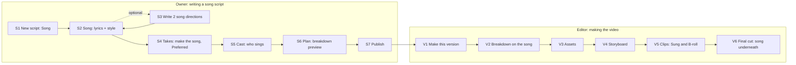

# Brand Studio Next: the flow map

Every flow, step by step, with every state. Nothing on Next is built before its flow is here, and every PR into `next` names the flows it touches (by their ids, e.g. **S3**) and what it changes for later steps. Flow-QA walks this file on the test site.

Sources: the spec (`docs/research/starpop-2026-10-28/spec.md`), Reed's changes (`ops/NEXT.md`), the Current rules (`ops/DECISIONS.md`). Where this file decides something the spec left open, it says **Decided here** and the Producer can overturn it.

## Names and words (from the UX audit, docs/next/ux-audit.md, #749)

- **Owner, story:** Write → Cast → Plan → Publish. Directions sit in Write as a Suggestions panel, Variations as a Versions section, and "Approve the words" is in Write. Editing approved words asks first: "Edit version A? It goes back to draft. Approve the words again before Next. Roles already found are kept." (today's un-approve, said in advance).
- **Owner, song:** Song → Takes → Cast → Plan → Publish, with no Suggestions or Versions panels.
- **Editor:** Plan → Cast → Storyboard → Clips → Final cut (item 1b, 2026-10-29). Plan has two views, **Scenes** (the plan) and **Shots** (what was the Breakdown step). **Cast** is what was the Assets step; the library keeps its name, **Cast & places**. Clips has two lists on one step, **Prompts** (each prompt checked, "Prompt OK", rule 21) then **Takes** (make, pick, "Approve take"), with Approve all on both.
- **One Video settings row** at the top of every video and on Make this version holds every per-video choice: shape, flavour, look, models, language, and for a song video the song ("Change song", V2a).
- **State words, every step:** Waiting · Making… 0:42 · Ready to check · Approved · Didn't finish · nothing charged (or "credits returned" when they were held) · Refused, with its free fix (for a song: the style line or another take, never the words) · Out of date.
- **Old links:** every old `/projects/…` address redirects to the same video in its new place, never a 404.
- **Out of date is viewable, never locked** (audit M14). A step that already has work but is out of date opens read only, with a banner: "Out of date: the breakdown changed after these were made." Its paid presses are disabled with that reason. One press runs the existing redo presses in order: **Update everything after this · N credits** (the same redraws and rewrites as today, priced first; it stops at the first step over budget or failed, saying which, with that step's own press). A step with nothing made yet still opens on the step that blocks it, as today.
- **A finished video stays finished until its new cut exists** (audit LW1, LW2). Any change that puts made work out of date on a video with a final cut (breakdown, look, flavour, the song take, Sung / B-roll, model or shape) warns first, naming what goes out of date, for example: "This video is finished. Changing the breakdown puts 3 clips out of date; your current final cut stays downloadable until you make a new one." Not yet / Change. After the change, Final cut opens (read only, M14) with the old cut and **Download MP4** working, labelled "Older cut: made before the breakdown changed". Lists and In production show **"Finished · changes waiting"** (never "Video done" or "0 being made") with the press **Open** to the first out-of-date step.
- **Where Sung starts** (Director, #755): the owner can mark a lyric line or a section `[Lip-sync]` in Song. Those lines start as Sung in every video, and everything else starts as B-roll. The mark is never sung: it's taken out before Suno. In a video, the editor's Sung / B-roll flips win (rule 31). The breakdown's "sung on camera, but the script doesn't ask" Advice only fires where neither the script's mark nor the video's flip asked for it, and never tells an editor to change the lyrics.
- **A final cut while clips are out of date** (Flow-QA): never blocked and never silent. Final cut offers **Make the cut with what's approved** (free; out-of-date clips go in as they are, and the cut is labelled "Includes 2 out-of-date clips") beside **Update everything after this · N credits**. The download names which clips were out of date.
- **Flavour at Publish, edge states** (Flow-QA): no product with flavours: the picker isn't shown. One flavour: it's picked by itself, shown as text. Several and none picked: Publish asks "Which flavour for Pitbull 1?" with the flavours as buttons (one press each); never blocked without that choice on the same screen. A product or flavour added after publishing: published versions keep theirs; new videos of them show "New flavour available: Chicken" in Video settings, Advice only.
- **Redo one frame** (audit LW3, M16): an out-of-date still has **Redo this frame · N credits** on its card. Because the frame was planned from the old breakdown, it rewrites that one frame's prompt from the new breakdown (one writing call for that shot only, with its neighbours' frames as context so the look and continuity hold), then draws it. It never redraws the old prompt.
  - **Offered when** the shot still exists in the new breakdown. When shots themselves changed (split, joined, renumbered), the card says "This shot changed in the breakdown" and the step offers **Redo the changed frames · N credits** (only the frames whose shots changed; the others stay). **Redo storyboard** stays for redoing every still, and its confirm says so.
  - **Price and limits:** the price covers the writing call plus the still. Over the video's budget or the editor's week, the press is disabled with the reason ("That's more than this video's budget." / "That's more than this week's N credits. It resets on Monday."), as every paid press.
  - **The drawing fails or is refused after the rewrite worked:** the new prompt is kept. The card offers **Try again** (the drawing only, the still's price) or the free **Soften it** reword, as any refused still. The writing call isn't charged twice.
  - **The rewrite fails:** "Didn't finish · nothing charged", with **Try again**.
  - **Undo** puts back both the earlier still and its earlier prompt.
- **Edit shot from a card** (audit M15): a frame or clip card has **Edit shot**, opening the breakdown's shot editor in a panel on the same screen. Saving changes this video's breakdown with the usual effects (that shot's still and clip go out of date, kept, Undo). Split and join on a song video stay in Breakdown.
- **Flavour from the script** (audit M12, N5): at Publish the owner picks a flavour per product for each version ("Pitbull 1 · Peanut butter"). It's each new video's default flavour and still changeable per video in the Video settings row (VS1 Flavour). A video reads its script's notes live (the owner can still edit notes after publishing, rule 31).

## How to read a step

Each step has a table of states. Every state says **what the person sees** and **the one press that moves them on** (rule 22: never a dead end; editing a raw prompt is never the only way out). The states every step is checked for:

| Code | State | Meaning |
|---|---|---|
| E | Empty | Nothing made yet |
| L | Loading | The page is reading what exists |
| Q | Waiting | Pressed, not started yet (in the queue) |
| R | Running | Being made |
| F | Failed | The service didn't finish it |
| X | Refused | The model said no (safety, policy, a name it won't use) |
| B | Over budget | Over the video's budget, the editor's week, or the $75 cap |
| O/Ed | Owner vs editor | What differs by role (owner sees dollars only in Usage; editors see credits, rule 4) |
| P | Phone | 390 wide: no sideways scroll, controls at least 44px, the one amber button in the bottom bar |
| U | Back / Undo | Going back a step, undoing, deleting |
| S | Out of date | An earlier step changed after this one was made |

Words in "quotes" are what the screen says. They are a starting point for Next-Screens; keep the meaning, polish the words.

Shared behaviour (as today, so not repeated in every table):
- **Loading** shows the step's outline with grey placeholders, never a blank page and never a count read before the step opened (#725).
- **Waiting** shows "Waiting to start" with a timer. After 10 minutes: "This hasn't started yet: the service that makes it isn't taking work right now. It's charged only if it runs." Press: **Cancel** (only before it starts).
- **Leaving the page** never stops anything: jobs run on the server, and the step shows the result when the person comes back.
- **Failed** always says "Nothing was charged" (or "credits returned") and offers **Try again** on the same screen.
- **Undo** sits in the toast for 8 seconds after any delete, replace, pick or Approve all.
- **Price first:** every paid button shows its price ("· 4 credits", or "free"), and the charge lands within that quote ("up to N" when it can vary; anything unused comes back). A charge above its quote is a bug for Flow-QA to file.
- **Server restart** mid-job: "The server restarted while this was being made. Nothing was charged; try again." with **Try again**.
- **Over budget, editor:** the paid button is disabled with the reason as its label ("That's more than this video's budget."); the free alternatives on the screen stay pressable. Past the week: "You've used this week's N credits. It resets on Monday." Never "Ask Reed".
- **The cap** ($75, 729 credits) stops everyone, owner included: "This video would go over its limit."

---

# 1. Song ads (build first)

**The idea in one line.** The owner pastes lyrics (or picks one of 2 AI directions), makes the song, picks the preferred take, and publishes. An editor makes the video: the breakdown is timed to the real song, most shots are B-roll under the song, and only the shots marked **Sung** lip-sync. The final video lays the whole song underneath.

**The lyrics are the script** (rules 19 and 31). The AI never changes them. They change only when the owner types, or presses a button that says it replaces them (picking a direction).

## Map

Owner steps on a song script: **Song → Takes → Cast → Plan → Publish** (the names Next-Screens uses in docs/next/screens.md). "Write 2 song directions" is a button inside Song, not a step. Variations are not offered on a song script (they would rewrite the words); to try other lyrics, the owner duplicates the script. **Decided here.**

Editor steps: the same five as a story video (**Plan → Cast → Storyboard → Clips → Final cut**, item 1b; the song breakdown below is Plan's Shots view, and V3 Assets is the Cast step).

## S1. New script: choosing the format (Dialogue, Song or Narrated)

Where: Script Library → **New script**.

| State | What they see | The one press |
|---|---|---|
| E | Three formats: **Dialogue** (as today's Story: people speak on camera), **Song** ("Your lyrics, sung word for word over a music video") and **Narrated** ("One voice reads your script over B-roll, with music"). The Look is a separate setting (ST1). | **Song** → a new draft opens on its Song step. **Narrated** → it opens on Write, then Narration (N1). |
| O/Ed | Both roles see it. An editor's song script is their own script: everything paid on it counts against their week (rule 5). | — |
| P | The two choices stacked, full width. | — |
| U | Back leaves an untouched draft behind? No: an empty draft is not saved until the first word is typed (as today). | Browser back returns to the Library. |
| Library | Song scripts carry a **Song** tag in the Library list and a "Song" filter chip. | Tapping one opens it on its first unfinished step. |

Bulk create and reel import still make Dialogue scripts. To learn from a song ad, the owner studies it inside Song (**S3a**): a study informs the directions, it never becomes the lyrics. **Decided here** (Reed's song workflow, #807 item 4).

## S2. Song: lyrics and style

Two boxes and one button.

- **Lyrics.** Paste or type. `[Verse]`, `[Chorus]`, `[Bridge]`, `[Outro]` tags are fine; they are not sung and don't count. Under the box, live, before anything is locked or made: "75 sung words: a song of about 0:31–0:38" (the pace Suno actually sang in Reed's pilot, 2.0–2.4 words a second; Director #794 `check.length_note`).
- **Style.** One line: genre, voice, tempo, mood, sound. Pre-filled from the brand's music style (spec item 3). Until brand setup exists, it starts empty with an example placeholder: "pop, female lead, 120 BPM, upbeat, modern polished".
- **"Write 2 song directions for me · about 3 credits"** (S3).

| State | What they see | The one press |
|---|---|---|
| E | Both boxes empty; Next is disabled with "Write or pick the lyrics first". | Type, or **Write 2 song directions for me**. |
| L | The boxes with placeholders. | — |
| Typing | "Not saved yet" with **Save lyrics** (and **Discard changes**). Leaving with unsaved words: "Leave without saving? The lyrics you changed are not saved." Stay / Leave. | **Save lyrics**, then **Next: Takes**. |
| Saved | The lyrics read only with "Sung word for word", and **Edit lyrics**. When takes exist, Edit lyrics asks first: "Edit the lyrics? Your 2 takes will be out of date. They're kept, and you can make new ones." | **Next: Takes**. |
| Nothing to go on | About is empty and the brand has no facts: the directions button is disabled with "Say what it's for in About first". | **Open About**. |
| Style empty | Never a block. Next stays allowed and the takes use the brand's music style, else the default; Advice under the box: "No style yet: the song will be upbeat pop by default." | **Next: Takes**. |
| Advice: long style | Over 25 words: "Suno follows short styles better. Keep it under 25 words." Advice only. | **Shorten it** (free, cuts in code to the first 25 words, Undo). |
| Advice: long song | Over about 150 words: "365 sung words: a song of about 2:32–3:02. That's a long ad: the video will be about that long too." Advice only. | — |
| Advice: no end line (rule 18) | The lyrics don't name the brand or where to find it: "The song doesn't say fomo or where to find it." Advice only. Two ways to meet it, either one: | **Sing the end line** (free: adds the brand's end line as a last `[Outro]` line; the owner can edit it; Undo), or **Speak it over the end** (free: the brand's end line, editable, is spoken over the song's last seconds with the music lowered under it; see V6). |
| Spoken end line set | Under the boxes: "Spoken at the end: 'Download fomo through the link in my bio.'" with **Edit** and **Remove** (Undo). | — |
| B (too long for the cap) | The sung length would make a video over 729 credits: "A song this long would go over the video limit. Cut it to about N words." This blocks **Make the song** only. | The owner cuts words; the count updates live. |
| O/Ed | Same for both. An editor's own script: the price lines show their week ("This week: U of A"). | — |
| P | Boxes full width, the Lyrics box grows with its text; the word count stays visible above the bottom bar. | — |
| U: lyrics changed after a song exists | See **Effects of changes** below: takes that sing other words are marked "Sings older words". | — |
| Published | Read only, with "Published · final" (rule 31: the lyrics are the script's lines). | — |
| "Locked" means | The AI never changes the lyrics. The owner types freely until publishing. There is no lock to undo. | — |

## S3. Write 2 song directions (optional)

Pressed on S2. Uses the brand, the product and anything already typed (as a brief, not as lyrics to keep). Two optional boxes above the button (Director #794):
- **From a script** (paste a script or voice-over): the directions adapt it into lyrics line by line, in order, keeping its beats, its claims and its key lines (hook, payoff, end line) as close to word for word as the rhyme allows, and adding no claims. The two directions become "the whole script as a song" and "cut to the planned length (or about 60 s)", and each card lists what it leaves out ("Leaves out: the vet quote"; nothing for a fresh song).
- **Sounds like** (a song or artist): turned into a style line that describes the sound (genre, era, voice, tempo, instruments, mood) and never names it, because Suno refuses names. If a style line names it anyway: Advice "Suno won't take names: describe the sound instead", with **Use the described style** (free).

| State | What they see | The one press |
|---|---|---|
| Q/R | "Writing 2 directions…" with a timer. "It shows here when it's ready. You can leave this page." | Cancel (before it starts). |
| Done | Two cards side by side (stacked on a phone): title, concept, lyrics with their length ("about 2:32–3:02"), style, visual concept, and "Leaves out: …" when adapted from a script. One is marked **Recommended**. | **Use this one** on a card. |
| Use this one, boxes empty | Its lyrics and style fill the boxes. Toast: "Option B's lyrics are in. They're yours now: the AI won't change them." Undo. | **Next**. |
| Use this one, boxes have words | Confirm: "Replace your lyrics with option B's? Your words are kept in Undo." Not yet / Replace. | **Replace**. |
| Claims not in the brand facts | A direction lists claims the brand block doesn't state (Director's `unchecked_claims`): on the card, "Not checked: 'vet-approved in 7 days'". After **Use this one**, the same line shows under the Lyrics box until the owner acts. Advice only, never a block. | **Keep it** (the owner vouches; the note goes), or **Edit lyrics** (the owner's own typing; rule 19). |
| Neither fits | Under the cards: **Write 2 more · about 3 credits** and "Or write your own above." | Either. |
| F | "The directions didn't finish. Nothing was charged." | **Try again**. |
| X | Claude refuses (e.g. a health claim): "Claude won't write this: [its reason, one line]." | **Try again** with the reason's free repair when there is one, else the owner types their own. |
| B | Editor past the week: the button says why and is disabled. Typing lyrics is always free. | Type the lyrics. |
| U | The directions stay on the page (collapsed under "Directions") until the owner deletes them; they're never used without **Use this one**. | — |

Rule 19 holds: directions are suggestions. Nothing the AI writes reaches the lyrics without **Use this one**, and once in, only the owner changes them.

## S3a. Study a song ad (a third box on S3)

Reed's pilot needed a song ad's shape before writing his own: its words, its pace and where its parts fall. A third optional box above **Write 2 song directions**: **Study a song ad** (paste a reel link, or upload the video).

| State | What they see | The one press |
|---|---|---|
| E | "Paste a song ad to learn its shape: its words, beat and parts. Free." | **Study it** (free: download, cuts, frames and transcript are the reel import's free prep; the beat is read from the audio on our server). |
| Q/R | "Studying the song ad…" with a timer. "You can leave this page." | Cancel. |
| Done | A study card: length, **BPM**, the **sections** (intro, verse, chorus, bridge, outro, each with its times and its lines; found from where the singing pauses and which lines repeat, and a section whose name is a guess says "guessed"), the words with their times, and a frame strip, each frame marked with its time. | **Use as a guide** (on by default), or **Remove**. |
| Used as a guide | **Write 2 song directions** follows the study's structure, section lengths and pace (and its BPM goes into the style line as a tempo, in words). The card says: "A guide only: the directions copy its shape, never its words." | **Write 2 song directions** (price as S3). |
| F | "We couldn't open that reel: [the reason]. Nothing was charged." (private, too long, not a video) | **Try another**. |
| U | The study stays on the version, collapsed under "Song ad studied", until removed. It never fills the lyrics or style boxes: only **Use this one** on a direction does (rule 19). | — |
| B | None: studying is free. | — |

The study's words are someone else's song. The directions never reuse its lines (Director: a check that no line of a direction repeats a line of the study), and nothing from it reaches the lyrics without the owner's press.

## S4. Takes: make the song

| State | What they see | The one press |
|---|---|---|
| Locked | Step label: "Write or pick the lyrics first". | Goes to Song. |
| E | "Make 2 takes · N credits". Under it: "Each take is a full song. The song sets the video's length." | **Make 2 takes**. |
| Q/R | Two player placeholders: "Making the song…" with a timer. | Cancel (before it starts). |
| Reading timing | After a take arrives, free, on the local lane: "Reading the song's timing…" on that take. The player already plays. | — |
| Done | Two players. Each shows its length and **the video it implies**: "0:31 · a video of about 40 credits" (Reed's pilot: takes of the same words differ by up to 20 s, which is real money). **Preferred** is on one: the first take whose timing is read, until the owner picks. The same line shows on every take in Change song (V2a). | **Next: Cast**, or **Make this Preferred**, or **Make 2 more · N credits**. |
| Timing still reading | That take's **Make this Preferred** is disabled with "Reading the song's timing…"; it turns on by itself when the timing is read. | — |
| Timing failed (the words couldn't be read; the length is known) | "We couldn't read this song's timing. It's free to try again." | **Try again** (free; a slow read may pass next time), or **Use timing spread evenly** (free: the lines are spread over the take's length in order, each shot marked "Timing guessed"; the take can then be Preferred), or **Make this Preferred** on the other take. |
| Timing failed (the file can't be read) | "This take's file can't be read, so its timing can't be measured." Trying again won't help, so it isn't offered. | **Make this Preferred** on the other take, or **Make 2 more · N credits**. The take can be deleted (Undo). |
| Advice: words off | Timing found lines the singer skipped or slurred: "The singer skips 'every single bowl' at 0:12." Advice only (rule 19 binds us, not the singer). | **Make 2 more**, or keep it. |
| Advice: sung twice | A line is sung twice: "Line 4 is sung twice in this take." Advice only; the shots follow the first time it's sung and the repeat rides in the shot after it. | **Make 2 more**, or keep it. |
| Advice: instrumental intro | Over 2 s before the first word: "This take starts with 4 s of music before the singing." Advice. At the stitch the head is trimmed to 0.5 s automatically (free). | — |
| Too long (after) | A take came out longer than the lyrics promised and a video of it would go over the cap: "This take is 1:12: a video of it would go over the limit." | **Use the first 0:55** (free: the take is trimmed at the last section end that fits, never mid-word, and the trimmed take becomes the one used; the full take is kept). |
| F | Suno makes both takes in one request, so they fail together: "The song didn't finish. Credits returned." Older good takes stay above, still Preferred. | **Try again · N credits** (one new request, 2 takes). |
| Slow | Suno sometimes stalls (Starpop saw over 5 minutes). Past 15 minutes the request stops: "The music service didn't finish this in time. Nothing was charged." | **Try again · N credits**. |
| X | Suno refused: "Suno won't sing this: [reason]". The common one is an artist's or band's name in the style line: "Suno refuses artists' names. Describe the sound instead (genre, voice, tempo, mood)." The fix is always in the style line or a retry, never in the lyrics (rule 19). | **Use the brand's style instead** (free, swaps the style line for the brand's music style or the default, Undo, then Make 2 takes again at its price). If the refusal is about the words themselves: "Suno won't sing these words: [reason]." The owner, on a draft, gets **Edit lyrics** (their own typing; the AI never rewords) and **Try again** (some refusals don't repeat). In a video (V2a), the lyrics are final, so the press is **Use this take** on another take, or **Try again**. |
| Songs off | No music service on this site (the test site without a music key, or the stand-ins off): "Songs aren't switched on here." in place of the button. Lyrics, style and directions still work. | — |
| Too long (before) | The price line under the button covers the song and the clips it implies: "2 takes · N credits. A video this long: about M credits to make." Over the 729-credit cap: the button is replaced by the fix. | **Keep the first N lines** (free: cuts the lyrics at the last section that fits, shown before/after, Undo), then Make 2 takes. |
| B | Owner: only the cap stops them. Editor's own script: the week. | Disabled button with the reason; the existing takes stay playable and pickable. |
| O/Ed | The same; dollars never shown. | — |
| P | Players stacked, full width; each has a 44px play button and its Preferred toggle as a full-width row under it. | — |
| U: delete a take | **Delete take** in the take's menu; Undo. Guards, each with its press: the Preferred take can't be deleted ("Make another take Preferred first", with **Make this Preferred** on the other take right there; when the other takes sing older words: "Make takes of the new lyrics first", with **Make 2 takes**). A take a video uses can't be deleted ("Video 'Pitbull song' uses this take"); takes on a published script aren't deletable at all. | — |
| U: change Preferred | Moves Preferred; a breakdown preview made on the other take goes out of date (S). | — |
| S | A take made before the lyrics or style changed: grey label "Sings older words" (or "Older style"). It can't be Preferred. | **Make 2 takes** for the new words. The old ones stay playable, and deletable. |
| Published | Read only for the owner. The preferred take becomes each new video's starting song; every published take is offered to editors in their video (V2a), where the choice is theirs (rule 31). | — |

**Decided here:** a take is tied to the exact lyrics and style it was made from. Only a take that sings the current lyrics can be Preferred. That keeps rule 19 true all the way to the final cut.

Takes per press: always 2, from one Suno request (Suno returns two songs per request, priced as one request: a placeholder of 1 credit a request until Suno's real price is set, rule 2). A failed request is retried whole: **Try again · 1 credit** makes 2 new takes; there's no single-take retry. A take that came back but whose timing failed is never re-requested from Suno (its fixes are free, below).

**How the lyrics reach Suno (Starpop's recipe, done in code, never changing a word):** the lyrics go in Suno's own lyrics field ("custom" mode, sung as written; never its write-the-lyrics mode), wrapped in `[Intro: vocals start immediately]` … `[End]`; the style line gets ", vocals start immediately, no instrumental intro, no instrumental breaks, continuous singing, tight ending" added after it, and "instrumental intro, instrumental break, long outro, spoken word" as styles to avoid. Suno's limits: lyrics up to 5,000 characters, style up to 1,000; over either, the box's counter says "Cut N characters" and saving waits until it fits.

## S5. Cast: who sings

As today's Cast step, with one addition: **the Singer**.

| State | What they see | The one press |
|---|---|---|
| Locked | "Make the song first" (no preferred take yet). | Goes to Takes. |
| E / reading | The cast read runs on the lyrics and the visual concept (free reading as today). Roles named in the lyrics or concept appear. | — |
| Singer | A card on top: "Who sings on camera?" with the roles, the brand's default cast, or **Nobody on camera** (all shots B-roll). The Singer is always a cast role. Pre-picked: the hero from the visual concept, else the brand's default cast's first character. When the lyrics and concept name nobody, the cast read adds a role named **Singer** automatically (its look is made per video at Assets, rule 7). | Pick, then **Next**. |
| Nobody on camera | Advice: "No shot will lip-sync. The song plays over B-roll only." | — |
| Rest | Exactly as today's Cast (lock to a library look, or "made at Assets"). | — |
| U | Changing the Singer after a breakdown preview marks it out of date (S6 S). | — |
| P | As today. | — |

## S6. Plan: scene plan, then breakdown preview (owner, optional as today)

The owner's scene plan first (P1: one action per lyric line; it is each new video's starting plan), then the same step as the editor's Breakdown (V2), made from it and the preferred take. If the owner skips it, it runs when the editor starts (as today), using the published preferred take.

| State | What they see | The one press |
|---|---|---|
| Locked | "Make the song first". | Goes to Takes. |
| Take changed | Preferred moved to another take of the same lyrics: the times re-flow to it in code, free, with Undo (as V2a). Nothing to press. | — |
| S | The lyrics, style or Singer changed after it was made: "Out of date: the song changed." | **Make it again · N credits** (as today). |
| Everything else | As V2. | — |

## S7. Publish

| State | What they see | The one press |
|---|---|---|
| Locked | "Make the song first" / "Pick the preferred take first" (a take exists, none singing the current words). | Goes to Takes. |
| Ready | The version card lists: Lyrics, Style, **Song: take 2 · 0:31** (a small player), Singer, Cast, Breakdown. Note: "Publishing makes this ready to make. After that the lyrics can't change (each video still picks its own take). To change the lyrics, duplicate the script." | **Publish**. |
| Confirm | "Publish {title}? Its lyrics become final." Not yet / Publish. | **Publish**. |
| Published | "Published · final". Only **Duplicate script** (copies lyrics, style and all takes, Preferred kept). The owner can still edit title, about and notes (rule 31). | — |

Not on song scripts: the Story flow's **Directions** (camera suggestions) and **Variations** steps are hidden. "Write 2 song directions" (S3) is the only writing help.

## V1. Make this version (editor)

As today. The price includes the song's Sung clips; the song is already paid.

| State | What they see | The one press |
|---|---|---|
| Ready | "Make this version · free" (breakdown saved) or "· N credits". Under it: "About N credits to make · 0:31 song". | **Make this version** → Breakdown. |
| B | "That's more than this week's N free credits…" (own script) or the video budget reason. | — |
| Taken | "{name} is making this version." | — |

## V2a. The song in this video (in the Video settings row)

In the video's settings row, shown again as a strip above the shots in Breakdown: the video's song (a player and its length) and **Change song**. The choice of take is the video's own (rule 31); the lyrics are not.

| State | What they see | The one press |
|---|---|---|
| Default | The published preferred take: "Song: take 2 · 0:31". | — |
| Change song | A sheet with every published take and any this video made, each with a player and length; the current one marked **In this video**. | **Use this take**. |
| Use this take, shots exist | Confirm: "Use take 1? The shots keep their lines and Sung marks; their times move to take 1 (free). Clips already made for take 2 go out of date." Not yet / Use it. | **Use it** (free re-timing in code, Undo). |
| Make 2 more | In the sheet: **Make 2 more takes · N credits** (the same lyrics and style; billed to this video's budget, or the editor's week on their own script). States as S4 (waiting, running, timing, timing failed, refused). | — |
| Too long | A take whose video would go over the cap: "Too long for this video" and its **Use this take** is disabled with that reason; the current take stays. | **Use the first 0:55** on that take (free, as S4), which makes it usable. |
| Delete | A take this video made can be deleted (Undo), except the one the video uses. Published takes can't. | — |
| B | The make button is disabled with the reason; the existing takes stay usable. | **Use this take** on an existing one. |
| P | The strip is one row (play, "0:31", Change song); the sheet is full screen, takes stacked. | — |

## V2. Breakdown on the song (now Plan → Shots, item 1b)

The shots are built from the preferred take's word timings. Each shot covers a stretch of the song, from one word boundary to another (never mid-word), and is marked **Sung** or **B-roll**. Default: every shot is B-roll (Reed: song ads are mostly B-roll; lip-sync is a rare extra). Sung is only where someone flips it. Instrumental stretches get B-roll shots of their own ("Music · 0:12–0:16"). The shots cover the song from its first word to its end with no gaps.

Desktop: the song's waveform across the top, the shots as blocks under it, a play head. Phone: the waveform fits the width (no sideways scroll), and the shots are a list under it; tapping a shot plays its stretch.

| State | What they see | The one press |
|---|---|---|
| E | "No shots yet". | **Make shots · N credits**. |
| R | "Planning shots to the song…" with a timer. | — |
| Done | Shot rows: time range ("0:00–0:04"), the sung words, **Sung** or **B-roll** badge, who's in it, where. | **Next** (Assets). |
| Flip | Each row has a **Sung / B-roll** switch. Sung needs the Singer in the shot: flipping a shot without the Singer adds the Singer to it (said in the toast, Undo). | — |
| Flip, nobody sings | The script said "Nobody on camera", so this video has no Singer yet. Flipping a shot to Sung opens "Who sings in this video?" with the video's roles. | Pick one: it becomes this video's Singer (per video; the script is unchanged) and is added to the shot. A role with no look goes to Assets as usual (rule 8). |
| Edit timing | No free dragging. A row has **Split here** (at a line or word gap the owner picks from the words) and **Join with next**. The times follow the song. | — |
| Problems | As today ("Fix the N problems in Breakdown first"), each with its one-click fix. New ones: "This shot crosses a place change" (rule 29) with **Split at the change** (free); "A Sung shot is longer than one clip can be" with **Split it** (free). | The fix. |
| Suggestion | When the video has a Singer and no shot is Sung, one closed line: "The Singer could sing the hook on camera." Never a problem. | **Sing the hook on camera** (free: flips the hook's shot to Sung, Undo). |
| F | "The shots didn't finish. Nothing was charged." | **Try again**. |
| X | Claude refuses: the reason, plus **Try again**. | — |
| B | As today. | — |
| O/Ed | The editor edits their video's breakdown, as today: Sung or B-roll, split and join are theirs (rule 31). The lyrics can't change. A flip that changes a clip's price shows the new price on that clip's **Rewrite clip prompts** before anything is made. | — |
| U | Every flip, split and join has Undo. | — |
| S | The video's take changed (V2a): times re-flow for free; nothing else goes out of date in Breakdown. The owner can't change a published script, so an editor's video is never pulled out of date from outside. | — |
| Timing guessed | A line the take skipped or slurred has no measured time: its shot shows "Timing guessed" (Advice). | **Change song** to another take, or keep it. |
| Advice: off the line | The breakdown follows the measured line times: a shot holding a sung line starts and ends with it (Director #794). A shot that isn't on screen while its line is sung, or ends mid-line: "Shot 2.3 ends in the middle of 'every single bowl'." Advice only. | **Snap to the line** (free: moves that shot's edges to its line's start and end, Undo). |

Clips follow scenes, not shots (rule 29): consecutive shots in one place and one action become one clip, as today. The song is sliced to fit each clip, never the clip to the song. A clip that holds a Sung shot lip-syncs only that shot's stretch; its other shots in the same clip are picture.

## V3. Assets (now the Cast step, item 1b)

As today. The Singer is a role like any other and needs an approved look (rule 8): Storyboard and Clips stay locked with "Approve every asset first (N left)" and the one press to Assets, exactly as today. Nothing new.

## V3a. Use the looks from your other video (at Assets)

Reed's pilot made a pair of videos from one song and drew the same dog and owner twice. On Assets, an unlocked role (rule 7) offers the looks already approved for the same role in the editor's other videos of the **same script**.

| State | What they see | The one press |
|---|---|---|
| None to share | Nothing new: the role's look is made as today. | — |
| Some to share | Under the role: "Approved in *Iron Paws · beach*: [the look]". | **Use this look** (free: a copy for this video). |
| Used | The copy is this video's own look, approved, with "From *Iron Paws · beach*". Changing it later changes only this video. | **Make a new look** (as today). |
| U | Removing or changing the look in the other video doesn't touch this one. | — |
| P | An editor sees only their own videos; the owner sees all videos of the script. | — |

Rule 12 holds: the copy belongs to this video and is never saved to Cast & places (no Save button). For a look many videos share, Reed still makes it in Cast & places and the script locks the role to it. **Needs Reed's OK** (it is a new reading of rule 12: a look moves between two videos of one script, never into the library).

## V4. Storyboard

As today: one still per shot. For Sung shots the still is used as a reference picture, not the first frame (Seedance can't take a first frame and an audio slice together). The frame card says so: "Sung: used as a reference, not the first frame."

| State | What they see | The one press |
|---|---|---|
| S | A shot flipped Sung ↔ B-roll after the still was made: the still is kept (it's the same picture), but its clip goes out of date (V5 S). | — |
| Everything else | As today. | — |

## V5. Clips (Prompts, then Takes)

As today, under the audit's names: the **Prompts** list (each checked with "Prompt OK", Approve all) then the **Takes** list (make, pick, "Approve take", Approve all), plus:

- A clip with a Sung shot shows "Lip-syncs 0:00–0:06" and a small player of that stretch.
- B-roll clips are made with sound off, as today.
- The clip's length is its song stretch, rounded up to what the video model accepts; the extra is trimmed at the stitch.

| State | What they see | The one press |
|---|---|---|
| Sung, done | The take plays with the song stretch. | Pick, approve, as today. |
| Advice: lip-sync drift | Not checked automatically (rule 11). The editor watches. | **Make another take**, or **Change this…**. |
| X | As today's refusal messages, naming the character (rule 23), with the free reword (#728). | **Reword and try again** (free). |
| S | The shot flipped Sung ↔ B-roll, or split/joined: "Made for an older breakdown". | **Rewrite clip prompts · N credits** (as today); old takes kept. |
| Sung keeps failing | A Sung clip whose takes fail or refuse: **Make this B-roll instead** (free: flips its Sung shots in this video's breakdown and rewrites the clip as B-roll; old takes kept; Undo). | — |
| Everything else | As today. | — |

## V6. Final cut: the song underneath

The final video is made for free, with **the song as the only sound** (Reed's pilot, docs/next/song-pilot-notes.md):
1. Each clip's picked take is trimmed to its own piece of the song (`song_slice`), counting from the take's start. Takes are made a little long, so nothing is slowed.
2. The trimmed takes are joined in order.
3. The takes' own sound is dropped, and the video's song (its take, trimmed if "Use the first…" was used) is laid under the whole picture.
4. The end has a 1.5 s fade.
The lip-sync clips were made from the same song, so they match. If the picture comes out short, the last shot holds its final frame. Today's "Make video" keeps the takes' sound, so for song videos this is new server work (Next-Server, after the song-timed breakdown).

| State | What they see | The one press |
|---|---|---|
| Done | The player, "Song: take 2, laid under the whole video", **Download MP4**, **Download the song**, **Download all clips (.zip)**. | — |
| F | "The video couldn't be put together. Nothing was charged." | **Try again**. |
| S | As today ("A clip changed since this video was made. It's free."), and also when the video's take or spoken end line changed. | **Make it again**. |
| Spoken end line | When set (S2), it's spoken over the song's last seconds with the music lowered under it (free, in the stitch). | — |
| Lengths | A take longer than its song stretch is trimmed to it; a shorter one holds its last frame to fill it. Never a gap, never silence. A clip with no approved take blocks the stitch as today: "Approve every clip to make the video (N left)." with the press to Clips. | — |

## V6n. Narrated videos: narrator, effects and music (the Narrated format)

Reed's narrated Iron Paws ads (docs/next/song-ad-workflow.md, "Narrated ads" and "v2: the sound") are now a **format** (Reed, 2026-10-29, ops/NEXT.md). One narrator reads the script over B-roll timed to its sentences, each take keeps its own sound effects, and music ducks under the narrator. A **Narrated** script is chosen at New script (S1). Its owner steps are **Write → Narration → Cast → Plan → Publish**, and its editor steps are the usual five. **Decided here:** the narration and its music belong to the script version, like a song take, so both videos of a pair share the voice, the music and the timing.

**N1. Narration (owner, a step on a Narrated script).**

| State | What they see | The one press |
|---|---|---|
| Locked | "Write the words first" (no words yet). | Goes to Write. |
| E | "One voice reads the whole script, with music under it." Voice: **Sarah** (ElevenLabs v3); choosing the voice and the music comes later. The pace line ("about 3.4 words a second · about 2:20"). | **Make the narration and music · N credits** (one voice call and one music call, catalogue prices, rule 2). |
| Q/R | "Making the narration…", then "Making the music…", with a timer. | Cancel (before it starts). |
| Done | The player with the music under it, its length, and each sentence's start time (measured free, one line per sentence). "Pauses trimmed: 2:26 → 2:19." | **Use this narration** (like Preferred). **Make another** keeps this one until the new one is used. |
| Trim didn't match | The trimmed narration, read again, didn't match the words letter for letter, so the untrimmed one is kept: "Kept the pauses: trimming would have clipped a word." Advice only. | — |
| Music failed | The narration is kept: "The music didn't finish. Nothing was charged for it." | **Try the music again**. |
| Words changed | "Reads older words": it can't be used, and stays playable. | **Make the narration** again. |
| F | "The narration didn't finish. Nothing was charged." | **Try again**. |
| B | Past the week: the button says why and is disabled (rule 5). | — |
| Dialogue line | A spoken line that isn't the narrator's (the Director's narrator check): Advice "This line is spoken on camera, but a Narrated script has one voice. The narrator will read it." | **Edit words**, or keep it. |

**How the narration is made (server, free after the two calls):** pauses are trimmed only on real silence. Any quiet stretch (below −40 dB) longer than 0.25 s is shortened to 0.25 s, and anything with sound in it is never cut. The trimmed narration is then transcribed again and compared letter by letter with the untrimmed one; it is used only if they match. The sentence times come from the trimmed narration. The music is one instrumental bed the length of the narration (Stable Audio 2.5 through Replicate, or a Suno instrumental through KIE), from a prompt the Director writes from the brand and the script.

**In the video:** the breakdown is timed to the narration's sentences (V2's song clock, with sentences as the lines). Every shot is B-roll: there's no Sung and no lip-sync. Clip prompts ask for the action's own sound effects, with **no speech and no music**. The video can change its narration like V2a (**Change narration**: the version's, or one made in this video), with the same re-flow, Undo and out-of-date marks as a take change.

**Final cut:** V6 steps 1–4, with the sound mixed rather than replaced:
- each take is trimmed to its sentences, and the takes are joined;
- **each take's own sound is kept, at about 0.75 under the narration**;
- the narration sits on top;
- the music sits at about 0.30 and ducks while the narrator speaks;
- the whole mix is about −14 LUFS, and the end fades.
The states are as V6, with "Narration: Sarah · music under it" and **Download the narration**.

**Reusing scenes across a pair** (the pilot reused shots with no dog or face in them in the second video) is held with V3a until Reed answers. Until then, each video makes its own clips.

## Reed's song workflow: what's built (#807, "Building it into Next")

| # | Reed's item | Flows | Built on `next` | Still to build | Owner |
|---|---|---|---|---|---|
| 1 | A song step: directions (with "adapt my script"), Suno takes, Preferred, each take's length beside its video cost | S1–S5, S7, V1, V2a | Song, Takes, Cast with the Singer, Publish, the video's own song (#748, #750, #759, #775, #781); the directions prompt with From a script and Sounds like (#794); length and video cost on takes (#810, open) | The **S3 route and screen** (no press yet writes directions; the prompt is ready); Suno's input from the Director's song request (#783, open); the **music adapter** (waits on the KIE decision, open question 4) | Next-Server (route, adapter), Next-Screens (S3 screen) |
| 2 | The song as the breakdown's clock: measured line times, shots land on them, long clips with people split | S6, V2, V2a | Measuring a take (word times on the locked lyrics) | The song breakdown (#799, open: last edge is Sung clips going out of date on a take change); split and join, `n02`, song clip prompts after it. Long clips with people split by rule 29's existing checks | Next-Server |
| 3 | The song as the only sound in Make video | V6 | Flow written (#796) | Trim each take to its slice, lay the song under, fade (`n02`'s `song_slice`, `final_videos.song_take_id`) | Next-Server, then Next-Screens for V6's screen |
| 4 | A study of a song ad: transcript, BPM, sections, frames | S3a | The reel import's free prep (download, cuts, frames, transcript) | The study job (BPM, sections) and its card; the directions taking it as a guide, with the no-repeated-lines check | Builder-Server-7 (study job), Next-Server (S3 taking it as input), Next-Screens (card), Director (directions input, in its song PR) |
| 5 | One cast for a pair of videos | V3a | — | **Use this look** at Assets, after Reed's OK on rule 12 | Next-Server, Next-Screens |
| — | Narrated format (#814, Reed 2026-10-29): narrator, take effects kept, ducked music, silence-only trims | S1, ST0, N1, V6n | The timing, trim and stitch come with 2 and 3; narrator check and narrated prompts (#828) | `kind = narrated`; voice (ElevenLabs v3 via Replicate) and music (Stable Audio 2.5 via Replicate, or Suno instrumental via KIE), stand-ins first; the silence trim with its letter check; the mix (take sound 0.75, music 0.30 ducked, −14 LUFS); N1 and ST0 screens; scene reuse held with V3a | Next-Server (kind, providers, N1 job, trim, mix), Next-Screens (S1 formats, ST0, N1, Change narration), Director (clip prompts keep effects with no speech or music; the music prompt) |
| — | Every video: the plan, automatic fixes, the advisory check (Reed 2026-10-29) | 1b (P1–P5), S6 | — | The plan job and the breakdown made from it; the step order, with existing videos planned from their breakdown; the automatic retry and wording fixes; the check job (stand-in first); the plan screen and Advice display; UX-Auditor's review and wireframes | Director (the plan prompt, proven patterns, the check's prompt), Builder-Server-8 (plan job and data, breakdown from plan, P3, the check job, n06), Next-Screens (Plan step, Advice and Review list), UX-Auditor (review, wireframes) |
| — | Format and Look as two settings (Reed 2026-10-29) | S1, ST0, ST1, VS1 | — | `looks/` registry (House, Disney Pixar, Zack D, Skeleton), `look` on scripts and videos, the pickers in the script header, New script and Video settings, the Looks page | Next-Server (registry, columns), Next-Screens (pickers, Looks page), Director (each look's paragraphs) |
| 6 | Smaller alarms: "Check the cast" on insert shots, "answer" read as a spoken line, the free clip-prompt fix with nothing to fix | — | — | Prompt and check fixes, live and Next | Director |

Order: 1's S3 route and 2 (#799) first, then 3, then 4, then 5 once Reed says yes.

## Effects of changes (song ads)

What happens to later steps when an earlier one changes. "Out of date" items are always kept, never deleted, and always offer the press that brings them up to date.

| Change | Takes | Breakdown | Stills | Clips | Final video |
|---|---|---|---|---|---|
| Lyrics edited (owner, draft) | Takes singing the old words: "Sings older words", can't be Preferred | Preview out of date | — | — | — |
| Style edited | "Older style" (still playable, can't be Preferred) | Preview out of date | — | — | — |
| Preferred take changed (owner, draft) | — | Times re-flow, free, Undo | — | — | — |
| Video's take changed (editor, V2a) | — | Times re-flow, free, Undo | Kept | Clips out of date | Out of date |
| Singer changed | — | Preview out of date | — | — | — |
| Published | The lyrics are fixed; takes become each video's choice | The published preview is each new video's start | — | — | — |
| Shot flipped Sung ↔ B-roll (editor) | — | Saved, Undo | Kept | That clip out of date | Out of date |
| Shot split or joined | — | Saved, Undo | New shot needs a still; others kept | Clips touching it out of date | Out of date |
| Look changed at Assets | — | — | Redrawn as today | Out of date as today | Out of date |
| New take picked in Clips | — | — | — | — | Out of date ("Make it again", free) |

---

# 1b. Every video: the plan, automatic fixes and the advisory check (Reed, 2026-10-29)

For every format, look and brand (fomo included). Built and tested on Next first, then brought to live (ops/NEXT.md). What stays with people: **approving the plan, approving the looks (one press), and watching the final video**. Worked examples of a plan: docs/next/ironpaws-vo/plan.py and docs/next/song-pilot/ironpaws-shot-plans.md.

## The new step order

- **Owner, any format:** the owner's **Plan** step (S6, and the story Plan step) now makes the **scene plan** first. The breakdown preview follows from it. Both stay optional for the owner, as the breakdown preview is today.
- **Editor:** **Plan → Cast → Storyboard → Clips → Final cut** (five steps; Producer, 2026-10-29).
  - **Plan** has two views at its top, **Scenes | Shots**. Scenes is the plan (P1). Shots is what was the Breakdown step: every Breakdown flow in this file (V2, V2a, the song clock, Sung/B-roll, split and join, "Made for an older plan") now lives in Shots. Shots is greyed until the plan is approved: "Approve the plan first".
  - **Cast** is what was the Assets step (V3, the looks to approve). The step says **Cast**; the library stays **Cast & places**, and a library look on a role says "From Cast & places", so the two never read as one place.
  - Wherever this file says "the Breakdown step", read Plan → Shots; "Assets", read Cast.
  - **Old links:** `?step=breakdown` opens Plan on Shots, `?step=assets` opens Cast, and bookmarks, notifications and "Needs you" links follow. A link to Shots before the plan is approved opens Scenes, with "Approve the plan first".
  - **The step's ✓:** Plan is done when the plan is approved and its shots are made.
- **Existing videos** (made before this ships, on Next and later on live): a video that already has a breakdown gets a plan read from that breakdown, in code and free (one scene per breakdown scene, its lines and its actions as written). The plan reads "Approved · made from this video's breakdown", with a muted line "This video started before plans existed" (UX-Auditor PL3). P1's Advice checks don't run on these plans, and nothing goes out of date. Its Plan step shows ✓, so no existing video is blocked or charged. A video with no breakdown yet opens on Plan.

## P1. The scene plan (Plan step)

**What a plan is.** The script's words, grouped into scenes. The words never change (rule 19).
- **At the top:**
  - the **structure**, with where it came from: "From the reference reel" (the reel import or S3a's study), or "Pattern: Problem → Why → Discovery → Proof → Payoff (pet supplement)", a proven pattern for the genre and brand;
  - the **cast**: the same people and animals in every scene, named once at the top.
- **Each scene:**
  - its part of the structure ("Problem");
  - its **place and time** (one place and one time, rule 29);
  - the script lines it covers, shown read only;
  - for **each line**, one vivid, exaggerated action ("He shakes and a fur blizzard fills the room");
  - **★ product** marks at the key moments (the find, the use, the proof, the end);
  - who is in it, always from the cast.

| State | What they see | The one press |
|---|---|---|
| E (no plan yet) | "Turn the script into scenes: where each line happens and what we see." The price. If the published version has the owner's approved plan, the video opens on Plan already **Approved**, labelled "From Reed's plan" (free), and the step picker shows "Plan ✓ · Reed's" (PL4); the editor re-approves only after changing it. | **Make the plan · N credits** (one Claude call; the price as every press, rule 22). |
| Q/R | "Making the plan…" with a timer. "You can leave this page." | Cancel (before it starts). |
| Ready to check | The structure line, the cast, then one card per scene (place, lines, actions, ★ marks, who's in it). A count: "9 scenes · every line used once · the product in 4". | **Approve the plan · makes the shots · N credits** (the step's one amber: it approves and makes the shots in one press, at the breakdown's price as today). Then Shots opens. |
| Approved | ✓ on the step. "Approved by Ana · 2 min ago". Each card is still readable and editable (see Editing). | **Next: Breakdown**. |
| Editing (free) | On a card: **Edit** (type the place, an action, who's in it), **★ / un-★** a line, and **Move this line to the next scene** or **to the previous scene**. **Split here** and **Join with next** keep every line in order. The words themselves are read only, with "The words are the script's: change them in the script" for the owner. Saving is free, with Undo. An approved plan goes back to "Ready to check" when edited. | **Approve the plan**. |
| Change one scene | **Change this scene…**: a note ("make it funnier, he's a drama queen") rewrites only that scene's actions (one small paid call, price on the button). | **Change · N credits**. |
| Redo the whole plan | **Make a new plan · N credits**, with an optional note. The current plan is kept under **Earlier plans** (one press brings it back, free). | **Make a new plan**. |
| Checks (Advice, never a block) | Done in code and free, each with its press: a line used twice or missing (can't happen in code; tested); a scene with two places ("Split here"); the product never shown ("★ a line"); someone not in the cast ("Use the cast" or "Add to cast"); a scene longer than the video model's limit ("Split here"). | The press named. |
| F | "The plan didn't finish. Nothing was charged." | **Try again**. |
| X | "Claude won't plan this: [its reason, one line]." With its free repair when there is one (e.g. a claim to soften in the brand notes). Otherwise the editor writes the scenes by hand: **Write it myself** (an empty card per line group, free). | The repair, or **Write it myself**. |
| B | Editor past the week, or the video past its budget: the paid presses say why and are disabled. Editing, approving, Write it myself and Earlier plans stay free. | — |
| Owner vs editor | The editor plans their own video. The owner can plan any video, and plans the script in S6 (the start for every new video of that version). A published script's plan is read only on the script (rule 31); each video's plan is that video's own. | — |
| P (phone) | One scene card per screen width, stacked. The Approve bar is fixed at the bottom. Edit opens full screen. Tapping a line opens a sheet with **Move to scene N−1**, **Move to scene N+1**, **Start a new scene here** and **★ / un-★**: one press each, with Undo (PL1). **Join with next** is in the card's "…". | — |
| Going back | Opening Plan from a later step is always allowed and read only until **Edit**. Editing an approved plan after the breakdown exists asks first, naming what goes out of date: "Change the plan? The breakdown goes out of date (3 shots, 2 clips after it). Your current final cut stays downloadable." Not yet / Change. | **Change**. |
| Out of date | The script's words changed after the plan was made (owner, draft only): "Made for older words". The scenes are kept. | **Update the plan · N credits** (keeps the scenes whose lines didn't change), or **Make a new plan**. |

**Song and Narrated.** The lines are the lyric lines or the narration's sentences. Times come later from the song or the narration (V2, V6n). A song plan marks no Sung shots: Sung or B-roll is still set on the Breakdown (V2).

## P2. What the plan changes later

| Step | Effect |
|---|---|
| Shots (inside Plan) | Made from the approved plan: its shots follow the scenes, in order, one place and one action each, with the ★ marks carried over as product shots. Same price and states as today. "Made for an older plan" when the plan changes after it (with **Update everything after this**, as today). Editing the shots doesn't change the plan. If the owner's plan came with a published breakdown preview, the shots come from it, free. |
| Cast (was Assets) | The cast comes from the plan's cast list, so the same people are drawn once and used throughout. The product images are the ★ products. Approving the looks is one press (**Approve all looks**). |
| Storyboard | Each still is drawn from its scene's action and place, with the product image attached on ★ shots. |
| Clips | Each clip is one scene's continuous action (rule 29). Its prompt opens from the plan's action. A clip whose scene changed goes "Out of date" as today. |
| Final cut | Unchanged. |
| Effects | A plan change marks the breakdown out of date (kept). Stills and clips follow through the breakdown, exactly as a breakdown change does today. |

## P3. Automatic fixes (no press)

| Case | What happens | What they see |
|---|---|---|
| A take refused by the video service | It's tried again once on its own, with the refusal's free repair applied (the same rewording the free fix offers today). Free: a refusal is never charged. | On the card: "Making… (tried again on its own: the first try was refused)". After it finishes, a muted line stays: "Tried again once on its own (refused)" (PL9). |
| "Service busy" or the service didn't answer | It's tried again once on its own, after a short wait. Credits are held once, and returned if both tries fail. | "Making… (tried again on its own: the service was busy)". After, the muted "Tried again once on its own (busy)" stays (PL9). |
| Both tries fail | Nothing more runs on its own. | As today: "Didn't finish · credits returned" or "Refused", with the free fix and **Make another take**. |
| A clip-prompt wording flag (a banned word in a picture description, a spoken-line mark, a text-on-screen line) | Fixed in code when the prompt is written. The spoken words are never touched (rule 19). | On the card (not under the collapsed prompt): "Fixed for you: removed 'logo text'." **See the change** and **Undo** (puts the original back, and the flag comes back as Advice) (PL10). |
| A fix that would change spoken words | Never made on its own. | Advice as today. |

Never automatic: a second retry, a paid redo, a change to the words, a change to an approved item.

## P4. The advisory check (stills and takes)

After each still and each take finishes, a check compares it with the cast's character sheets and the ★ product image. It's paid, a few cents a video (Reed approved), and shown once in Video settings ("Checks: about N credits a video"). **On the test site it runs on the free stand-in until the Producer approves a real test.**

| State | What they see | The one press |
|---|---|---|
| Checking | A small "Checking…" under the item. It never blocks: Approve works while it runs. | — |
| Nothing found | No line: "✓ checked" sits inside the item's status chip (PL5). | — |
| Advice | A quiet **"2 notes"** chip on the card, never a failure colour; it opens a panel (desktop) or a sheet (phone) (PL6). Inside, one line per finding, each naming what and who: "Mia's face may differ from her sheet", "The outfit changed: the red bandana is missing", "The bag's label isn't readable". Each has a ready-written note. | **Change this…** (opens today's change box with the note filled in, at its usual price), or **Looks fine** (dismisses it; kept in the item's history). |
| Check failed | "Couldn't check this one." (muted). Nothing charged. | — |
| Over budget | Checks are skipped. "Not checked: the video is at its budget" shows once in the step's summary line, not on every card (PL7). Nothing blocks. | — |
| Approve all | Approves everything, flagged or not. The summary says "2 approved with Advice", with links. | — |
| Owner vs editor | The same for both. The owner sees flagged items in Review too (below). | — |
| P | The Advice lines sit under the still or take, with the two presses side by side. | — |

It never blocks, never redoes anything on its own, and never changes an approval. Rule 11 is replaced by this on live only once it ships from Next (ops/DECISIONS.md); until then live keeps rule 11.

**Review.** One list of the video's flagged items, opened from the same **"3 items with Advice ▸"** chip in the Storyboard, Clips and Final cut headers. Each item links to its card. On Final cut the list is open by default, above Download (PL8). The step summary line reads "AI check: 3 notes on 2 clips". Watching the final video stays with people.

## P5. Open for Reed

1. **One-press approvals on Storyboard and Clips.** UX-Auditor recommends yes (docs/next/ux-audit.md §7.2): stills and takes that check clean approve on their own, items with Advice wait for a person, and Approve all stays. After Cast there's one priced **Make the video · N** in the cost bar. Rule 21 would become: prompts are shown and changeable before takes, with an optional "Check prompts before takes" setting (default off). Reed's list of what stays with people names the plan, the looks and the final video. Should stills and takes then be approved automatically once checked, leaving Advice items for a person, or keep today's per-item approval with Approve all? This map keeps today's approvals until Reed says. **Needs Reed's OK.**
2. **Proven patterns.** The Director keeps a short list of structures per genre (pet supplement, app, food…). The plan names the one it used. Reed may want to see the list.

---

# 2. Format and Look (build second)

**Two settings (Reed, 2026-10-29, ops/NEXT.md).**
- **Format** is how the video is made: **Dialogue**, **Song** or **Narrated**. It's picked at New script (S1) and changes the steps.
- **Look** is how the pictures are drawn: **House** (the default, our current look), **Disney Pixar**, **Zack D** or **Skeleton**, then the rest in Reed's order.
- Any format goes with any look. "Song" is no longer in the styles list, and no look is "narrated" any more: narration is the Narrated format.

A look is a config file in a `looks/` folder, not code. A look is **On** (editors can pick it) only after Reed has approved a sample. Below, "style" in ST2 and ST3 means a look.

## ST0. Changing the format (before publishing)

| State | What they see | The one press |
|---|---|---|
| E | On a draft the header reads **"Dialogue ▾ · House ▾"**. Format is a picker only for Dialogue ↔ Narrated; a song shows a plain **"Song"** chip. Both are plain text once published (PL11). | Tap the format → Dialogue or Narrated. |
| Dialogue ↔ Narrated | Same words, different steps. Confirm: "Make this Narrated? One voice will read it; Cast keeps its roles but nobody speaks on camera." Undo. A narration already made is kept for when it comes back. | **Change**. |
| To or from Song | Not offered: a song's words are lyrics (rules 19 and 31). "To try this as a song, start a song script." | **Start a song script** (opens S1 with Song picked). |
| Published | Read only. | — |
| Advice | The Director's narrator check finds every spoken line is one narrator's on a Dialogue script: "This reads as narrated. Make it Narrated?" | **Make it Narrated**, or keep it. |

## ST1. Picking a look (on a script)

Where: the script's header, next to the title ("Look: House ▾"), for every format. It defaults to the brand's default look (item 3), else House.

| State | What they see | The one press |
|---|---|---|
| E | "Look: House" (the default). | Tap → the picker. |
| L | The picker's cards as grey tiles. | — |
| Picker | Cards with one sample still each, name, one line ("Soft 3D feature-film look"). House first, then Reed's order. Off entries show **Off** for editors and are greyed: "Not switched on yet". | **Use this look** on a card. |
| Owner sees Off entries | Owner can pick an Off entry on their own draft to try it, labelled "Off for editors: only you can use it". | **Use this look**, or **Switch on for editors** (only once a sample is approved, ST3). |
| Publishing on an Off look | Publish says first: "Claymation is off for editors, so they couldn't make this." | **Publish on House instead** (free, Undo), or **Make a sample** (ST3) and switch it on, then publish. |
| Change after looks exist | Confirm with the whole price of redoing: "Change to Claymation? 3 roles need a new look, 9 stills and 4 clips go out of date. To finish: about N credits (was M)." Not yet / Change. | **Change**. |
| B | The estimate updates before the confirm; an editor over budget sees the reason and the picker stays on the current look. | — |
| P | Cards in one column, sample still full width, the button under each. | — |
| U | Undo in the toast after a change; changing back is free and the earlier looks come back (they're kept per look). | — |
| Published | Read only on the script; the video's own look can still be set in Video settings (item 4, VS1). | — |

Where the pickers show: the script header ("Dialogue ▾ · House ▾", ST0), New script (Format only), Video settings (Look only: a video can't change format), and the Styles page, renamed **Looks** (owner, ST3).

## ST2. What a look changes downstream

| Step | Effect |
|---|---|
| Assets | A look is per style. A library character with no sheet in this style: the editor gets "Make a {style} look for this video · N credits", a per-video look that stays with the video and is never saved to Cast & places (rule 12). Only the owner adds a style sheet to a library character, in Cast & places ("Make a {style} sheet", a new version on the item; the House one is kept). Unlocked roles get a per-video look in the style automatically, as today. (Producer, 2026-10-28) |
| Storyboard | Stills use the style's paragraphs (look, character when people are in frame, camera) and its default picture model. |
| Clips | Prompts open with the style's motion line. Banned words from the style are repaired in code (free), never a block, and only in the picture descriptions: the script's spoken lines are never touched (rule 19). A banned word inside a spoken line is Advice only. |
| Refusals | The style's failure/fix list drives the free fix offered on a refused or broken still ("Make another" before rewording, per the entry). |

## ST3. Switching a look on (owner, the Looks page)

| State | What they see | The one press |
|---|---|---|
| E | On the Looks page (owner): each Off entry has "Make a sample · N credits" (one still and one 5 s clip of the brand's hero: its default cast's first character). | **Make a sample**. |
| No hero | The brand has no default cast yet: "Who's in the sample?" with the brand's library characters. With none at all, a sample character is described in the style itself. | Pick one, or **Use a sample character**. |
| R/F/X | As Storyboard and Clips today. | Try again / the free fix. |
| Sample ready | The still and clip. | **Switch on for editors**, or **Not yet**. |
| On | "On · editors can pick it". | **Switch off** (Undo). Videos already using it keep it. |

**Out of date (ST):** changing a video's style marks its stills and clips "Out of date" (kept, with the usual redo press), exactly like a look change.

---

# 3. Brand setup (build third)

One Brand page with sections, each saying where it's used ("Used in: script, stills, clips"). The new sections (products' description and claim, voice and tone, CTA lines, default cast, music style, default style and language, website import) are owner-only; editors read them. What editors can edit today (logo, colours, screens, Cast & places characters) stays as it is until Reed decides otherwise (behaviour unchanged, per the UX audit).

## BR1. The Brand page

| Section | Edit | States |
|---|---|---|
| Logo, colours, fonts, style board | As today. | — |
| Products and bags | As today, plus a short description and the main claim per product. | Empty claim: Advice "Scripts won't mention a claim for this product." |
| App screens | As today. | — |
| Voice and tone | Audience; how the brand talks; **Do** list; **Don't** list (today's "never say" moves here, nothing lost). | — |
| CTA lines | Several lines, one marked **Default**. | Deleting the default: the next line becomes default (toast, Undo). Deleting the last: Advice "Videos will end without a saved call to action" (rule 18 stays Advice). |
| Default cast | Pick library characters. | A picked character later deleted: shows "Deleted: pick another" with **Pick another** / **Remove**. |
| Music style | One line (feeds S2). | — |
| Default style and language | Pickers (ST1, item 4). | Picking an Off style: "Off for editors: new scripts will start on House until it's on." |

| State | What they see | The one press |
|---|---|---|
| L | Section outlines. | — |
| Typing | "Saved" per section after a pause. Leaving unsaved: "Leave without saving?" | Stay / Leave. |
| Editor | Read only, with "Only the owner changes the brand." | — |
| P | Sections stacked, each collapsible; lists edited one row at a time. | — |
| U | Every delete has Undo. | — |
| S | Brand changes never touch published scripts, and nothing already made goes out of date. A video in progress uses the brand as it is when each later step runs (a new end line shows up in clips not yet written). Said under the page title: "Changes apply to work from now on. Nothing already made changes." | — |

## BR2. Import from website (nice-to-have, last)

| State | What they see | The one press |
|---|---|---|
| E | "Paste the brand's website" box. | **Read the site · about 3 credits** (owner only). |
| R | "Reading the site…" | — |
| Done | A review screen: each found item (logo, colours, description, products) with a tick, nothing saved yet. | **Save the ticked ones**, or **Cancel**. |
| F | "Couldn't read that site. Nothing was charged." | **Try again**, or fill it in by hand. |
| Nothing found | "Nothing useful on that page. Try the home page." | — |

**Effects:** one brand summary built in code from these fields feeds every writing and prompting step. It replaces the per-prompt copies (rule 26).

---

# 4. Video settings (build fourth)

The **Video settings** row at the top of every video and on "Make this version" (the UX audit's one row for every per-video choice): Shape · Flavour · Style · Video model · Picture model · Language, and the Song on a song video (V2a). Each shows its choice ("Auto" by default) and price.

## VS1. Changing a setting

| State | What they see | The one press |
|---|---|---|
| E | "House · Auto · Auto · English". | Tap a setting → its picker. |
| Picker | Each choice with its price in credits ("Seedance 2.5 · 1 credit a second", "Nano Banana Pro · 1.2 credits a still"). Off choices (an untested language) are hidden from editors. | Pick → confirm. |
| Song video, model can't lip-sync | Video models that can't take a song slice are labelled "No lip-sync" in the picker. Picking one asks: "Seedance 2.0 can't lip-sync. Your 3 Sung shots become B-roll (picture only)." Not yet / Switch. | **Switch** (the Sung shots flip to B-roll in this video, with Undo; switching back flips them back). |
| Confirm | "Switch to Seedance 2.0? To finish: about N credits (was M). Clips already made stay as they are and show Out of date." Not yet / Switch. | **Switch**. |
| B | The confirm shows "That's more than this video's budget" and Switch is disabled; the picker stays open. | Pick a cheaper choice. |
| Cap | A choice that would push the video over 729 credits is greyed: "Over the video limit". | — |
| O/Ed | Editors see credits only. The owner picks for any video; an editor for their videos. | — |
| P | The row collapses to one line "Settings: House · Auto…"; tapping opens a sheet with the four pickers. | — |
| U | Undo after a switch. Switching back makes the old takes current again (they were kept). | — |
| S | Model or look switch: later stills or clips "Out of date". | — |
| Flavour | Stays changeable after the video starts. The confirm names what changes: "Switch to Chicken? 4 stills and 2 clips that show the bag go out of date. To finish: about N credits (was M)." Not yet / Switch. Kept, with the usual redo; Undo. | **Switch**. |
| Shape | Stays changeable (locking it would be new behaviour). Everything made is in the old shape, so the confirm gives the whole redo: "Change to 1:1? All 9 stills and 4 clips go out of date. To finish: about N credits (was M)." Over budget or the cap: Switch disabled with the reason. Undo; switching back makes the old ones current again. | **Switch**. |
| Language (Reed, 2026-10-28) | A video follows its script's language, shown read only in Video settings: "Spanish (from the script)". The language is chosen when the script is written. To make another language, the owner presses **Make a copy in another language** on the script: a new, unpublished, translated script for the owner to review and publish (rule 19 holds: the published words never change). | — |

**Language:** the script is written in the chosen language, every spoken line in a clip prompt says "in Spanish", and the English-only checks follow the language. Each language is switched on only after a sample test.

---

# 5. Organization (build fifth)

## OR1. Projects (folders)

A brand holds projects ("November launch"). A project holds scripts, videos and quick clips. "No project" is always there. Internally the table has another name (the database already calls a video a project); people only see "Project".

| State | What they see | The one press |
|---|---|---|
| E | "No projects yet. Everything works without one." | **New project**. |
| Moving | On any script, video or clip: "Project: none ▾". | Pick → moved (toast, Undo). |
| Delete project | "Delete November launch? Its 6 items move to No project." | **Delete** (Undo). Nothing inside is deleted. |
| Editor | Sees the projects of the brands they work on; files their own items into them and can make a project. Only the owner renames or deletes a project made by someone else. The owner files anything. | — |
| P | Projects are a list in the left tab (item 6). | — |

## OR2. Media

One page with every still, sheet, take, song and final video. Filters: brand, project, kind, who made it.

| State | What they see | The one press |
|---|---|---|
| E | "Nothing made yet in {brand}." | **Make a quick clip**. |
| L | Grey tiles. | — |
| Item | Thumbnail, kind, when, who. | **Open in {step}** (e.g. "Open in Clips"), or **Download**. |
| Owner vs editor | The owner sees everything. An editor sees what they can already open today (their own work and published scripts' videos); nothing new becomes visible through Media. | — |
| Deleted video | Its media is listed as "From a deleted video" until it's purged. | **Restore the video** (owner). |
| P | Two-column grid, filters in a sheet. | — |

## OR3. Preferred and going back

- **Preferred** (already on takes and song takes) also goes on stills and looks. Later steps use the preferred one. Moving Preferred marks later steps "Out of date" (kept, with the usual redo).
- **Versions** on storyboards and clip prompts, as breakdowns have. "Versions" lists them with **Go back to this** (Undo). Going back to an older breakdown marks later steps out of date: never a dead end (rule 22).

## OR4. Cost log

Usage adds per-project and per-video rows: dollars for the owner, credits for editors (who only see their own videos).

---

# 6. Cleaner layout (designed alongside, built last)

Three columns everywhere: **left** brands → projects → scripts and videos with a status ("Making", "Needs you"); **centre** the work; **right** this video's media. One bottom **cost bar** says what's about to run and its price before any paid press.

| State | What they see |
|---|---|
| Phone 390 | Left and right columns become tabs ("Browse · Work · Media"); the cost bar sits above the bottom tabs and holds the one amber button. No sideways scroll; controls 44px. |
| Nothing to pay | The cost bar shows the budget only ("412 / 660 credits"). |
| Over budget | The cost bar's button is disabled with the reason; free presses stay in the centre. |
| "Needs you" | A status in the left column means a step is waiting for this person (an approval, a pick); tapping it opens that step. |

The Designer draws it first (on the Screening room direction Reed picked); Reed approves; each page's PR deletes the old layout it replaces. Every flow above keeps its states and presses: the layout moves them, it never removes one.

## Open questions for the Producer

1. **Music is Suno** (Reed, 2026-10-28; MiniMax dropped). Its price per request comes from the account Reed connects; until then the buttons show the catalogue's price, and the test site runs on the free stand-in (two takes per request, like Suno).
2. **Lip-sync without a first frame** is the spec's biggest risk. The one paid 15-second test (spec step 0) decides whether Sung shots ship as designed, or fall back to "the Singer sings in B-roll style" (picture only, no lip-sync).
3. **Song-ad study** (S3a) is in, from Reed's workflow (#807 item 4). **Shared looks for a pair of videos** (V3a) needs Reed's OK on rule 12.
4. **KIE for Suno: decided.** Real Suno through KIE is on for the test site with a $5 test budget (Reed, 2026-10-29). The key is in the deploy secrets only, and every real song is logged in ops/SPEND.md.
