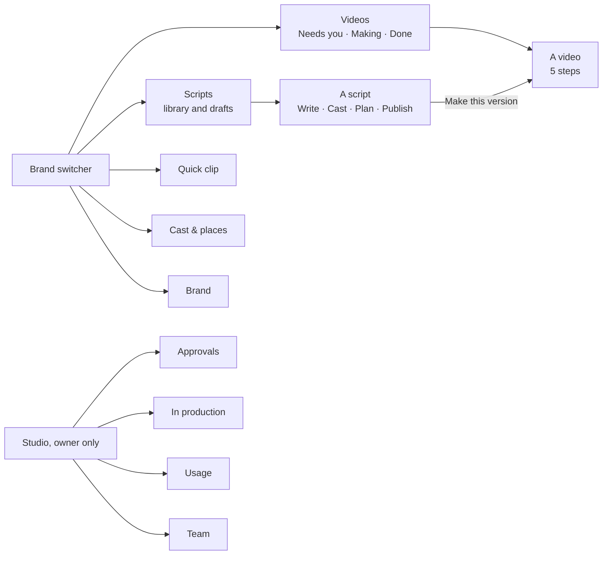
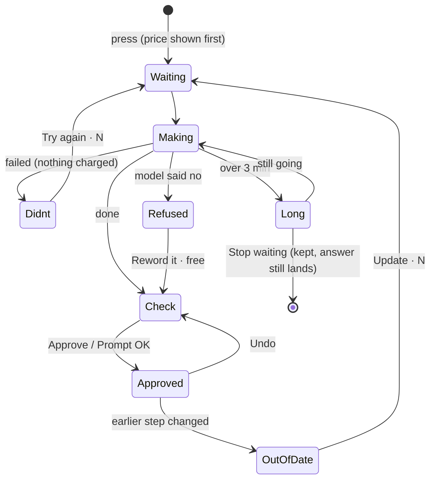
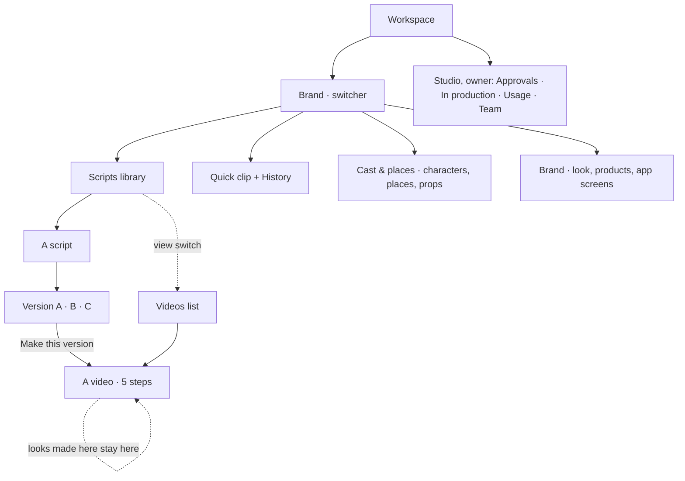
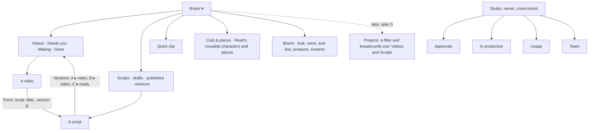
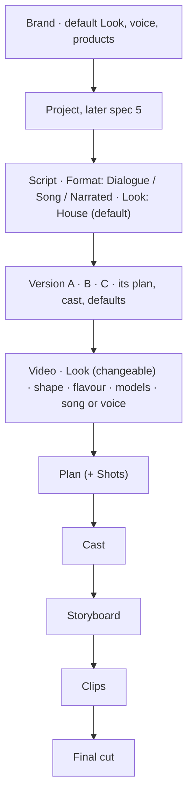

# UX audit: today's flow, and a cleaner order and look

For Reed. Owner: UX-Auditor. Status: **draft for Next-Lead, Next-Screens and Flow-QA to check**. Docs only: nothing here is built yet.

Reed asked (2026-10-28): *"explore reworking the order and look of our current flow, without changing the underlying stuff. Make it make sense, conduct a thorough ux audit on this new site."*

So this is a **re-layout and re-wording**, not new logic. Every rule stays as it is, in particular rule 4 (editors see credits, never dollars), 18 (the end line is Advice), 22 (no dead ends), 26 (lean code), 29 (one scene or action per clip) and 31 (a published script is final). Where a fix needs the server, it says so and goes to Next-Server.

**Sources:** the web app on `next` (`web/src`, read page by page); QA-Live's runs (`docs/qa/live-run-2026-10-27/README.md` on branch `qa/kel-faces-2026-10-27`, runs 1–3); the Starpop study (`docs/research/starpop-2026-10-28/`); `docs/next/flows.md` and `data.md` (Next-Lead, branch `agent/next-lead/flows-2`); `docs/next/screens.md`; the design rules in `docs/design/redesign/phase3/README.md`; and Reed's issues today (#725, #726, #728, #730). Screenshots from a free local walk (stand-ins, `BS_FAKE_PROVIDERS`), with notes, are in [`ux-audit-shots/`](ux-audit-shots/) (§1.8).

---

## The short version

1. **The flow is right; the screens are noisy.** Brief → Script → Breakdown → Assets → Storyboard → Clips → Final cut is the right order, and our rules (price first, Approve all with Undo, no dead ends) are better than Starpop's. What hurts is that each step carries 3–10 buttons, several of them amber, and the same thing has 2–3 names.
2. **Six of Reed's issues today come from four causes:**
   - buttons that grey out without saying why;
   - parts of one screen that load at different times;
   - an old failure that outlives a newer result;
   - prices that change after the page loads.

   All four can be fixed in the screens alone (table in §1.7).
3. **Costs are in five places on a video page** (the meter, each button, the auto-looks banner, the "This week" line, the Approvals card), and the "to finish: about N credits" estimate is only on the *old* video page. Proposal: **one cost bar** at the bottom of the work area, with the step's one amber button and its price in it.
4. **Hidden decisions.** The script's words become final in three places: "Approve the script", which is hidden inside Cast; "Writing variations makes A's words final"; and Publish. The flavour that blocks Next sits at the bottom of Assets.
5. **Proposed order:**
   - Writing: six steps become four: **Write → Cast → Plan → Publish**. Directions and Variations move inside Write.
   - Video: the five steps stay, but Downloads is called **Final cut**, and Clips shows two clear phases (**Prompts**, then **Takes**).
   - Navigation: **Videos** gets its own place in the menu. Today an editor's videos hide behind a switch inside Scripts.
6. **Reed's 30 Oct decisions** (Part 8): over-budget presses are now *held* for the owner ("Ask the owner · N", Withdraw), so Approvals comes back when something waits. The allowance counts Quick clips only. Every earlier and AI-flagged take stays playable and downloadable, with its reason. The director's chat becomes the video page's main view, with the steps as "look inside". The Approvals page text is now wrong (S42).
7. **The video flow with the creative plan** (Part 7): four or five editor steps instead of eight. With Reed's yes it's Plan, Cast, Make, Final cut; with his no it's Plan, Cast, Storyboard, Clips, Final cut. Breakdown folds into Plan either way. If Reed agrees (P5.1), three human presses (approve the plan, approve all looks, watch the final cut) and one priced Make the video. The AI check is a quiet "2 notes" chip with a ready Change this… note, and one Review list. Automatic fixes are said after the fact on the card.
8. **Every screen and card** (Part 6): Quick clip History shows everyone's clips from every brand; a version chip on a script card names a person but not the step, and opens the wrong place; one video has three names; the Brand page has no setup checklist; money mixes credits and dollars with decimals; Approvals can't receive anything any more.
9. **Reed's wider ask** (Part 5): the hierarchy, the script → editor handoff, saving, editing ease, and how much each step shows. The biggest gaps:
   - the script never says the flavour, so every editor is stopped to pick it again;
   - a script and its videos don't link to each other;
   - "kept in History" has no History to open;
   - a late breakdown fix locks the editor out of their own takes;
   - clip cards show the prompt but not the lines they cover.
   - In the local walk, editing a finished video's breakdown locked the editor out of the video she had already finished (§1.8 LW1).
10. **Fastest wins:**
   - every disabled button says why;
   - rename the two different "Looks good" buttons;
   - one word for the breakdown;
   - stable prices.

   These are 14 small (S) changes, listed first in §4.

---

## How to read this

- **Severity:**
  - **Blocker:** an editor can't go on, or can lose work or money without knowing.
  - **Major:** an editor gets stuck, has to guess, or presses the wrong thing.
  - **Minor:** it slows them down or reads oddly.
- **Evidence:**
  - `file:line` is the web code on `next`.
  - **QA r1/r2/r3** are QA-Live's runs 1, 2 and 3 (2026-10-27/28).
  - **Shot** is a screenshot in `ux-audit-shots/`.
  - **#NNN** is a merged PR.
- Every finding has an id (G = everywhere, L = library, W = writing, V = video, O = owner pages). Part 4 points back to them.

---

# Part 1. The audit of today's flow

## 1.1 Everywhere

| Id | What's confusing | Sev | Evidence |
|---|---|---|---|
| **G1** | **A greyed button often doesn't say why.** The design rule is "a disabled button always says why" (phase3 rule 3). The shared `Button` does this, with `reason` shown under it. But Clips, Storyboard and frames still use raw `<button>`s that skip it. "Make clip" can be grey for any of six reasons with no words: the prompt isn't marked OK yet, the budget or week is used up, a take is already being made, a blocking problem, out of date, or a look isn't approved. Some of these are explained elsewhere on the card or page, but never next to the button. | **Blocker** | `projects/ClipCard.tsx:264` (six conditions, no reason); `ClipsPane.tsx:241–250` ("Make the takes": grey while prompts are unread or stale); `StoryboardPane.tsx:219–224, 276–289`; `FrameCard.tsx:139, 161, 174`. Reed today: "greyed Make clip with no reason". |
| **G2** | **More than one amber button per screen.** On Storyboard, "Make all stills" and "Redraw N stills" can both be amber, with "Approve all" and "Redo storyboard" beside them. On a clip with problems, the card has 8–10 controls. The rule is one amber per screen, top right on desktop and in the action bar on a phone. | Major | `StoryboardPane.tsx:270–292`; `ClipCard.tsx` (whole card); phase3 rule 1. |
| **G3** | **One thing, several names.** The editor reads: Breakdown / shots / plan; Assets / looks / sheets / characters / cast; Downloads / final video / Video done; version / video; Library / Cast & places. Worst of all, **"Looks good" means two different things on the same clip card**: "Looks good" marks the prompt as read (rule 21), and "✓ Looks good" approves the picked take. Its undo is just "Undo". | Major | `ClipCard.tsx:250` (✓ Looks good = approve take), `:260` (Looks good / Undo = prompt read); `BreakdownPane.tsx:106, 120, 125` ("Planning shots…", "The shots didn't finish.", "No shots yet · Make shots") on a step called Breakdown; `BreakdownView.tsx:214` ("These shots were made for an older script."); `library/LibraryPage.tsx:58` (heading "Library" under the menu item "Cast & places"). |
| **G4** | **Costs live in five places,** and the most useful one is missing on the new video page. The new page shows "412 / 660 credits · 62%". It doesn't show "To finish: about N credits · M left", which only the old six-step page has. The auto-looks price is in a banner title, each button carries its own price, and editors on their own script see "This week: N of M" instead. None of these says what the *next press* will do to the budget. | Major | `VideoPage.tsx:113–119` (Meter only); `EstimateNote.tsx` is used only by `ProjectPage.tsx:165, 208`; `AutoLooks.tsx`; spec §6 "one cost bar". |
| **G5** | **Prices that change after the page loads.** A price is asked for separately from the card, so the button first shows no price (or a fallback) and then changes. On a look made for this video, "Change it · 1 credit" turns into "Change it · up to 2 credits" once the look's own record arrives. On a clip, the price appears only after the price request returns. Prices are also rounded in two ways: `Math.round` on Clips and Storyboard, and round-up `wholeCredits` elsewhere, so the same cost can read 0 or 1. | Major | `AssetCard.tsx:174, 357` (`changeUpTo ?? price`); `ChangeBox.tsx` (price query); `ClipsPane.tsx:187` and `ClipCard.tsx:95` (`Math.round`) against `components/credits` (round up). QA r2 #6: "Change this… charged 0.48 credits against 3 quoted". Reed today: "Change it prices". |
| **G6** | **A screen built from reads that land at different times.** The page header, the step picker and the Next button work out their counts from one read. The work area waits for its own fresh read. So for a moment the picker says "Approve every asset first (2 left)", the header says "Loading assets…", and the cards are still skeletons. #725 and #726 fixed the counts; the parts still arrive one by one. | Major | `VideoPage.tsx:62–97` (three "Loading assets…" places: the header meta, the Next reason and the pane); `AssetsPane.tsx:99–109`. Reed today: "half-loaded Assets". |
| **G7** | **An old failure outlives a newer result.** A card's status comes from the newest *job*, not from what the card holds now. If the newest take failed but an earlier take is picked, the chip still says "Failed · credits returned" in red. #730 fixed the case after a Change it; the picked-take case remains. The failure text is the server's raw line, which can still read "The service couldn't finish this. Ask the owner for details." (QA r2 #5), against rule 4's spirit. | Major | `ClipCard.tsx:91–93`; QA r2 #5; Reed today: "stale failures on Clips". |
| **G8** | **"Changing…" can spin with no way out.** The note box locks and the button spins while a change runs. The page checks the job only when the change record carries a job id, and treats a finished job as lost only 15 s after it ends. A record with no job id (a fix made in code), or a job the worker never picks up, leaves "Changing…" on screen for good: no timer, no Stop, and the box can't be edited. That's a dead end (rule 22). | **Blocker** | `ChangeBox.tsx:94–105, 150–155`. #710 and #708 covered a failed rewrite, not a missing job. Reed today: "stuck Changing…". The server side goes to Next-Server (§4, N1). |
| **G9** | **Refusals read four different ways.** These are all the same situation: the model said no. Nothing was charged, and the fix is a free reword. Each wording is accurate, but the editor has to learn four patterns. | Major | `FixClip.tsx` ("Reword it to pass · free"); `Soften.tsx` ("Soften it"); QA r2 #5; #648, #728. Reed today: "the refusals". |
| | • A still the image model may refuse: Advice, "Soften it". | | |
| | • A take refused as copyright: "…looks too much like someone else's character or video. Try another look for {name}…", which blamed the wrong character in QA r2. | | |
| | • A take refused as unsafe: "The video model refused this prompt: it read it as sexual…", with "Reword it to pass · free". | | |
| | • "Flagged as sensitive": "making it again may pass". | | |
| **G10** | **Two video pages.** Videos made from the Script Library use the five-step page (`/videos/:id`). Older videos use a six-step page (`/projects/:id`: Brief, Script, Shots, Storyboard, Clips, Final video) with different step names. Many links still point at `/projects/…` and bounce: Make this version, Approvals, In production, Usage. The old "Projects" list and "New video" form are still live, but only reachable by link. | Minor | `App.tsx:39–43`; `ProjectPage.tsx:70` (the bounce); `VersionPanel.tsx:39`; `ApprovalsPage.tsx:210, 272`; `ProductionPage.tsx:233, 272`; `usage/BrandLists.tsx:146, 169, 241`. |
| **G11** | **On a phone, a video page opens with a tall header** before any work shows: the brand bar, "‹ Scripts", the title, the meter, "Step 2 of 5 · Assets", the Script button, then the step heading. The shell is meant to hide the brand bar inside a video, but it only checks the old `/projects/` address. | Minor | `shell/Shell.tsx:72–73, 115`; `VideoPage.tsx:100–141`. |
| **G12** | **"Not started" doesn't say what it's waiting for.** When a step waits for the owner's OK, the video shows a grey "Not started" badge and the Breakdown shows the same. Nothing says it's waiting for the owner, or why. | Minor | `Meter.tsx:19`; `BreakdownPane.tsx:103`. |

## 1.2 Brands and the Script Library (owner and editor)

| Id | Screen | What it's for | What's confusing | Sev | Evidence |
|---|---|---|---|---|---|
| **L1** | Brand switcher, menu | Pick the brand; the brand's home is its Script Library. | Editors have no place for **their videos**. "Videos" is a view switch at the top of Scripts (`?view=videos`), and the back link on every video says "‹ Scripts", not "Videos". An editor's day starts from their videos. | Major | `Shell.tsx:18–23` (four sections: Scripts, Quick clip, Cast & places, Brand); `videos/ViewSwitch.tsx`; `VideoPage.tsx:100–105`. |
| **L2** | Script Library | Find a script and a version to make; owners write and publish. | Too many entrances at the same level: New script, Import a reel, Bulk create, and the filters (status, length, reference, versions left, brand, sort). The lists are "Making now", "Your drafts" and the library, with version chips that each open a panel. The owner and editor views mix writing and making. | Minor | `scripts/ScriptsPage.tsx:213–390`. |
| **L3** | Make this version (panel) | Read a version's words, cast and plan, then start it. | "About 32 credits to make" was far too low in r1 (94 charged). It's better since #679 (r3: 86 shown, ~70 charged). But the panel doesn't say what the number covers, and the video's shape, platform and flavour are chosen later, inside the steps. The press opens the old `/projects/` address. | Minor | `VersionPanel.tsx:39, 85–99`; QA r1 #3, r2 #7, r3. |
| **L4** | Approvals in the top bar *and* the rail | Owner sees what waits for them. | The same link is in two places on desktop; on a phone, In production, Team and Usage live only in the account menu. That's fine for the owner, but worth knowing. | Minor | `Shell.tsx:140–162, 344–347`. |

## 1.3 Writing a script (owner; editors on their own scripts)

Today there are six steps: **Script → Directions → Variations → Cast → Breakdown → Publish**. Three of them are optional.

| Id | Step | What it's for | What's confusing | Sev | Evidence |
|---|---|---|---|---|---|
| **W1** | All | Get the words final, find the roles, optionally plan the shots, publish. | **Half the steps are optional, but the picker shows them as equal.** Directions says "This step is optional. Press Next to skip it." Variations says "Optional. Most scripts go out as one version." An owner walks through two steps just to skip them. | Major | `scripts/flow.ts:5–12`; `DirectionsStep.tsx:22`; `VariationsStep.tsx:200`. |
| **W2** | Script | Write, paste, or have Claude write it from About or a reel. | The About fields sit under the words box, but "Have Claude write it for me" is disabled until they're filled ("Say what it's for in About first"). For a reel, "Read this reel" takes the amber slot and Next disappears until it's read. Both are right, but neither shows the order (reel → words → OK). | Minor | `ScriptStep.tsx:26, 81–83`; `ScriptFlowPage.tsx:89–93`. |
| **W3** | Directions | Claude's camera, movement and reaction suggestions; the words never change. | It's a separate step for what is really a **side panel of suggestions on the words**. Leaving with accepted-but-not-added directions asks a question the owner may not expect. | Minor | `DirectionsStep.tsx:21–28`; `ScriptFlowPage.tsx:192`. |
| **W4** | Variations | 0–2 alternates, approved side by side. | **"Writing variations makes A's words final."** is a one-line note above the button. It's a hidden, one-way decision. | Major | `VariationsStep.tsx:215`. |
| **W5** | Cast | Find roles, lock roles to Cast & places looks, merge duplicates. | **The words become final here, out of sight.** "Find roles in the script" is grey with "Approve the script first", and the "Approve the script" button sits in the Cast step ("Approving makes them final; you can undo it."). The words step is where the owner expects to OK the words. | **Major** | `FindRoles.tsx:16, 30–37`. |
| **W6** | Breakdown (preview) | Optionally plan the shots before publishing; the editor starts from it. | It's called "Breakdown" in the picker, but the screen says "plan" ("Plan saved for version A", "Remove this plan?", "Make it again"). | Minor | `BreakdownStep.tsx:96, 157–158, 237–248`. |
| **W7** | Publish | Publish N versions; they become final (rule 31). | Fine. It says what's final, and the confirm is clear. Keep it. | — | `PublishStep.tsx:37, 109`. |

## 1.4 Making a video (editor; owner too)

There are five steps: **Breakdown → Assets → Storyboard → Clips → Downloads**. Each has a step picker (a row on desktop; "Step 2 of 5 · Assets" opening a sheet on a phone), the meter, a "Script" button, and **Next: {step}** as the amber, placed top right on desktop and in the action bar on a phone. This frame works. The problems are inside the steps.

### Breakdown

**What it's for:** check the shots, fix problems, then go on.

| Id | What's confusing | Sev | Evidence |
|---|---|---|---|
| **V1** | **Shape and "Where will it be posted?" sit on top of Breakdown.** These are video settings, not breakdown work. Changing the shape after stills exist asks "Frames were drawn for 9:16. Changing the shape redraws them." with no price, in a browser pop-up. | Major | `VideoPage.tsx:146`; `ShapeRow.tsx:21`. |
| **V2** | **"Redo · N credits" sits beside the counts line, always.** It's paid and replaces the breakdown. It asks first only if the owner edited it. | Major | `BreakdownView.tsx:221`. |
| **V3** | The step says "shots" everywhere: "No shots yet", "Make shots", "Planning shots…", "These shots were made for an older script.", "Make new shots" (G3). | Minor | `BreakdownPane.tsx:106–125`; `BreakdownView.tsx:214`. |
| **V4** | **Each shot row has 3–4 controls** ("Lines 3–4", Edit, "…"), each clip has an editable seam, and every problem has Go to, a fix and Keep anyway. That's a lot for a step most editors only check. | Minor | `BreakdownView.tsx:262–390`. |
| **V5** | **Kept problems came back after each cast change** (r1 #1: kept 7 four times). That's fixed by #628. The reaction-shot false alarms (r1 #2) are fixed too. Listed so the new layout keeps those fixes. | — | QA r1 #1–2, r2 "No false Check the cast alarms". |

### Assets

**What it's for:** approve every look (rule 8), see the places, products and screens, and pick the product flavour.

| Id | What's confusing | Sev | Evidence |
|---|---|---|---|
| **V6** | **Half-loaded on open (G6).** "Loading assets…" shows in three places, while the step picker already shows a lock reason with a count. | Major | `VideoPage.tsx:87, 97`; `AssetsPane.tsx:99–109`. |
| **V7** | **The flavour that blocks Next is at the bottom.** Next reads "Pick a peanut butter flavour first", but the picker is under Cast, Places and Products, with no jump to it. | Major | `VideoPage.tsx:87`; `AssetsPane.tsx:174–189`. |
| **V8** | **A look card has up to 9 controls:** Approve, Change this… plus Change it, Use a different character, Merge into…, Delete this look, Use its own look again, "Make its look in Cast & places" (which leaves the video), "Fix it with a note", and the role-words "Update to match". | Major | `AssetCard.tsx:190–383`. |
| **V9** | **Auto looks start themselves after a countdown** ("Making looks for Nate and the Boss · up to 17 credits (usually 9)", "Starting in 5 s", Not now). This is right by Reed's rule. But it's the only spend on the site that starts without a press, and its price is only in the banner title. | Minor | `AutoLooks.tsx`; DECISIONS 2026-10-26. |
| **V10** | Roles that no shot of *this* video uses are listed as "Not in this video's shots". That's better than r3 #6 ("missing"), but they still take space. | Minor | `AssetsPane.tsx:158–165`; QA r3 #6. |

### Storyboard

**What it's for:** one still per clip; check the look, then approve every frame.

| Id | What's confusing | Sev | Evidence |
|---|---|---|---|
| **V11** | **Up to four buttons at the top, two of them amber:** Approve all, Make all stills (amber), Redraw N stills (amber), and Redo storyboard (amber when there are no frames yet). "Redo storyboard" drops every still, behind a browser pop-up. | Major | `StoryboardPane.tsx:212–231, 270–292`. |
| **V12** | **Frame buttons grey out without a reason (G1).** The sheet warning ("Mia needs an approved sheet. Open Mia") links into Cast & places, outside the video. For a look made for this video, the way on is Assets, not the library. | Major | `FrameCard.tsx:139, 161, 174`; `sheetBlocks.tsx:41–60`. |
| **V13** | "Soften it" is the still's version of the clip's "Reword it to pass" (G9). | Minor | `Soften.tsx`. |

### Clips

**What it's for:** read each prompt (rule 21), make takes, pick one, approve.

| Id | What's confusing | Sev | Evidence |
|---|---|---|---|
| **V14** | **Three jobs on one card with no order shown:** read the prompt (Looks good), make takes (Make clip / Make another take), pick and approve (radio buttons, "✓ Looks good"). The step heading "Clips · 6 · 2 approved" is repeated under the page's own "Clips" heading. | Major | `ClipsPane.tsx:232–258`; `ClipCard.tsx` (whole card). |
| **V15** | **Greyed Make clip with no reason (G1).** | **Blocker** | `ClipCard.tsx:264`. |
| **V16** | **Stale failure on the card (G7).** | Major | `ClipCard.tsx:91–93`. |
| **V17** | **Two "Looks good" buttons (G3).** | Major | `ClipCard.tsx:250, 260`. |
| **V18** | **Change it price and wording.** "Change it and make a new take · N" includes the take; "Change the prompt · N" is just the rewrite. That's clear since #730. But the number can appear late (G5), and the meter doesn't show what the press will leave. | Minor | `ClipCard.tsx:213–218`; `ChangeBox.tsx`. |
| **V19** | **"Changing…" can stick (G8).** | **Blocker** | `ChangeBox.tsx:94–105`. |
| **V20** | **Out-of-date clips show two lines** saying the same thing: the banner "N clips were made for an older breakdown. Rewrite…", plus "Rewrite the clips made for an older breakdown first (N)." The rewrite button is amber, and "Make the takes" goes grey with no reason. | Minor | `ClipsPane.tsx:256–257`; `RewriteClips.tsx`. |
| **V21** | "Advanced: edit the prompt" opens a box that can't save a prompt over 5,000 characters, even unchanged (r2 #4). | Minor | QA r2 #4 (server limit; Next-Server). |
| **V22** | "Use the real image · Home (shot 4.2)" switches sit on every card with an insert. They're useful, but they're always open. | Minor | `ClipCard.tsx:220–228`. |

### Downloads

**What it's for:** the finished video, put together for free, plus each clip's takes.

| Id | What's confusing | Sev | Evidence |
|---|---|---|---|
| **V23** | **"Video done" happens by downloading.** Pressing "Download all clips (.zip)" (the amber) shows "Video done. Downloads stay here." The finished state is real (it's what Usage counts), but it's a side effect of a download link. | Minor | `DownloadsPane.tsx:96–105`; DECISIONS 2026-10-25 ("Finished"). |
| **V24** | It's called "Downloads" in the steps, "Final video" on the old page, and "Video done" in the library. Rule texts and the mission say **Final cut**. | Minor | `videoSteps.ts:10`; `steps.ts:11`; `ScriptsPage.tsx:39`. |

## 1.5 Owner pages: Approvals, In production, Usage, Team

| Id | Screen | What's confusing | Sev | Evidence |
|---|---|---|---|---|
| **O1** | Approvals | Request kinds use inside words: "Storyboard frames", "Frame still", "Clip prompts", "Clip take", "House-style sheet". Plain names would be "Stills for {video}", "A new take of clip 3", "A look for {role}". Links go to `/projects/…` (G10). The rest is good: dollars only here, Approve all with a total, Decline says nothing was charged. | Minor | `ApprovalsPage.tsx:18–26, 210, 272`. |
| **O2** | In production | Good: a step, the last activity, "Nothing for 2 days", "Close to the budget". Its step names must follow any rename (Downloads → Final cut). | — | `ProductionPage.tsx:15, 38–39`. |
| **O3** | Usage | Older videos are marked "(earlier way)". Brand → videos and scripts lists, plus Charges with "Give credits back". It's clear for Reed. The per-video rows link to the old page (G10). | Minor | `usage/BrandLists.tsx:146–149`; `Charges.tsx`. |
| **O4** | Team | Clear: invite by email or link, roles, credit limits with plain helper text ("Most one video can cost"). Keep it. | — | `team/TeamPage.tsx`; `team/CreditLimits.tsx:81–82`. |

## 1.6 What already works (keep it)

- **A price inside every paid button,** with "up to N · Usually M. Anything not used comes back." Starpop only shows cost in an approval bar.
- **Locked steps say why** ("Fix the 3 problems in Breakdown first", "Approve every asset first (2 left)"), and a link to a locked step lands on the step that blocks it (`videoSteps.ts:31–35`).
- **Approve all with Undo,** skipped items listed with reasons, on Assets, Storyboard and Clips.
- **Out of date is a state, not a dead end:** "Rewrite clip prompts · N credits", and stills redraw themselves after a cast change within budget.
- **Plain failure lines** ("The shots didn't finish. Nothing was charged.") and server-restart wording.
- **On a phone:** the step picker sheet, the problems sheet, the action bar above the tabs, and 44px controls.
- **The script stays the authority** (rules 19, 31). Starpop rewrote finished lyrics; we don't.

## 1.7 Reed's six issues today, and where they come from

| Reed hit | What happens | Cause (finding) | Fix in screens? |
|---|---|---|---|
| Half-loaded Assets | The step picker, header and cards fill in at different moments; "Loading assets…" shows in three places. | G6, V6 | Yes: one skeleton for the whole step until its own read lands (§4 S10). |
| Stale failures on Clips | A red "Failed · credits returned" chip while a good take is picked; the server's raw failure line. | G7, V16 | Yes: the status comes from what the card holds; the failure becomes a line under it that clears on the next try (§4 S7). |
| Greyed Make clip, no reason | Six silent reasons. | G1, V15 | Yes: every paid button uses the shared Button with its reason (§4 S1). |
| "Change it" prices | The price shows late or changes after load; two rounding rules; what the price covers isn't said. | G5, V18 | Yes: a fixed price slot (skeleton until known), one rounding, and "Change it and make a new take · up to N" with the parts under it (§4 S6). |
| Stuck "Changing…" | No timer, no Stop, and it never clears when the change has no job id. | G8, V19 | Partly. The screen shows a timer, after 3 min "Taking longer than usual", and **Stop waiting** (keeps the note). The missing job id goes to Next-Server (§4 M9, N1). |
| The refusals | Four wordings for one situation. | G9, V13 | Yes: one "Refused" card everywhere, with one free fix (§2.5, §4 M8). |

## 1.8 What the free local walk showed

An owner (Reed) and an editor (Maya) on Iron Paws ran one video end to end on the free stand-ins, then Maya edited a shot. Full notes: [`ux-audit-shots/NOTES.md`](ux-audit-shots/NOTES.md). Stand-in text ("INT. TEST — DAY", grey stills) is not counted as a problem. These add to the findings above.

| Id | What happened | Sev | Shot |
|---|---|---|---|
| **LW1** | **Editing a finished video's breakdown cuts off the finished video.** Saving a shot edit gave no warning. Then Storyboard was out of date, Clips and Final cut were locked, and their links sent Maya back to Assets or Storyboard, so the MP4 she already had couldn't be reached. The fix agreed with Next-Lead (M14, out-of-date steps stay viewable read-only) covers it. Saving a breakdown on a finished video should also warn first: "This video is finished. Saving marks 6 stills and 4 clips out of date; the final cut stays downloadable." | **Blocker** | `25-1280-video-breakdown-unsaved-edit`, `26-1280-video-breakdown-after-edit`, `29-390-video-step-picker-locked`, `30-390-video-storyboard-out-of-date` |
| **LW2** | **A locked video still reads "Video done" everywhere else.** Videos shows "✓ Video done", Usage counts it finished, and In production shows "0 videos being made", all while the video was out of date and locked. | Major | `02-390-library-videos-view`, `41-390-in-production`, `42-390-usage` |
| **LW3** | **An out-of-date frame has no button of its own.** The badge says "Breakdown changed: redo this frame", but the card's Change this… is held ("Make the storyboard again first") and Approve is grey with no reason. The only way on is "Redo storyboard" at the top, which drops every still. It's not a dead end, but close to one (rule 22). Proposal: "Redo this frame · N" on the card (today's per-frame Make another, unheld for a stale frame). *To check with Next-Lead, since it unholds a press.* | Major | `30-390-video-storyboard-out-of-date`; `FrameCard.tsx:110, 191` |
| **LW4** | **The retake prices next to each other don't add up.** "Change it and make a new take · 3 credits" sits beside "Make another take · 22 credits". The change price appears to leave out the take, so the button that makes a take reads 7× cheaper than the one beside it. On Storyboard, three "try again" prices sit side by side: "Make another · 1 credit", "Change it · 4 credits" and "Redo storyboard · 4 credits". | **Major** | `23-390-video-clips-takes`, `21-390-video-storyboard-stills`. Server price for "change and make a new take": **N7**. |
| **LW5** | **The version panel shows two prices:** "About 21 credits to make" and "Make this version · 3 credits" (the breakdown). At 390 the button sits on the sheet's bottom edge. The version card (M12) gives one line: "Starting costs 3 (the breakdown) · the whole video about 21." | Minor | `14-390-version-panel-editor`, `14-1280-version-panel-editor` |
| **LW6** | **Many action screens have no amber at all** (Variations written, Storyboard with stills, Clips, Assets with a look to approve, Quick clip, Brand). While Next is disabled, the actual next press (Approve, Approve all, Looks good) is grey-styled secondary. That's G2's other side: §2.3's table gives each state its one amber. | Major | `07`, `21`, `22`, `23`, `28`, `30`, `44`, `46` |
| **LW7** | **Publish offers to publish a variation that Variations says to approve first.** Variations blocks Next with "Approve or remove variation B first", but Publish (through the step picker) offers "Publish 2 versions", listing B as "Words: When you publish". Publishing approves it; that's by design (`PublishStep.tsx:83`), but the two steps disagree about what's required. Proposal: Variations says the same ("B will be approved when you publish"), or Publish asks "B isn't approved yet. Publish it as it is?" | Minor | `11-390-write-publish`; `PublishStep.tsx:80–84` |
| **LW8** | **Auto looks after an edit spend with no press on that visit.** Maya opened Assets by a link after the edit; the countdown ran out and the meter went 31 → 34 → 36. The next screen says "Made 1 look · 2 credits". Per Reed's rule this is allowed, but it needs the cost bar (§2.4) to say it before it starts, and the meter and the note should agree. | Minor | `27-390-video-assets-countdown-after-edit`, `28-390-video-assets-look-to-approve` |
| **LW9** | **The length differs by screen:** "about 11 s" in the library and version panel, and "22 s of 22 s planned" on Breakdown. Assets shows a ✓ in the step picker before it has been opened. | Minor | `14`, `15-390-video-breakdown` |
| **LW10** | **The Brand page's End line example says fomo on Iron Paws** ("Download fomo through the link in my bio."). The placeholder should use the brand's own name. | Minor | `46-390-brand`; `brand/KitPage.tsx:127` |
| **LW11** | **At 390, toasts cover the action bar and its Next button,** for their 8 s with Undo. | Minor | `07-390-write-variations-written`, `22a-390-video-clips-no-prompts` |
| **LW12** | **Greyed Quick clip buttons don't say why:** "Add" and "Improve prompt" (G1). | Minor | `44-390-quick-clip` |

Confirmed by the walk: G1/V15 (`22-390-video-clips-before-looks-good`, `23a-390-video-clips-making`), G3/V17 (the green "✓ Looks good" badge on a clip still "Queued 2s"), G6/V6 (`16-390-video-assets-loading`: "Loading assets…" three times with three grey boxes), V23 (`24-390-video-downloads`: the zip is amber, the MP4 grey), and the three names for Cast & places (`45-390-cast-and-places`).

---

# Part 2. The proposed order and look

## 2.1 Step order

> **Updated by Part 7:** the video has five steps (Plan with its Shots view, Cast, Storyboard, Clips, Final cut), or four (Plan, Cast, Make, Final cut) if Reed says yes to P5.1. Writing is Write → Plan → Cast → Publish.

**Writing (owner, or an editor on their own script).** Six steps become four. Nothing is removed: Directions and Variations become panels inside Write.

| Today | Proposed | Why |
|---|---|---|
| Script | **1 Write**: the words, About, the reel. Two panels beside the words: **Suggestions** (today's Directions) and **Versions** (today's Variations, 0–2). Ends with **Approve the words** (moved from Cast). | One place where the words are made and OK'd. The finality press is where the words are (fixes W4, W5). |
| Directions | → a panel in Write | Optional; it was a step to skip (W1, W3). |
| Variations | → a panel in Write | Optional; writing them makes A final, which is now said on the Approve press itself (W4). |
| Cast | **2 Cast** | Unchanged, minus the hidden Approve (W5). |
| Breakdown (preview) | **3 Plan** *(optional, marked "Optional" in the picker)* | Plain name; the editor's step stays "Breakdown" (rule texts use it). Skipping it needs no visit: "Next: Publish" is offered from Cast too. |
| Publish | **4 Publish** | Unchanged (W7). |

A **song script** follows Next-Lead's flows (S1–S7): **Song → Takes → Cast → Plan → Publish**. The Song step is the Write step with the lyrics box. It has **no Suggestions or Versions panels**, because variations would rewrite locked lyrics. Its only writing help is "Write 2 song directions" inside Song (agreed with Next-Lead).

**Editing words that are already approved** (behaviour unchanged): the words show "Approved · words final" with **Edit the words**. Pressing it asks first: "Edit version A? It goes back to draft. Approve the words again before Next. Roles already found are kept." Today an edit already un-approves a version; the question just says so before it happens.

**Making a video (editor).** Same five steps, same locks, same rules. Two renames and one clearer split.

| Today | Proposed | Change |
|---|---|---|
| — | **Video settings** row at the top (not a step) | Shape, "Where will it be posted?" and product flavour move here from Breakdown and Assets. They're asked once in **Make this version** and editable at the top of the video. Each change says its effect in the confirm, as today's behaviour does:
  - **Flavour** stays changeable after start: "Switch to Chicken? 4 stills and 2 clips that show the bag go out of date. They're kept, and you can redo them."
  - **Shape** stays changeable, with the whole redo price: "Change to 1:1? All 6 stills are redrawn · 2 credits. Clips made for 9:16 go out of date." *Decided here; Next-Lead writes it into flows.md.* Locking the shape would be new behaviour, so it isn't proposed.
  - **Song** (song ads, V2a): the video's song ("Song: Take 2 · 0:31 ▾") sits in this same row and opens the "Change song" panel from screens.md S3e. That way every per-video choice lives in one place. Later, spec item 4 (style, video model, picture model, language) lands in the same row. Re-laid out, not new: it's the same PATCH to the video. |
| Breakdown | **1 Breakdown** | One word inside the step ("breakdown", never "shots"). "Make it again · N" moves into a "…" menu (V2, V3). |
| Assets | **2 Assets** | One skeleton until loaded (V6). Each look card keeps one main press; the rest goes in "…" (V8). |
| Storyboard | **3 Storyboard** | One amber at a time (§2.3). "Make it again" in "…" (V11). |
| Clips | **4 Clips**, in two phases on the same step: **Prompts** ("Prompt OK" on each, rule 21) then **Takes** (make, pick, **Approve take**) | The order on the card becomes visible; the two "Looks good" get two names (V14, V17). Not a new step and not a new lock: today's rule (prompts read before takes are paid) decides which phase shows first. |
| Downloads | **5 Final cut** | The name Reed's docs use. **Download MP4** is the amber; the zip and the takes are secondary. "Video done" is said as a state ("Final cut ready · downloaded 14:02"), not as a toast on a zip link (V23, V24). |

No step is merged: each still has its own lock and approval (rules 8, 21). Breakdown and Assets were considered for a merge, but Assets spends money (looks) and Breakdown is free to check, so they stay apart.

## 2.2 Navigation: brand → project → video



- **Videos becomes a menu item** (first for editors, and their home after sign-in). It holds the list that's now behind the Scripts view switch, grouped as **Needs you** (a step waiting on them: looks to approve, prompts to check, takes to pick), **Making** (something running), and **Done**. Each row shows its step in words.
- **Scripts** stays the library (and the owner's home).
- **Projects** (spec item 5, not built yet) slot in **between the brand and its scripts and videos**, as a filter row and a breadcrumb: "fomo › November launch › The altar reel · B". "No project" is the default, so nothing changes until projects exist.
- **Inside a video,** the back link names where it goes: "‹ Videos", or "‹ {script title}" when opened from the script. The breadcrumb doubles as the brand switcher's context.
- **One address per video:** `/b/:brand/videos/:id`. The old `/projects` pages retire (G10). Every old `/projects/…` link redirects to the same video in its new place, never a 404 (rule 22). Older videos open in the five-step page at their furthest step; the server already gives both kinds the same data. *To check with Next-Lead.*
- **Phone tabs:** Videos · Scripts · Quick clip · Cast · Brand (5 × 78 px at 390). The owner's Studio pages stay in the account menu, and Approvals stays as the bell.

## 2.3 One primary action per screen

The amber is always the step's next move. Everything else is secondary, ghost or in a "…" menu.

| Screen | The one amber | Secondary (visible) | In "…" |
|---|---|---|---|
| Videos | **Open** the top "Needs you" row (a row tap) | Filters | — |
| Scripts | **New script** (owner) / **Make this version** in the panel (editor) | Import a reel, Bulk create | — |
| Write | **Approve the words · Next: Cast**, or **Read this reel** while a reel is unread | Have Claude write it · N, Suggestions, Versions | Delete script |
| Cast | **Next: Plan** (or **Next: Publish**) | Find roles · N, Lock to a look, Add a role | Merge into…, Remove |
| Plan | **Next: Publish** | Make the plan · N | Make it again · N, Remove this plan |
| Publish | **Publish N versions** | — | Duplicate |
| Breakdown | **Make the breakdown · N** when there is none, else **Next: Assets** | Fix N problems (free), Put the right cast in each shot (free) | Make it again · N, Edit shots |
| Assets | **Approve all looks** while any is waiting, else **Next: Storyboard** | Per card: Approve, Change this… | Use a different character, Merge into…, Delete this look |
| Storyboard | In this order, the first that applies: **Make the storyboard · N** → **Redraw N out-of-date stills · N** → **Make N stills · N** → **Approve all frames** → **Next: Clips** | Per frame: Change this…, Make another | Make the storyboard again · N, Advanced: edit the prompt |
| Clips · Prompts | **Prompt OK for all ready (N)** → **Make the takes · N** | Per card: Prompt OK, Change the prompt · N | Advanced: edit the prompt |
| Clips · Takes | **Approve all takes** → **Next: Final cut** | Per card: pick a take, Approve take, Change it and make a new take · N, Make another take · N | Download this take, Use the real image |
| Final cut | **Download MP4** | Download all clips (.zip), each clip's takes | Make it again (free) |

"Prompt OK for all ready" is today's per-card press, repeated for each ready card, with one Undo (rule 21 "Approve all" on every per-item list; it was missing in r1 #10). It's a client loop over the existing press, so no new server rule is needed.

## 2.4 Where costs appear: one cost bar

One bar, in the same place on every step: **at the bottom of the work area**, sticky on desktop, and as the action bar above the tabs on a phone. It replaces the meter in the header and carries the step's amber.

```
┌──────────────────────────────────────────────────────────────────────────────┐
│ 412 / 660 credits · 62%  ▓▓▓▓▓▓▓░░░░   To finish: about 140 · 248 left       │
│ This press: Make the takes · 54 credits → leaves 194          [ Make the takes · 54 ] │
└──────────────────────────────────────────────────────────────────────────────┘
```

- **Left:** what's used and the budget, as today's meter. An editor on their own script sees "This week: 40 of 145 credits" instead. Credits only for editors (rule 4); the owner may see "$" only in Approvals and Usage, as now.
- **Middle:** "To finish: about N", from the estimate the server already gives (`/projects/{id}/estimate`, today only on the old page), opening to the per-step list.
- **Right:** the amber, with its price inside (rule 2 design), and above it "This press: … → leaves M". This is the "one cost bar before any paid press" from the spec. Card buttons keep their own prices, but the bar is where the step's main spend is said once.
- **When it can't be pressed,** the bar says why in words, where the amber would be: "That's more than this video's budget." or "You've used this week's 145 credits. It resets on Monday." The free alternatives on the screen stay pressable (rule 22). An editor is never told "Ask Reed" (rule 4).
- **Auto looks** say their price in the bar during the countdown ("Making 3 looks · up to 17 (usually 9) · starting in 5 s · Not now"), not only in a banner (V9).
- **Prices never change after the page shows:** the price slot is a grey placeholder until it's known, then it's set. One rounding everywhere: whole credits, rounded up (phase3 rule 2).

## 2.5 How states read

One vocabulary and one badge set for every card, step and list. Each state says what happened and offers its one press. Words first, colour second (phase3 rule 4).

| State | Badge | The line under it | The one press |
|---|---|---|---|
| Waiting (queued) | **Waiting** (grey) | "Waiting to start · 0:12". After 10 min: "The service that makes it isn't taking work right now. It's charged only if it runs." (flows.md) | Cancel (before it starts) |
| Running | **Making… 0:42** (grey, count-up) | "You can leave this page; it carries on." | — |
| Running too long | **Making… 3:10** | "Taking longer than usual." | **Stop waiting** (the note or work is kept; a late answer still shows) |
| Ready to check | **Check this** (amber outline) | — | Approve / Prompt OK |
| Approved | **Approved** (green) | — | Undo (8 s toast), then "Undo approval" in "…" |
| Failed | **Didn't finish** (red) | "Didn't finish · nothing charged" (or "· credits returned" when they were held) plus the reason in plain words. It clears the moment a new try starts or succeeds, and never sits under a newer good result. | **Try again · N** |
| Refused | **Refused** (red) | "The video model wouldn't make this: it read it as {reason}. Nothing was charged." For copyright, it names the shot, not a guessed character. | **Its free fix**. For a still or a clip prompt that's **Reword it · free** (one name for Soften it and Reword it to pass); for a song it's the style line or another take, never the words (rule 19). Then **Make another take · N** |
| Out of date | **Out of date** (amber) | "Made for an older breakdown. Earlier takes are kept." | **Update · N** (rewrite prompts or redraw stills) |
| Waiting for the owner | **Waiting for the owner's OK** (grey) | "This would go past the video's budget." | — (editor), **Approve** (owner) |
| Locked | Step picker: grey with the reason | "Approve every asset first (2 left)" | the link to the blocking step |
| Loading | skeleton in the final layout | (no counts until this step's own read lands) | — |

## 2.6 Phone (390) and desktop

| | Phone, 390 wide | Desktop, 1024 and up (1280+ adds the right column) |
|---|---|---|
| Frame | Bottom tabs (5); cost bar above them; no brand bar inside a video (fix G11) | Left: the brand rail (icons only inside a video). Centre: the work. Right (≥1280): **Script** or **Media** (this video's stills, takes, looks), switchable |
| Video header | One line: "‹ Videos" · title · "…". Under it: "Step 4 of 5 · Clips ▾" (the sheet, as today) | Breadcrumb · title · "…". Under it: the five steps as a row, with state words ("Assets ✓", "Clips · 2 to check") |
| Cards | One column, media first; the main press full width; the rest in "…" | 2–3 columns; the same card |
| Long lists | Problems and Advice in a sheet (as today) | Problems box above the shots (as today) |
| Script | "Script" in the "…" menu, opens a full-height sheet | Right column |
| Rules kept | No sideways scroll; every control 44px; 8px apart | Amber 44px; secondary may be 36px |

This is Starpop's three columns: the brand and its videos, the work, and the media. Their media column is a shared gallery. Ours is this video's own stills, takes and looks, plus the script, which is what an editor checks against.

## 2.7 Borrowed from Starpop, and what we keep

| Borrow | From | Where |
|---|---|---|
| Three columns: list, work, media | Starpop layout (shots 02, 03) | Video page at ≥1280 (§2.6) |
| One approval or cost bar before a run | Starpop's approval bar (shot 28) | The cost bar (§2.4); ours also shows the budget and what's left |
| Status words on the list ("Running", "Needs approval") | Starpop's project tree | Videos: Needs you · Making · Done |
| "Preferred" mark | Starpop media | Spec item 5. The picked take already works this way; the same badge would go on stills and song takes later |

| Keep (we do it better) | Why |
|---|---|
| A price inside every paid button | Starpop shows cost only in the bar; we do both |
| Named jobs and reasons | Starpop's tasks tray says "Background task" (shot 38) |
| A retry on failure, with "nothing charged" | Starpop's song step failed silently (shot 31) |
| Script-led steps with locks that say why | Starpop is chat-led; the order is the agent's |
| Approve all with Undo; no dead ends (rule 22) | Not in Starpop |

---

# Part 3. Low-fi wireframes

**Clickable version** (updated for Part 8: set Card state to *Over budget* to see held requests, Withdraw, the owner's Approve/Decline and Approvals appearing in the menu; the Director view with chat, locks and delivery note, and "Look inside" for the steps; "Other takes" with the AI's reason, Play, Use this take and Download; Quick clip at 97 credits, mine across brands. Updated for Part 7: Plan with Shots, Cast, Storyboard, Clips with AI notes and automatic-fix lines, Final cut with the Review list; a switch for Reed's P5.1 yes or no; writing Write → Plan → Cast → Publish; Format and Look chips): [`wireframes/index.html`](wireframes/index.html) is one self-contained file, grey-box, dark or light. It toggles between phone 390 and desktop and between editor and owner, and a state switch shows Normal, Waiting, Failed, Refused, Out of date and Over budget on the video steps. It covers the Videos home, the Scripts library, Make this version (the handoff card), Write, Song, Takes, Cast, Plan, Publish, Breakdown, Assets, Storyboard, Clips (Prompts and Takes), Final cut, the cost bar and the state words. Part 6 adds:
- the brand switcher (with colours and "N need you");
- script cards with version rows;
- Quick clip with "my clips in this brand";
- Cast & places with plain statuses;
- the Brand page's setup checklist;
- In production, Usage (credits first, then dollars) and Team (per-editor week);
- Approvals hidden while nothing waits. The ASCII below is the same layout in text.

## 3.1 A video at Clips, desktop (1280)

```
┌ fomo ▾ ───────────────────────────────────────────────────── 🔔 Approvals ─ (RP) ┐
│ ▣ │ fomo › November launch › The altar reel · B                           [ … ] │
│ ▣ │ ✓ Breakdown ── ✓ Assets ── ✓ Storyboard ── ● Clips · 2 to check ── Final cut │
│ ▣ │─────────────────────────────────────────────────────┬───────────────────────│
│ ▣ │ Clips      [ Prompts · 2 to check ] [ Takes ]        │ Script │ Media        │
│ ▣ │                                                      │                       │
│   │ ┌ Clip 1 · 8 s ─────────────── Approved ┐ ┌ Clip 2 ┐ │ 1 NATE: Will you…     │
│   │ │ ▶ [ take 2 video        ]              │ │ Check  │ │ 2 LEXI: Hell no.      │
│   │ │ Take 1 ○  Take 2 ●                     │ │ this   │ │ 3 …                   │
│   │ │                                    […] │ │        │ │                       │
│   │ └────────────────────────────────────────┘ │Prompt  │ │ (lines of the clip    │
│   │ ┌ Clip 3 · 6 s ─────────── Didn't finish ┐ │ (5 ln) │ │  you're on are        │
│   │ │ Nothing was charged. The service was   │ │Show all│ │  highlighted)         │
│   │ │ busy.                                  │ │[Prompt │ │                       │
│   │ │ [ Try again · 6 ]                      │ │  OK ]  │ │                       │
│   │ │ Change this… [________] [Change it · 7]│ │  […]   │ │                       │
│   │ └────────────────────────────────────────┘ └────────┘ │                       │
│   ├──────────────────────────────────────────────────────┴───────────────────────│
│   │ 412 / 660 · 62% ▓▓▓▓▓░░  To finish: about 140 ▾   This press → leaves 606     │
│   │                                       [ Prompt OK for all ready (2) ]  (amber)│
└───┴──────────────────────────────────────────────────────────────────────────────┘
```

## 3.2 The same, at 390

```
┌──────────────────────────────┐
│ ‹ Videos   The altar reel · B  … │
│ [ Step 4 of 5 · Clips      ▾ ] │
│ [ Prompts · 2 ][   Takes     ] │
│ ┌ Clip 2 · 6 s ── Check this ┐ │
│ │ [ storyboard still       ] │ │
│ │ NATE: "Will you…"           │ │
│ │ Prompt: The camera holds …  │ │
│ │ (5 lines)        Show all   │ │
│ │ [      Prompt OK        ]  │ │
│ │ Change this… [__________]  │ │
│ │ [ Change the prompt · 1  ] │ │
│ │                        […] │ │
│ └────────────────────────────┘ │
│ ┌ Clip 3 · 6 s ─ Didn't finish┐ │
│ │ Nothing was charged.        │ │
│ │ [     Try again · 6      ] │ │
│ └────────────────────────────┘ │
├──────────────────────────────┤
│ 412/660 · 62%  To finish ~140 ▾│
│ [ Prompt OK for all ready (2) ]│  ← cost bar + the one amber
├──────────────────────────────┤
│ Videos Scripts Quick Cast Brand│
└──────────────────────────────┘
```

## 3.3 Assets, desktop

```
┌───┬──────────────────────────────────────────────────────────────────────────────┐
│ ▣ │ fomo › The altar reel · B          9:16 · Reels · Peanut butter  [Settings]  │
│   │ ✓ Breakdown ── ● Assets · 2 to approve ── Storyboard ── Clips ── Final cut   │
│   │──────────────────────────────────────────────────────────────────────────────│
│   │ Cast                                                                          │
│   │ ┌ [ sheet image ] ┐ ┌ [ sheet image ] ┐ ┌ [ making… ] ┐                       │
│   │ │ Lexi · Goth GF  │ │ The Boss        │ │ Customer    │                       │
│   │ │ Locked          │ │ Check this      │ │ Making… 0:20│                       │
│   │ │ In 6 shots      │ │ 40s, man, boss  │ │             │                       │
│   │ │            […]  │ │ [ Approve ] […] │ │             │                       │
│   │ └─────────────────┘ │ Change this…    │ └─────────────┘                       │
│   │                     │ [__________]    │                                       │
│   │                     │ [Change it · up to 2]                                   │
│   │                     │ Usually 1. Anything not used comes back.                │
│   │                     └─────────────────┘                                       │
│   │ Places · Products · App screens (pictures only, nothing to approve)           │
│   ├──────────────────────────────────────────────────────────────────────────────│
│   │ 18 / 220 · 8%   Making 1 look · up to 4 (usually 2)     [ Approve all looks (1) ] │
└───┴──────────────────────────────────────────────────────────────────────────────┘
```

The flavour is in the Settings row at the top. If it isn't chosen, the amber reads "Pick a flavour first" and pressing the reason opens Settings (V7).

## 3.4 Writing a script, desktop

```
┌───┬──────────────────────────────────────────────────────────────────────────────┐
│ ▣ │ ‹ Scripts   The altar reel        Draft · only you can see it          […]   │
│   │ ● Write ── Cast ── Plan (optional) ── Publish                                │
│   │───────────────────────────────────────────────┬──────────────────────────────│
│   │ The words                                      │ [ Suggestions ] [ Versions ] │
│   │ ┌──────────────────────────────────────────┐  │ Camera, movement, reactions. │
│   │ │ NATE: Will you marry me?                 │  │ Your words never change.     │
│   │ │ LEXI: Hell no.                           │  │ [ Suggest · 3 credits ]      │
│   │ │ …                                        │  │  ─ or ─                       │
│   │ └──────────────────────────────────────────┘  │ Versions: A only              │
│   │ About ▸   Reel: read ✓                         │ [ Write 1–2 variations · 3 ] │
│   ├───────────────────────────────────────────────┴──────────────────────────────│
│   │ Approving makes the words final (Undo is offered).  [ Approve the words · Next: Cast ] │
└───┴──────────────────────────────────────────────────────────────────────────────┘
```

At 390 the side panel becomes two buttons under the words ("Suggestions", "Versions") that open full-height sheets. The bar holds "‹" and the amber, as today.

## 3.5 Videos (editor home), 390

```
┌──────────────────────────────┐
│ fomo ▾                    (KE)│
│ Videos              [ Filters ]│
│ NEEDS YOU                     │
│ ┌ The altar reel · B ─────────┐│
│ │ [poster]  Clips · 2 to check ││
│ │           62% of budget      ││
│ └─────────────────────────────┘│
│ MAKING                        │
│ ┌ Pitbull 1 · A ──────────────┐│
│ │ [poster]  Storyboard ·       ││
│ │           Making… 1:10       ││
│ └─────────────────────────────┘│
│ DONE                          │
│ ┌ Mom's 3 days · C ── Final cut ┐│
│ └─────────────────────────────┘│
├──────────────────────────────┤
│ Videos Scripts Quick Cast Brand│
└──────────────────────────────┘
```

## 3.6 States on one card (any step)



---

# Part 4. Prioritized change list

**Sizes:** S = one small PR, about a day; M = 2–4 PRs; L = 5 or more PRs, or a new screen frame. Each item names its findings. None changes a rule or the server, except the N items at the end (for Next-Server). All are built on `next` by Next-Screens. Flow-QA checks each against flows.md.

### Small wins first

| # | Change | Fixes | Size |
|---|---|---|---|
| S1 | Every paid or blocking button uses the shared `Button` with its `reason`: Clips (Make clip, Make another take, Make the takes, Redo), Storyboard (Make all stills, Redraw, Make storyboard), frame buttons. The reason names the next press ("Press Prompt OK first", "Approve Mia's look in Assets first", "That's more than this video's budget."). | G1, V12, V15, V20 | S |
| S2 | Rename the clip's two "Looks good": the prompt's becomes **Prompt OK** (undo: "Undo Prompt OK"); the take's becomes **Approve take** (undo: "Undo approval"). | G3, V17 | S |
| S3 | One word inside Breakdown: "Make the breakdown", "Making the breakdown… 0:12", "The breakdown didn't finish. Nothing was charged.", "This breakdown was made for older words.", "Make it again". | G3, V3 | S |
| S4 | The video's back link says where it goes ("‹ Videos" or "‹ {script}"); the shell hides the brand bar on `/videos/:id` at 390 too. | L1, G11 | S |
| S5 | When Next is blocked by the flavour, the reason is a link that scrolls to and highlights the flavour picker (until S-row M5 moves it to Settings). | V7 | S |
| S6 | Prices never change after they show: a grey placeholder in the price slot until it's known; one rounding (`wholeCredits`, up) on Clips and Storyboard too; "Change it and make a new take · up to N" with "Rewrite 1 + take 8" in the meta line. | G5, V18 | S |
| S7 | A clip's status chip comes from what the card holds (Approved / Take 2 picked / Not made). A newest-take failure becomes a line under the video ("The last try didn't finish. Nothing was charged.") that clears on the next try. The server's raw "Ask the owner for details." is replaced by "The service couldn't finish this. Nothing was charged; try again." | G7, V16 | S |
| S8 | "Not started" becomes **Waiting for the owner's OK** with "This would go past the video's budget." | G12 | S |
| S9 | Approvals: plain request names ("Stills for {video}", "A new take of clip 3", "A look for {role}", "Clip prompts" → "Prompts for {video}"). | O1 | S |
| S10 | Assets (and every step): one skeleton covers the step picker counts, the header line and the cards until the step's own read lands. "Loading assets…" is said once. | G6, V6 | S |
| S11 | The Cast & places page heading reads "Cast & places", not "Library". | G3 | S |
| S12 | Downloads → **Final cut**: Download MP4 is the amber, the zip is secondary; "Video done" shows as a state line, not a toast on the zip. Same rename in In production and the Videos list. | V23, V24, O2 | S |
| S13 | Shape change after stills: an in-app Dialog that says what really happens. Today nothing is redrawn (NL6), so it should say "6 stills and 4 clips go out of date" once N13 lands, and offer the redo with its price. The same goes for "Redo storyboard" ("drops 6 stills"). | V1, V11, NL6 | S |
| S14 | The duplicated "Clips · N · M approved" and "Storyboard · N frames" headings fold into the page's own step heading meta line. | V14 | S |

### Medium

| # | Change | Fixes | Size |
|---|---|---|---|
| M1 | **The cost bar** (§2.4): one component on every video step and the writing steps' paid presses, carrying the meter, "To finish: about N" (existing estimate route), "This press → leaves M", and the one amber. It replaces the header meter. | G4, V9 | M |
| M2 | **One state badge and line set** (§2.5) shared by Breakdown, Assets, Storyboard, Clips and Final cut. | G7, G9, G12 | M |
| M3 | **Clips in two phases** (Prompts, Takes) on the same step, with "Prompt OK for all ready (N)" as a loop over the existing press with one Undo. The card's secondary presses go in "…". | V14, V22, G2 | M |
| M4 | **One amber per step**, by the table in §2.3: Storyboard's priority order, Breakdown's "Make it again" into "…", the look card's extra presses into "…". | G2, V2, V8, V11 | M |
| M5 | **Video settings row**: shape, platform, flavour (and, for song ads, the video's song) move into one row at the top, also offered in Make this version. Each change confirms its effect and price. Spec item 4 (VS1 in flows) adds style, models and language here. | V1, V7, L3 | M |
| M6 | **Videos in the menu** (rail and phone tabs), with Needs you / Making / Done; the editor's home after sign-in. | L1 | M |
| M7 | **Writing flow in four steps**: Suggestions and Versions as panels in Write; **Approve the words** moves from Cast to Write's amber; Plan marked Optional. | W1, W3, W4, W5, W6 | M |
| M8 | **One refusal card** for stills, takes and songs, with its free fix ("Reword it · free" for stills and clips; the style line or another take for songs), and the copyright line names the shot, not a guessed character (server text to agree with Next-Server). | G9, V13 | M |
| M9 | **"Changing…" never sticks on screen**: a timer, "Taking longer than usual" after 3 min, and **Stop waiting** (keeps the note; a late answer still lands). | G8, V19 | M |
| M10 | Point every link at `/videos/:id` and retire the old six-step page, Projects list and New video form (deleting code, rule 26). *To agree with Next-Lead: older videos open at their furthest step.* | G10, O1, O3 | M |

### Large

| # | Change | Fixes | Size |
|---|---|---|---|
| L1 | **Three columns on desktop** (§2.6, §3.1): steps in the header row, the work in the centre, **Script / Media** on the right at ≥1280. This is spec item 6, built last and wrapping M1–M5. | G4, G11, spec §6 | L |
| L2 | **Projects in the navigation** (brand → project → video): a filter row on Videos and Scripts and a breadcrumb in the video. It depends on spec item 5's data. | spec §5 | L |

### For Next-Server (not screen work, listed so they're not lost)

| # | What | Why |
|---|---|---|
| N1 | Every change record carries the job that will finish it (or a "done in code" marker), so the screen can always tell "changing" from "lost". | G8 |
| N2 | The take failure line in plain words, never "Ask the owner for details." | G7, rule 4 |
| N3 | The copyright refusal names the shot, not only a guessed character (r2 #5). | G9 |
| N4 | The 5,000-character limit on a saved prompt accepts an unchanged saved prompt (r2 #4). | V21 |

### Added after Reed's wider ask (Part 5)

| # | Change | Fixes | Size |
|---|---|---|---|
| S15 | Clip and frame cards show the script lines they cover and who's in them (from the breakdown already loaded); the prompt collapses to its Summary line with "Read the prompt". | I1, I2 | S |
| S16 | Cast: an unlocked role says "Not locked: each video makes its own look (about N credits each)." | HO2 | S |
| S17 | The Breakdown dirty bar says "Edits wait for Save. Fixes and flips save at once." | SV1 | S |
| S18 | "The words are final. Reed can change them in a new script." where a note touches words and on the Script panel of a video. | §5.4 | S |
| S19 | Cast & places says at the top: "Reed's reusable characters. Looks made for a video stay with that video." | H3, SV5 | S |
| S20 | Final-cut safety: saving a breakdown, a look or the flavour on a finished video warns first with what goes out of date, and the final cut stays downloadable (with M14). Lists say "Out of date" rather than "Video done" while a finished video has out-of-date steps. | LW1, LW2 | S |
| S21 | One price line in the version panel ("Starting costs 3 · the whole video about 21"); Variations and Publish say the same about unapproved variations; the end-line placeholder uses the brand's name; toasts sit above the action bar at 390; Quick clip's grey buttons say why. | LW5, LW7, LW10, LW11, LW12 | S |
| M16 | "Redo this frame · N" on an out-of-date frame card (agreed with Next-Lead). | LW3 | S/M |
| M11 | **Script ⇄ video links**: the version row shows who's making it and at which step, and opens the video; the video's header shows "From: {script} · {version}", linked. | H1, HO5, HO6 | M |
| M12 | **The version card** at Publish and Make this version, with Settings (shape, platform, flavour) confirmed before the first paid press, plus notes from Reed. Needs N5 for flavour and live notes. | HO1, HO3, HO4 | M |
| M13 | **Earlier (N)** on stills, per-video looks and the breakdown, with "Use this one" (free). The breakdown part may need N5b. | SV2, SV3 | M |
| M14 | **Out-of-date steps stay open read-only**, and an "Update everything after this · N" press in the cost bar runs the existing redraw and rewrite presses in order. *Navigation change: agree with Next-Lead and Flow-QA.* | E1, E2 | M |
| M15 | **Edit shot from a frame or clip card**, in a panel, without leaving the step; and fixing a library sheet in a panel over the video. | E3, H5 | M |

**For Next-Server (Part 5):**

| # | What | Why |
|---|---|---|
| N5 | A **flavour per product on the script version**, set by Reed at Publish (default for the video, still changeable per video), and the video reading **notes** live from its script. | HO1, HO3, rule 16 |
| N5b | A read route for a video's earlier breakdowns (if none exists), for "Earlier (N)". | SV2 |
| N6 | When a Cast & places sheet changes, the stills and clip prompts that use it go Out of date, as a cast swap already does. | SV4 (QA r2 #3) |
| N7 | "Change it and make a new take" is priced with the take included (today it reads 3 next to "Make another take · 22"). | LW4 |

### Added for Part 6 (every screen and card)

| # | Change | Fixes | Size |
|---|---|---|---|
| S22 | The Videos view heading says "Videos"; "Video done" once per row; one name per video, "{script} · {letter}", everywhere (Videos, In production, Usage, chips). | VL1, VL2, VL3 | S |
| S23 | Script cards get a Draft or Published badge; the Status filter gets Draft and Published; the editor's own finished chip says "you". | LC1, LC4 | S |
| S24 | Version chips (later rows) open where the version is: Final cut for a done video, the current step for one in production (through `/videos/`). | LC3 | S |
| S25 | The filters sheet ends with "Show N scripts"; a filter that's on is a chip with ✕, never amber; the count sits above the list it counts. | LC5, LC8 | S |
| S26 | One "New" button with a menu (New script · Import a reel · Bulk create); "New video (the earlier way)" goes with M10. | LC6 | S |
| S27 | The brand switcher reads "All brands" on studio pages. | B3 | S |
| S28 | Quick clip: Try again shows only on your own clips (or for the owner); a cancelled row says "Cancelled · nothing charged"; each row has a date; Improve prompt shows its price and why it's grey. | QC2, QC3, QC4 | S |
| S29 | Cast & places: the heading says "Cast & places"; no "vN" on cards; "Sheet to approve" is told apart from "Needs a sheet"; the item page's Save says "No changes yet"; "Delete forever" is a danger button that asks first; the archived view says so. | CP1–CP4 | S |
| S30 | Brand page: the End line example uses the brand's name; tags show as words; the grey "Add" buttons say why. | BR1, BR4, BR5 | S |
| S31 | Approvals is hidden from the rail and top bar while nothing waits; its "any more / before 26 Oct" note goes. | ST1 | S |
| S32 | Owner money: credits as whole numbers first, then dollars, on In production, Usage and Team; "of 56" says "of a 56-credit budget". | ST2 | S |
| S33 | In production: "Search videos"; Usage: explain "—", "finished" not "made", "Every charge" as a tab, not a closed section at the bottom. | ST3, ST4 | S |
| S34 | Team: People first; "Free generation" reworded; each editor's "This week: N of M" (the server already returns it). | ST5 | S |
| S35 | Invite and setup: the bad-link page says to ask Reed for a new link; /setup after setup says "This studio is set up. Sign in"; the invite says what an editor can do. | A1–A3 | S |
| S36 | The empty states in §6.10: each gets its one press. | §6.10 | S |
| M17 | **Version rows on the script card**: step, what's waiting, who and % of budget (the In production data), replacing the chips. | LC2 | M |
| M18 | **Brand switcher rows** with the brand's colour or logo and "N need you". | B1, B2 | M |
| M19 | **Brand setup checklist** on every Brand page, and it opens after New brand. Works with spec item 3. | B4, BR2, BR3 | M |
| M20 | **Quick clip History: mine in this brand by default**, with brand, maker and date on each row; the owner can switch to everyone's. Needs N8. | QC1 | M |
| M21 | **Cast & places item page**: History says what changed; the sheet's main press is amber. Needs N9. | CP3 | M |
| M22 | **One card system** (§6.11) shared by Scripts, Videos, In production, Usage lists, Quick clip History and Cast & places. Deletes the per-list cards it replaces (rule 26). | §6.11 | M |
| M23 | **"This week: N of M"** on the Videos home and beside every paid amber for editors (the cost bar, M1). | §6.1, QC5 | S/M |
| S37 | The editor's Scripts list: no script shown twice; the default filter shows as a chip ("Ready to make ✕") so finished scripts can be found. | NL4 | S |
| S38 | 44 px at 390 for script title links, Cast & places tabs and buttons. | NL5 | S |
| M24 | The **Reference filter** lists only references used by this brand's scripts. | LC7 | S/M |

**For Next-Server (Part 6):**

| # | What | Why |
|---|---|---|
| N8 | `GET /jobs` filters by person, brand and kind (`mine`, `brand_id`, Quick clips only), and pages, so History can show "my clips in this brand" and a busy week never pushes a paid clip out (NL1). | QC1, NL1 |
| N9 | A library item's History says what changed in each version (a short diff of name, notes, outfits, sheet). | CP3 |
| N10 | *If Reed wants it:* per-editor weekly allowance (today it's one number for all). | ST5, Q7 |
| N11 | The "Lower the weekly allowance?" check counts an editor whose use **equals** the new limit. | ST5 |
| N13 | A shape change marks the stills and clips made for the old shape out of date (kept, with the usual redo), as a breakdown change does. | NL6 |
| N14 | *Per Reed's answer:* two weekly allowances (Quick clips 150, own scripts about 145) as rule 5 says, or rule 5 changes to one. | NL3 |
| N12 | *If Reed decides editors can't edit brands:* `PATCH /brands/{id}` becomes owner-only (or the menu line changes instead). | B5, Q5 |

### Suggested build order

1. S1–S14, in any order (each touches one or two files).
2. Then M1 (cost bar) and M2 (states): every later item builds on them.
3. Then M3–M10.
4. Then S15–S19 and M11–M15 from Part 5, alongside M3–M10 (M12 waits for N5).
5. Then S22–S36 (Part 6), and M17–M24 once M22's card system is agreed.
6. L1 last, as the spec says.

This sits beside Next's feature order: song ads first, then styles, brand setup, video settings, organization, layout. M5 is where spec item 4's settings land. L1 is spec item 6.

---

# Part 5. Site hierarchy, the handoff, saving, editing ease and information per step

Added at Reed's request (2026-10-28): *"overall site hierarchy. Does script writing flow → editor handoff make sense, are things stored and saved in a meaningful way, are the flows laid out in a way that makes editing easy, is proper information shown (or too much shown) at each step?"* Same format as above: findings with severity and evidence, then proposals. The new changes are added to Part 4 as S15–S19, M11–M15 and N5–N6.

## 5.1 Site hierarchy and navigation

**What's there today:**



**How Reed and editors think about it:** Reed thinks *brand → script → its versions → the videos made from them*. An editor thinks *my videos → the one I'm on → the step I'm at*. The site is built around Reed's view only.

| Id | Finding | Sev | Evidence |
|---|---|---|---|
| **H1** | **A version and a video are one thing with two names,** and the site never shows the link. A script has versions A–C, and each version makes exactly one video (`script_produce.py:56`). But the video is titled "{script} — {version title}", its back link goes to Scripts (not to its script), and the script page doesn't link to its videos. From a video you can't get to the script it came from; from a script you can't get to its videos, except through the library's version chips. | Major | `server/app/routes/script_produce.py:57, 59`; `VideoPage.tsx:100–105`; `ScriptsPage.tsx:451–475`. |
| **H2** | **Editors have no home.** Their videos sit behind a view switch inside Scripts (L1). Quick clip has its own History, and the two never meet. | Major | `videos/ViewSwitch.tsx`; `clip/ClipPage.tsx:280`. |
| **H3** | **People look for a video's looks in the wrong place.** Looks made for a video live only in that video (rule 12, "This video only"). Cast & places holds only Reed's library characters. An editor who wants "the boss from yesterday's video" looks in Cast & places and finds nothing. There's no place that lists the looks, stills and takes across videos. That's Starpop's Media page, spec item 5. | Minor | `AssetCard.tsx` badge "This video only"; spec §5 "Media". |
| **H4** | **Owner and editor screens share one menu but not one map.** Reed's Studio group (Approvals, In production, Usage, Team) sits under the brand sections, but its pages are cross-brand. On a phone they're only in the account menu. | Minor | `Shell.tsx:325–350`. |
| **H5** | **Cast & places mixes a library with a workshop.** It's both where Reed makes reusable characters and where an editor is sent ("Make its look in Cast & places", "Open Mia") to fix a library character's sheet in the middle of a video. That second trip leaves the video. | Major | `AssetCard.tsx:370`; `sheetBlocks.tsx:41–60`. |

**The proposed map.** It's the same pages, placed where each person looks for them.



- **Script ⇄ video links both ways:** a script's version row says "B · being made by Kel · Clips" and opens that video; a video's header says "From: The altar reel · version B", linked (fixes H1).
- **Videos is its own section** (M6) and includes the editor's quick clips as a filter ("Quick clips"), so all their own work is in one list (H2). The data stays where it is.
- **A video's own looks show in its Media column** (L1). Cast & places says once, at the top: "Reed's reusable characters. Looks made for a video stay with that video." (H3)
- **Fixing a library sheet from inside a video opens a side panel** (a sheet on a phone) over the video, using the same Cast & places page in a panel, so the editor never leaves the step (H5).

## 5.2 The script → editor handoff

**What happens today, from the code:**

| What | Reed sets it in | The editor gets it | Notes |
|---|---|---|---|
| Words | Write (per version) | Yes: the video's script, read-only in the Script panel | Final (rules 19, 31) |
| Title, About, notes | Write | About becomes the video's "goal"; **notes don't show** on the video | `script_produce.py:61` |
| Reference reel | Write | Yes (`reference_breakdown`, `reference_replace`) | |
| Locked roles | Cast | Yes: they arrive as Locked looks at Assets | `cast_ids` |
| Unlocked roles | Cast | A per-video look is made at Assets for each version separately | rule 7 |
| Breakdown preview | Plan | Yes, free, when saved; otherwise paid at start | `script_produce.py:81–103` |
| Planned length | Plan / version | Yes (`target_seconds`) | |
| Brand kit, end line, screens | Brand | Yes, read by every prompt | |
| **Shape and platform** | — (nowhere) | **Defaults (9:16, no platform);** asked on Breakdown | `models/projects.py:56–57` |
| **Product flavour** | — (nowhere) | **Asked at Assets, and blocks Next** | `models/projects.py:62`; MISSION: "the project picks the flavour; Pitbull 1 says peanut butter" |
| Price | — | "About N credits to make" on the version panel | |

| Id | Finding | Sev | Evidence |
|---|---|---|---|
| **HO1** | **The flavour is re-asked, though the script already decides it.** Reed's Pitbull 1 says peanut butter, but the script has nowhere to store it, so every editor is stopped at Assets to pick it again, and could pick wrong (rule 16: the right bag exactly). | **Major** | as above. Fixing it needs a field on the version: **Next-Server item N5**. |
| **HO2** | **Unlocked roles look different in each version.** Each of A, B and C makes its own look for "the boss" (rule 7), so the same script's three videos have three bosses, each paid for separately. That's by the rules, but nothing on Cast says so when Reed leaves a role unlocked. | Minor | rule 7, rule 12; `CastStep.tsx:115` ("Made at Assets"). |
| **HO3** | **Reed's notes for the editor don't reach the editor.** The script's notes field isn't shown on the video. About becomes the video's goal, but it's not shown either; only the Script panel shows the words. | Minor | `script_produce.py:61`; `ScriptPanel.tsx`. |
| **HO4** | **"Make this version" starts spending before the editor has seen the video's settings.** With no saved breakdown, the press runs a paid breakdown at once. Shape and flavour come later, and a shape change later redraws stills. | Minor | `VersionPanel.tsx:31–40, 85–99`. |
| **HO5** | **Release and Archive hide in a "…" next to the title,** and the version panel doesn't say what Release does to the editor's work ("This video and its clips are archived, not deleted" is only in the confirm). It's fine as a rare action, but the version row in the library should show who has it. | Minor | `ReleaseVideo.tsx:57–67`. |
| **HO6** | **The owner can't see the editor's side from the script.** Reed sees videos in In production, but the script page doesn't show "B · Kel · at Clips · 62% of budget". | Minor | `ProductionPage.tsx` vs `ScriptFlowPage.tsx`. |

**Proposal: one clean handoff, the "version card".** One card, written by Reed at Publish and read by the editor at Make this version, holds everything the editor needs:

```
┌ The altar reel · Version B ──────────────── Published · final ┐
│ Words (6 lines) · Show all           Reel: DeiD2HlPrBt          │
│ Cast: Lexi = Goth GF (locked) · The Boss (made per video)      │
│ Plan: 9 clips · 54 s (saved, free to start)                    │
│ Settings: 9:16 · Reels · Peanut butter       [ Change ]        │
│ Notes from Reed: "Keep the ring throw in slow motion."         │
│ About 86 credits to make · 2× budget 172                       │
│                                       [ Make this version ]    │
└────────────────────────────────────────────────────────────────┘
```

- Reed sets the defaults at Publish; the editor confirms or changes them before the first paid press (fixes HO1, HO4). Flavour needs N5; shape and platform already exist on the video and are only moved forward.
- The video's header keeps a one-line "From: The altar reel · B · Notes from Reed ▸" (HO3).
- Cast says under an unlocked role: "Not locked: each video makes its own look (about 2 credits each)." (HO2).
- The library's version row says who's making it and where they are (HO5, HO6). In production already has the data.

## 5.3 Storage and saving

**Where things live:**

| Thing | Lives with | Shared with | Saved how | Versions / Undo |
|---|---|---|---|---|
| Script words | the script version | its videos (copied at start) | **a press**: "Save script" ("Not saved yet"; leaving asks) | Earlier texts in Variations; editing un-approves |
| About, title, notes | the script | — | a press ("Save") | — |
| Directions | the script | — | Accept, then "Add to script" | Cleared when the words change |
| Cast roles | the script | its videos | at once (each lock or merge) | Undo toast (merge, remove) |
| Breakdown preview | the script version | the video made from it | a press ("Save changes") | "Make it again" asks; Remove has Undo |
| A video's breakdown | the video | — | a press ("Save changes"); **free fixes save at once** | "Your edits are kept in History", **but the video page has no History** |
| A per-video look | the video | — (rule 12) | at once | Delete with Undo; Change it keeps no visible earlier sheets |
| A library character | the brand's Cast & places | every script and video that uses it | a press | History with "Restore v3" (`ItemPage.tsx:167–199`) |
| A still | the video | — | at once (Change it) | "The earlier one is kept", **but only an 8 s Undo toast brings it back** |
| A take | the video | — | at once | Every take listed and pickable; downloadable at Final cut |
| Approvals (look, frame, prompt OK, take) | the video | — | at once | Undo toast; "Undo approval" |
| Shape, platform, flavour | the video | — | at once (on change) | — |
| Brand kit | the brand | everything | a press ("Save changes", with Undo) | Undo toast |

| Id | Finding | Sev | Evidence |
|---|---|---|---|
| **SV1** | **Two saving styles on one page.** Breakdown edits wait for "Save changes", but a free fix on the same page saves at once, and so do Sung/B-roll flips (song ads). The dirty bar says "You have unsaved changes" while the fix button beside it has already saved. It's predictable once learned, but not said. | Minor | `BreakdownView.tsx:156–175` (bar), `BreakdownFixes.tsx` (fixes save at once), `removeRef` ("Save your changes first.") |
| **SV2** | **"Kept" without a place to find it.** These say "Your edits are kept in History", "The earlier one is kept" and "Earlier takes are kept", but only takes can be seen again. Breakdown history and earlier stills have no screen on the new video page; after 8 s they can't be reached. | **Major** | `BreakdownView.tsx:221`; `ChangeBox.tsx:138`; `FrameCard.tsx:193` (only the last earlier still, only via the toast). |
| **SV3** | **A look's change history is missing for per-video looks.** Library characters have History with Restore, but a per-video look changed with "Change it" loses its earlier sheet from view, though the server keeps the sheet versions. | Minor | `ItemPage.tsx:167` vs `AssetCard.tsx` |
| **SV4** | **A library change doesn't mark what uses it.** Changing a Cast & places sheet didn't mark the stills or clip prompts that use it as out of date (QA r2 #3); 8 prompts and 5 stills were updated by hand. | Major | QA r2 #3. Server: **N6**. |
| **SV5** | **What's per video vs shared is said only by a small badge.** "This video only" or "This script only" is the only signal. That's right by rule 12, but easy to miss. | Minor | `AssetCard.tsx` |
| **SV6** | **The words are copied into the video at start,** so the owner's later edits to title, about and notes (rule 31) don't reach a running video. That's correct for words, but for notes it means a note added after start never reaches the editor. | Minor | `script_produce.py:77–79` |

**Proposals:**
- **"Versions" on every card that keeps earlier ones** (stills, per-video looks, the breakdown): a small "Earlier (3)" link on the card opens a strip of the earlier ones, with **Use this one** (free). This is spec item 5's "Go back"; the data is already kept for stills and sheets. The breakdown history needs a read route if there isn't one (**N5b**, to check with Next-Server). (SV2, SV3)
- **One saving rule, said once:** on Breakdown, the dirty bar says "Edits wait for Save. Fixes and flips save at once." (SV1)
- **A legend in the Media column:** "This video's looks and stills stay with this video. Reed's characters come from Cast & places." (SV5)
- **Notes from Reed** are read live from the script, not copied (HO3, SV6). Notes are not final under rule 31, so this keeps the rules. It's a server read: N5.

## 5.4 Editing ease: presses for common changes

Counted from the code. A "press" is a click or tap; typing a note counts as one.

| Common change | Where you are | Presses today | Forced backwards? | Proposed |
|---|---|---|---|---|
| Redo one clip with a note | Clips | 3 (type, Change it and make a new take, Approve take) | No | 3, the same |
| Make another take | Clips | 2 (Make another take, Approve take) | No | 2 |
| Redo one still | Storyboard | 3 (type, Change it, Approve) | No | 3 |
| Swap a role to a library character | Assets | 4 (Use a different character, choose, Use this character, Approve) + Storyboard redraws by itself + Clips "Rewrite clip prompts" (1) + Prompt OK (1 per clip) | Partly | 4 + 1 + "Prompt OK for all" (1) |
| Fix a shot's cast after the storyboard | Clips | Back to Breakdown (1 + 1), Edit (1), chips (1–3), Save changes (1), Assets (it may stay approved), Storyboard: Redraw (1) + Approve all (1), Clips: Rewrite (1) + Prompt OK × N + Make takes (1) + Approve × N ≈ **12–20** | **Yes**: Clips is locked until the frames are redrawn, so the existing takes can't even be seen | **≈ 9**: see below |
| Change a spoken line | Clips (editor) | **Not possible** in a video (rules 19, 31). The screen doesn't say so; a note that touches words is refused with "To change the words, edit the script." | — | Say it where the editor looks: "The words are final. Reed can change them in a new script." No dead end, since the note still changes everything else. |
| Change the flavour after stills | Assets | 1 (pick); stills with the bag go out of date with no warning | No | 2 (pick, confirm with what goes out of date) |
| Change the shape after stills | Breakdown | 2 (shape, browser OK); price not said | No | 2, with the price said |

| Id | Finding | Sev | Evidence |
|---|---|---|---|
| **E1** | **A breakdown fix late in the video locks you out of later steps.** After any breakdown change, the step locks send a link to Clips back to Storyboard ("Redo the out of date frames first"), so the editor can't see their own takes while fixing. They walk forward again step by step. | **Major** | `videoSteps.ts:20–28, 31–35`; `steps.ts:33–36`. |
| **E2** | **Common changes are spread over steps:** a cast fix means Breakdown, then Storyboard, then Clips, each with its own amber and its own "approve all". | Major | as above |
| **E3** | **Edits in Breakdown are hidden behind Edit per shot,** with a Sheet on a phone; there's no "edit this shot" from the Storyboard frame or the clip that shows it. | Minor | `BreakdownView.tsx`; `FrameCard.tsx` |

**Proposals:**
- **Out-of-date steps stay open to look at** (read-only, with the Out of date badge), and the step picker says "Clips · out of date" instead of locking. Paid presses stay disabled with their reason until the earlier step is redone, so nothing new runs on old work. *This changes navigation, not the server: to agree with Next-Lead and Flow-QA (rule 22).* (E1)
- **"Fix this shot" from where you see it:** each frame and clip card gets "Edit shot 3.2" in its "…" menu. It opens the shot editor in a panel and saves the breakdown, without leaving the step. The usual out-of-date marks follow. (E2, E3)
- **One "Update everything after this" press:** after a breakdown or cast change, the cost bar offers "Update 3 stills and 2 clip prompts · 4 credits". It runs today's Redraw and Rewrite presses in order, then the editor approves as usual. It's a client sequence of existing presses. (E2)

## 5.5 Information on each step: essential, missing, noise

| Step | Essential (keep, make bigger) | Missing | Noise, or too much (hide or move) |
|---|---|---|---|
| Library | Title, status, versions left, who's making what | Who's making each version and where they are (HO6) | Seven filters open on a phone; reference thumbnails on every card |
| Write | The words, Approve, the reel's kept/rewritten count | "Approving makes the words final" said on the button | About fields under the words; directions on their own step |
| Cast | Roles, locked or made per video, age/gender/job | What "made per video" costs, and that it differs per version (HO2) | "Find roles again" as a peer of the main press |
| Plan | Length, clips, problems | — | Seam and scene-look lines for every clip |
| Make this version | Words, cast, plan, price | Settings, notes from Reed (§5.2) | — |
| Breakdown (editor) | Problems with their fix; counts; the shots' lines | The script line each shot covers, shown next to it (today it's a "Lines 3–4" button) | Camera, reaction and seam on every shot (show on Edit); Shape row (move to Settings) |
| Assets | Each look, Approve, In N shots | The look's earlier sheets (SV3) | Role facts + description + role-words box all open on every card; unused roles listed |
| Storyboard | The still, its shot's line, Approve | The spoken line under each still | The prompt (fine in the lightbox only) |
| Clips | The take, the spoken lines it covers, who's in it, Approve | **The script lines and the characters** on each clip card (today only the prompt shows) | **The full prompt** (5 lines of Courier with picture chips) is shown before every take. Rule 21 needs it reviewable, so it stays, but collapsed to its Summary line with "Read the prompt"; "Use the real image" switches go in "…" |
| Final cut | The MP4, Download | How long it is and what it cost (Reed: dollars in Usage; editors: credits) | Every older take open at once |
| Approvals (owner) | What, which video, credits and $ | — | Internal kind names (O1) |

Owner and editor differ by rule 4 only in money (Reed sees $ in Approvals and Usage). On screens the owner also sees edit controls on published scripts (title, about and notes, rule 31); nothing else needs to differ.

| Id | Finding | Sev | Evidence |
|---|---|---|---|
| **I1** | **Clip cards show the prompt but not the script lines or the characters,** so to check "does this clip say the right line?" the editor opens the Script panel and matches clip ids by eye. | **Major** | `ClipCard.tsx:18–48, 132–137` (PromptText only); `ScriptPanel.tsx` |
| **I2** | **Long prompts shown in full by default to editors** (5 lines, Show all) before every take. They're needed for review (rule 21), but too much on a phone. | Minor | `ClipCard.tsx:33` (`line-clamp-5`) |
| **I3** | **Every shot shows its camera, reaction, seam and scene look,** where the essential lines are hidden behind a "Lines 3–4" button. | Minor | `BreakdownView.tsx:330–386` |
| **I4** | **Assets cards open everything at once** (facts, description, role words, notes box). | Minor | `AssetCard.tsx`; `RoleTextFit.tsx` |

---

# Part 6. Every screen and card

Added at Reed's request (2026-10-29): *"even brand selection… how editors see what's available, what's been done, what information is shown at each card."* This covers every screen outside the video steps, as owner and editor, at 390 and 1440. The evidence is a second free local walk: 77 screenshots and notes in [`ux-audit-shots/part6/`](ux-audit-shots/part6/) (stand-ins only).
- **Setup:** three brands (fomo, Iron Paws, and an empty Night Owl Coffee), an owner and two editors, scripts in every state, 6 Quick clips (one failed, one cancelled), Cast & places items (one archived), and a pending invite.
- **Not reachable for free:** Approvals with a waiting item (nothing in the server creates one any more), and Charges with rows (the stand-ins record no charges).

The new changes are S22–S36, M17–M24 and N8–N12 in Part 4.

## 6.1 What an editor can see is available, and what's done

The question Reed asked, answered screen by screen:

| An editor wants to know… | Where it is today | Problem |
|---|---|---|
| What can I make? | Scripts, filtered to "Ready to make" by default for editors, though nothing says a filter is on | The count "1 script" sits under two other groups (P6-03 editor) |
| What am I making, and what does it need from me? | Scripts → "Making now" group; or the Videos switch | Rows say "At Assets", not what's waiting ("1 look to approve") (P6-08) |
| What have I finished? | The Videos switch → "Video done" | Your own finished version chip isn't marked "you" (P6-03 editor); a done chip opens the video at Breakdown, not the final cut |
| What have others made? | The Videos switch (owner sees all, editor sees own) | Fine |
| How much can I still spend? | "This week: N of M credits" in small grey text, only on Quick clip and own-script pages | Not on the Videos list or the editor's home |
| What did I make in Quick clip? | Quick clip → History | **History shows everyone's clips from every brand** (P6-10/11/12) |

**Proposal:** the **Videos home** (M6) answers all six in one place for an editor: Needs you / Making / Done, each row saying what's waiting, plus "This week: 40 of 145 credits" at the top and a "Quick clips" filter. Scripts stays the place to find something new to make.

## 6.2 The brand switcher and New brand

| Id | Finding | Sev | Shot |
|---|---|---|---|
| **B1** | **Every brand has the same orange dot** until a colour is added on the Brand page, so the dots don't tell brands apart. | Minor | P6-01 |
| **B2** | **The list carries no information:** no "2 need you", no "3 being made", nothing to say which brand has work waiting. | Major | P6-01 |
| **B3** | **On studio pages (In production, Usage, Team) the switcher still shows the last brand visited,** but those pages cover every brand. | Minor | P6-23, P6-25, P6-32 |
| **B4** | **The New brand dialog promises "You add its logo, colours and screens next",** but the empty brand's page has no first step (see BR3). | Major | P6-02, P6-21 |
| **B5** | **The editor's line "Brands are set up by the owner." isn't true:** the server lets any team member edit a brand (`server/app/routes/brands.py:1, 98–108`, "Anyone on the team can create and edit; only the owner archives"), and editors see an editable Brand page. One of the two must change: a **question for Reed** (Q5). | Major | P6-01 editor, P6-18 editor |

**Proposal:** each brand row gets its colour (or its logo), and one count in words, "2 need you" (editor: their own; owner: everyone's). On a studio page the switcher reads "All brands". After New brand, the brand page opens with a **setup checklist** (BR3).

## 6.3 Script Library cards

**What a card shows today:** a poster or the reel's thumbnail; the title (a link); the description (cut at 390); one "·" line of brand, author · age, "Ref: …", length, and "N versions left to make"; then the version chips "A · Video done", "B · In production · Sam", "C · Ready to make" (P6-03).

| Id | Finding | Sev | Shot |
|---|---|---|---|
| **LC1** | **Nothing says draft or published.** "Writing" is used for both Reed's unpublished script and Maya's private draft. The Status filter has no Draft or Published option. | Major | P6-03, P6-04 |
| **LC2** | **A chip names a person but not the step or what's waiting** ("B · In production · Sam"). In production has the step; the card doesn't. | Major | P6-03 |
| **LC3** | **Chips open the wrong place.** "A · Video done" opens the finished video at "Step 1 of 5 · Breakdown" with "Redo · 3 credits", not at the final cut; "B · In production" opens Breakdown, not Sam's step. The chip links go through the old `/projects/` address (G10). | Major | NOTES "Also seen"; `ScriptsPage.tsx:458` |
| **LC4** | **The editor's own finished chip isn't marked "you",** while their in-production one is. | Minor | P6-03 editor |
| **LC5** | **Counts in the wrong place:** "1 script" sits under the Making now and Your drafts groups, so it reads as if there's only one. "1 version left to make" leaves the reader to work out which chip it means. | Minor | P6-03 editor |
| **LC6** | **Four ways to start something:** New script, Import a reel, Bulk create (an unlabelled icon at 390) and "New video (the earlier way)". | Minor | P6-03, P6-06 |
| **LC7** | **The Reference filter lists the server's built-in example reels** ("A groom is dumped at the altar…") on every brand, Iron Paws included. | Minor | P6-04; `server/app/prompts/examples/` |
| **LC8** | **The filters sheet has no Done or "Show N scripts" button;** only ✕ closes it. When a filter or "Deleted and archived" is on, its pill turns amber, so the page has two ambers. | Minor | P6-04, P6-05 |
| **LC9** | **Two times, one card:** "Deleted · 4 min ago" and "Reed · 4 min ago", unlabelled. The Sort box cuts its own value ("Recently changec"). | Minor | P6-05, P6-03 1440 |

**The proposed script card** (owner; an editor sees the same without Draft):

```
┌ [poster] Crusty eyes pitbull                         Published   ··· ┐
│          Owner and pitbull mornings…                                │
│          Iron Paws · Reed, 2 days ago · from a reel · about 11 s    │
│  A ✓ Final cut · Maya          ▸ opens the final cut                │
│  B ● Assets · 1 look to approve · Sam · 18%   ▸ opens Sam's step    │
│  C ○ Ready to make             ▸ opens the version card             │
└─────────────────────────────────────────────────────────────────────┘
```

- **A Draft or Published badge** on every card, and the Status filter gets both (LC1).
- **Each version is a row, not a chip,** saying its step, what's waiting, who, and % of budget (the In production data), and opening where that version is (LC2, LC3, LC4). "N left" disappears: the Ready rows are the ones left.
- **One "New" button** with a menu: New script · Import a reel · Bulk create. "New video (the earlier way)" goes with the old pages (M10) (LC6).
- The filters sheet ends with **Show 3 scripts**, and a filter that's on shows as a chip with ✕, never amber (LC8).

## 6.4 The Videos list

| Id | Finding | Sev | Shot |
|---|---|---|---|
| **VL1** | **The heading still says "Scripts"** when Videos is selected. | Minor | P6-08 |
| **VL2** | **One video, three names:** "Crusty eyes pitbull — Local variation 1" here, "Crusty eyes pitbull · B" in In production and Usage, "B" on the library chip; version A is just "Crusty eyes pitbull". | Major | P6-08, P6-23, P6-26 |
| **VL3** | **"Video done" twice on one row** (subtitle and badge); a row says "At Assets" but not what's waiting, and shows no cost or time since the last change. | Minor | P6-08 |
| **VL4** | **The empty state says "your scripts"** to the owner, whose editors make the videos; "0 videos" repeats "No videos yet." | Minor | P6-09 |

**Proposal:** one name everywhere, **"{script} · {letter}"** (the variation's own title, if any, as a second line). The row follows §3.5: poster, title, the step and what's waiting in one badge ("Clips · 2 to check"), "62% of budget · Kel · 4 min ago", and one status badge. LW2's "Finished · changes waiting" is a status too.

## 6.5 Quick clip and its History

| Id | Finding | Sev | Shot |
|---|---|---|---|
| **QC1** | **History lists every Quick clip in the studio, from every brand and every person, to everyone.** The empty brand and an editor who has made nothing both see all 6 rows, so the History empty state can never show. Rows don't say who made them or for which brand. The search box says "Search your clips". (`GET /jobs` is scoped to the workspace only: `server/app/routes/jobs.py:198–214`.) It stays inside the team, so it's not a leak outside it; but it's plainly not "your clips". | **Major** | P6-10, P6-11, P6-12 |
| **QC2** | **An editor is offered "Try again · 5 credits" on Reed's failed clip.** The server refuses it ("Only whoever made it, or the owner, can do that.", `jobs.py:235–236`), so the press fails. | Major | P6-10 editor, P6-12 |
| **QC3** | **A failed row says one thing three ways:** "Didn't finish · credits returned", "Nothing was charged; try again.", and "5 credits" still shown. The cancelled row says nothing (who, and whether credits came back) and has no action. No row has a date. | Minor | P6-10 |
| **QC4** | **"Improve prompt" is grey with no reason and no price;** past the allowance it stays enabled, so it's unclear whether it uses the week. | Minor | P6-10, P6-33 |
| **QC5** | **Past the allowance, the reason is clear** ("You've used this week's 5 credits. It resets on Monday."), but the week is small grey text at the top right, far from the button. | Minor | P6-33 |
| **QC6** | **Rows are named by job number** ("More for clip 1234" in the menus); "adaptive" sits among the shape ratios as jargon. | Minor | `clip/History.tsx` |

**Proposal:** History shows **my clips in this brand** by default, with a "Show: Mine · Everyone's" switch for the owner (QC1). Each row: the prompt's first line, "Iron Paws · Maya · today 14:02", the status in §2.5's words (failed: "Didn't finish · nothing charged" and **Try again** only on your own; cancelled: "Cancelled · nothing charged"). The cost bar holds Generate with its price, and "This week: 27 of 145" sits beside it (QC5). *Changing who sees whose clips is a question for Reed (Q4); it needs a server filter (N8).*

## 6.6 Cast & places

| Id | Finding | Sev | Shot |
|---|---|---|---|
| **CP1** | **One section, three names:** "Cast & places" (menu), "Cast" (phone tab), "Library" (page heading), plus a "Props" tab neither name mentions. | Minor | P6-13 |
| **CP2** | **Cards show "v4" or "v1"** (meaningless to Reed), and "Needs a sheet" is used both for no sheet and for a sheet waiting for approval (Sunny kitchen). | Major | P6-13, P6-14 |
| **CP3** | **The item page:** "Save" is grey with no reason (elsewhere it says "No changes yet"); no amber; History rows say only "v3 · Oct 29 by Reed / Restore", not what changed; "House-style sheet" and "Source photo, not used in videos" are inside words. | Minor | P6-15 |
| **CP4** | **"Unarchive" and "Delete forever" are identical 18 px text links** side by side; nothing says you're looking at archived items. | Major | P6-16 |
| **CP5** | **The empty state is good** ("No characters for this brand yet. Add a character once, use them in every video.", with New character right above). Keep it as the pattern for others. | — | P6-17 |

**Proposal:**
- **Character card:** the sheet, the name, and one status in words: "Ready", "Sheet to approve", "Needs a sheet", or "Archived". No "vN".
- **Item page:** "Approve sheet" or "Make the sheet · up to 4" is the amber.
- **History rows** say what changed: "Notes: added 'Big ears.' · Reed, Oct 29".
- **Archived view:** a banner "Archived characters (1)". "Delete forever" becomes a danger button that asks first.

## 6.7 The Brand page

| Id | Finding | Sev | Shot |
|---|---|---|---|
| **BR1** | **The End line hint quotes fomo on every brand** ("Download fomo through the link in my bio."). | Minor | P6-18, P6-21 |
| **BR2** | **Nothing says what's missing and what it costs the videos.** Iron Paws has no logo, colours, voice or end line, and nothing tells Reed his videos will be made without them. | Major | P6-18 |
| **BR3** | **A new brand's page has no first step and no amber,** after the dialog promised "You add its logo, colours and screens next". | Major | P6-21 |
| **BR4** | **"App screens" holds bag photos on a dog-food brand;** tags are raw slugs ("peanut-butter"); the product is called "bag · 2 flavours". | Minor | P6-19, P6-20 |
| **BR5** | **The two "Add" buttons (Fonts, Never say) are grey with no reason** (they need text first). | Minor | P6-18 |

**Proposal: a setup checklist at the top of every Brand page,** saying what each item is used for. It's the spec's item 3 ("each section says where it's used"), shown as progress:

```
Iron Paws · 3 of 7 set up
✓ Name   ✗ Logo (used on CTA screens)   ✗ Colours   ✗ How we sound (used in every script)
✓ Products: 1 product, 2 flavours   ✓ Screens and pictures: 2   ✗ End line (the default CTA)
                                                        [ Add the logo ]  ← the amber: the first missing item
```

- "App screens" becomes **"Screens and pictures"**, or the tab is named per brand kind once brand setup exists (Next-Server, spec item 3). Tags show as words.
- The End line example uses the brand's own name (BR1, LW10).

## 6.8 Studio pages (owner): Approvals, In production, Usage, Team

| Id | Finding | Sev | Shot |
|---|---|---|---|
| **ST1** | **Approvals can no longer receive anything.** Nothing in the server puts a job in "waiting for the owner" any more (`jobs.py:150`, clips hard-code it off), and the page explains its own history to Reed ("Editors are never sent here any more… Requests from before 26 Oct…"). Yet it stays in the rail, and as a bell or button in the top bar. | Major | P6-22 |
| **ST2** | **Credits and dollars are mixed with odd decimals.** In production: "4.7 of 56.12 credits · $0.00"; Usage tiles are dollars only; the Usage brand table puts "$0.00" next to "31.33" credits; only Team converts ("≈ $14.91 a week"). The "of" figure is the video's budget, unlabelled. | Major | P6-23, P6-25, P6-26, P6-29 |
| **ST3** | **In production's search says "Search scripts"** on a list of videos; its Step column says "Assets" for a video still on Breakdown (never opened). | Minor | P6-23 |
| **ST4** | **Usage:** "—" cost per video unexplained; "2 people made videos this week" when one finished; "Didn't finish" used for videos (elsewhere it belongs to clips and jobs); Every charge is a collapsed section at the very bottom. | Minor | P6-25, P6-26, P6-28 |
| **ST5** | **Team:** one weekly allowance for all editors, and People rows show no credits used, though the server has them (`GET /credits/allowances`). "Free generation" sits next to a counted allowance. The "Lower the weekly allowance?" warning didn't show when the new limit equalled what Maya had used, so it saved and blocked her. The page order is Studio name and limits, then People. | Major | P6-29, P6-32, P6-33 |

**Proposals:**
- **Approvals:** hide it from the rail and top bar while nothing waits. It's still reachable by its address for old requests. *Retiring it entirely is a question for Reed (Q6).* (ST1)
- **One money rule for the owner:** credits first, as whole numbers, with dollars beside them only on owner pages ("31 credits · $3.19"). "of 56" becomes "of a 56-credit budget". The Usage tiles show both. (ST2)
- **In production:** "Search videos"; the step comes from where the video really is (the same source as the Videos list); "Clips · 2 to check" wording as everywhere. (ST3)
- **Team:**
  - People first, each editor showing "This week: 27 of 145". The allowance becomes "Weekly allowance per editor".
  - Per-editor limits are a question for Reed (Q7, N10).
  - "Free generation" becomes "Credits each editor can spend on their own scripts and quick clips each week."
  - Lowering the limit to or below anyone's use warns: "Maya has used 5; she'll be stopped until Monday." (N11)

## 6.9 Sign-in, invite and setup

| Id | Finding | Sev | Shot |
|---|---|---|---|
| **A1** | **"Join Studio":** the default studio name reads oddly, and nothing prompts Reed to name the studio. The invite doesn't say what an editor can do. | Minor | P6-35 |
| **A2** | **A bad invite link gives no next step** ("This invite link is not valid any more."). It should add: "Ask Reed for a new link." | Minor | P6-36 |
| **A3** | **/setup shows the full owner form after setup,** with "Setup code (from your server settings)". It should show "This studio is set up. Sign in". | Minor | P6-37 |

## 6.10 Empty states, all in one place

| Screen | Says today | The one press | Proposed |
|---|---|---|---|
| No brands | "No brands yet. The owner adds brands. fomo and Iron Paws come with the studio." | — | Owner: **New brand**. Editor: as now, minus the brand names |
| Scripts (owner, empty brand) | "No scripts for Night Owl Coffee yet. Write a script once and make up to three videos from it." | (New script in the top bar) | Put **New script** and **Import a reel** inside the empty state; "up to three videos: the original and two variations" |
| Scripts (editor) | "No scripts ready to make yet. The owner publishes scripts here. You can also write your own." | — | Add **Write your own** |
| Videos | "0 videos · No videos yet. Videos made from your scripts show up here." · Show scripts | Show scripts | "Nothing being made yet. Pick a version that's ready." · **Show scripts ready to make** |
| Quick clip History | Never shows (QC1) | — | "Your first Iron Paws clip starts here." · **Start describing** (exists; reachable once QC1 is fixed) |
| Cast & places | "No characters for this brand yet. Add a character once, use them in every video." | New character | Keep (the model for the rest) |
| Brand (new) | — (no empty state) | — | The setup checklist (§6.7) |
| Approvals | "Nothing waiting." plus a history note | — | Hidden while empty (ST1) |
| In production | "Nothing is being made right now." | — | Add **Open Scripts** |
| Usage brands | "No brands yet. Add a brand from the brand menu." | — | **New brand** inside it |
| Every charge | "No charges yet." | — | Fine |
| Bad invite | "This invite link is not valid any more." | — | "Ask Reed for a new link." (A2) |

## 6.11 One card system

Today each list draws its own card: Scripts, Videos, In production, Usage brand lists, Quick clip History and Cast & places all differ in field order, names and units. **One card shape with four fixed slots** would make every list read the same:

| Slot | Script card | Video row | Clip row | Character card | In production row |
|---|---|---|---|---|---|
| Picture | poster or reel | poster | first frame | sheet | poster |
| Title | script title + Draft/Published | "{script} · {letter}" | prompt's first line | name | "{script} · {letter}" |
| One status, in words (§2.5) | — (each version row has one) | "Clips · 2 to check" | Ready / Making… / Didn't finish | Ready / Sheet to approve | the same as the video row |
| One meta line | brand · author, age · length | % of budget · who · when | brand · who · when · length | in N videos | brand · who · when · credits ($ for owner) |

The rules:
- There's never more than one status badge per row.
- Times say what they are ("made 2 days ago", "deleted 4 min ago").
- Version numbers ("v4") and job numbers are never shown.
- On owner pages, money is credits, then dollars.

## 6.12 From Next-Layout's walk (folded in)

Next-Layout ran its own walk before the hand-off (84 shots on branch `agent/next-layout/audit-part6`, closed as a duplicate, #774). Reed's words to them (2026-10-29): *"i want not only perfect, professional UI - but i want EVERYTHING looked at. I mean even brand selection. Does it make sense the way it is organized right now? How editors see whats available, what's been done - what information is shown at each card, everything"*. The points not already above:

| Id | Finding | Sev | Evidence |
|---|---|---|---|
| **NL1** | **Quick clip History is built from the studio's newest 200 jobs of every kind,** then filtered to Quick clips in the browser. On a busy week a paid clip drops out of History altogether. | Major | `server/app/routes/jobs.py:198–214` (`limit(200)`); `clip/History.tsx` |
| **NL2** | **Editors can save more than the Brand page:** screens, and Reed's own Cast & places characters, including a paid sheet redo. This is part of Q5; Next-Lead holds it as is until Reed decides. | Major | `brand/BrandPage.tsx:27, 51`; `library/ItemPage.tsx:146, 157–162`; `server/app/routes/library.py:240` |
| **NL3** | **The server has one weekly allowance (145),** but rule 5 has two (Quick clips 150 a week, own scripts about 145). Next-Lead is taking this to the Producer and Reed. | Major | `server/app/models/credits.py:16–17`; rule 5 |
| **NL4** | **The editor's Scripts list shows a script twice** (in "Making now" and in the list). It also defaults to "Ready to make" without saying so, so the editor's own finished script disappears from it. | Major | `scripts/ScriptsPage.tsx:130, 196–200, 372–383` |
| **NL5** | **Under 44 px at 390:** script title links (23 px), Cast & places tabs (40 px) and its buttons (42 px). There's no sideways scroll on any screen. | Minor | Next-Layout's shots |
| **NL6** | **Changing the shape doesn't redraw or mark the stills out of date on the server:** `PATCH /projects` only stores it, though the confirm says "Changing the shape redraws them". So after a shape change, stills and clips silently keep the old shape. Next-Lead is asking Next-Server to mark them out of date. | **Major** | `server/app/routes/projects.py:334–351`; `ShapeRow.tsx:21` |

---

# Part 7. The video flow with the creative plan, automatic fixes and the AI check

Added at Reed's request (2026-10-29, ops/NEXT.md "For every video", #845): *"re-do any UX and UI as needed - again VERY THOROUGH"*. Reed's brief:
- **A creative plan before the breakdown.** The script becomes a scene plan the editor approves, edits or redoes: the structure, one vivid exaggerated action per line, the product at the key moments, the same cast throughout. The words never change.
- **Automatic fixes.** A refused or "service busy" take retries once on its own (refusals are free), and clip-prompt wording flags fix themselves.
- **An advisory AI check** on stills and takes, against the character sheets and the product image. It flags likely face, outfit and product problems as Advice, each with a ready "Change this…" note. It never blocks or redoes anything. It replaces rule 11 when it ships.
- **What stays with people:** approving the plan, approving the looks (one click), and watching the final video.
- **Format** (Dialogue, Song, Narrated) and **Look** (House, Disney Pixar, Zack D, Skeleton…) are two separate settings (flows.md ST0–ST3).

Worked examples of a plan are `docs/next/ironpaws-vo/plan.py` (narrated) and `docs/next/song-pilot/ironpaws-shot-plans.md` (song). Each is a table of clips: song or narration time, the lines, the place, "what we see", and ★ where the product shows. A cast block above it says who appears and in which outfit.

## 7.1 The flow if the new pieces are simply added

If each new piece became its own step, the editor's video would have **eight**:

**Script → Plan → Cast → Breakdown → Storyboard → Clips → Review → Final cut**

| Id | Problem | Sev | Why |
|---|---|---|---|
| **P1** | **Plan and Breakdown say the same thing twice.** The plan is scenes, places, actions and product moments; the breakdown is scenes, shots, places, actions and clips. Two steps with two approvals over one table means two places to edit, and the second goes out of date whenever the first changes. | **Blocker** | the plan examples vs `BreakdownView.tsx` |
| **P2** | **Eight steps, but Reed wants only three human moments** (plan, looks, final video). Today an editor presses Approve or Looks good on every look, every frame, every prompt and every take, plus Next five times. For a 9-clip video that's about 40 presses that Reed has now said aren't people's job. | **Blocker** | ops/NEXT.md; rule 21; today's Approve all on each step |
| **P3** | **"Review" as a step repeats Clips.** The AI check reviews stills and takes where they're made. A separate step would mean walking back to Clips to fix anything it found. | Major | — |
| **P4** | **The AI check can nag.** Every flag on every card, in red, with toasts, would read as failure and push editors to redo things that are fine. Reed says it never blocks or redoes. | Major | ops/NEXT.md |
| **P5** | **Automatic fixes are invisible.** A take that retried itself, or a prompt reworded in code, is hidden state: a take that cost twice the time with no explanation, or a prompt that no longer reads as written. | Major | §1.1 G8 (hidden state) |
| **P6** | **Format and Look are mixed up in today's words:** "Style" in Video settings, "Song" once a style, the Styles page. A script says nothing of its format on its card. | Minor | flows.md ST0–ST3; `VS1` "Style" |
| **P7** | **Cast sits in the wrong place for narrated and song scripts.** In those, the people on screen come from the plan (the owner, the dog), not the words, so a Cast step before the plan has nothing to read. | Major | `ironpaws-vo/plan.py`: the owner isn't in the narration |
| **P8** | **Rule 21 vs Reed's three human moments.** Rule 21 says clip prompts are reviewable before takes are paid for; today that means a "Prompt OK" press per clip. If people only approve plan, looks and the final video, takes start without a per-prompt press. That's a rule change. | **Needs Reed** | rule 21 |

## 7.2 The proposed order (agreed with the Producer and Next-Lead, 2026-10-29)

**Writing (owner, or an editor's own script):** four steps for every format. The Song format adds Takes after Song.

| Step | Dialogue | Song | Narrated | Ends with |
|---|---|---|---|---|
| **1 Write** | The words (Suggestions and Versions panels) | **Song** (lyrics, style, directions), then **Takes** | The narration, then the voice (N1) | **Approve the words** |
| **2 Plan** | The scene plan (flows.md P1), with its **Shots** view (the breakdown preview) | the same, with the song clock | the same, with the narration clock | **Approve the plan** |
| **3 Cast** | Roles read from the words **and the plan**; lock to a look, or "made for each video" | + Who sings on camera? | nobody speaks; the people and pets come from the plan | Next |
| **4 Publish** | the version card (words, plan, cast, defaults, notes) | + the song | + the voice | **Publish** |

Plan comes **before** Cast because the plan decides who's on screen (P7): a narrated ad's owner and dog aren't in the narration's words.

**Making a video (editor): five steps, or four if Reed says yes to P5.1 (Q8, Q9).** The Producer agreed to fold Breakdown into Plan. The step formerly called Assets is called **Cast**, not "Looks", because Look is now the drawing style (House, Disney Pixar…). It stays distinct from the **Cast & places** library.

| Step | What it holds | The step's one amber |
|---|---|---|
| **1 Plan** | The scene plan (P1). **Shots** is a view inside it, with everything today's Breakdown holds: shots, timing, the song clock, Sung/B-roll, split and join, problems with their free fixes, "Made for an older plan". A video from Reed's approved plan opens **Approved · From Reed's plan**. | **Approve the plan** if it was changed, else **Next: Cast** |
| **2 Cast** (was Assets) | Every role's look from the plan's cast list, the places, the ★ products; auto looks with the price first | **Approve all looks** (one press, rule 8) |
| **3 Storyboard** | One still per clip, each with its AI check line (P4) | see "If Reed says yes / no" below |
| **4 Clips** | Prompts, then takes; automatic retries and wording fixes (P3); AI check lines | see below |
| **5 Final cut** | The cut; the **Review** list of items with Advice; watch, then download | **Download MP4** (after watching) |

Not a separate step:
- **Breakdown** is Plan's Shots view (P1).
- **Review** is the one list of flagged items, opened from a chip in the step header on Storyboard, Clips and Final cut (P3).
- Nothing is lost: every still and take keeps Change this…, Make another, the takes list and the Earlier strip.
- Rule 8's lock holds: Storyboard opens only after Cast is approved.
- Rule 29 stays the plan's and the shots' job.

### The case for "only three human presses" (flows.md P5.1, needs Reed)

Reed's list of what stays with people is: **approving the plan, approving the looks (one click), and watching the final video**. Today an editor also presses Approve on every still and every take, and Prompt OK on every clip prompt, plus Approve all on each list.

| | **If Reed says yes** (recommended) | **If Reed says no** (today's way) |
|---|---|---|
| After Cast | One priced press in the cost bar, **Make the video · about 62 credits**, draws the stills, writes the prompts and makes the takes in order | **Next: Storyboard**, then each step's own presses as today |
| Storyboard | Stills are approved on their own **once checked with nothing found**. A still with Advice stays **Check this** for a person. Approve all is still there. The amber is **Next: Clips** | Approve each still or Approve all, then Next |
| Clips | Prompts show before their takes and can be changed. Takes start on their own. A take checked clean is picked and approved on its own; one with Advice waits. The setting **Check prompts before takes** (Video settings, off by default) brings back the per-prompt OK | Prompt OK on each (or for all), Make the takes, pick and approve each (or Approve all) |
| Final cut | Watch, then Download MP4. The Review list shows what was approved with Advice still open | the same |
| Presses, 9-clip video, nothing flagged | **about 4** (Next: Cast, Approve all looks, Make the video, Download) | about 40 |
| Rule 21 | Changes to: "Clip prompts are shown, and can be changed, before their takes are made; *Check prompts before takes* pauses for a per-prompt OK." | unchanged |
| Risk | A bad take with no Advice reaches the cut unseen until the watch. That's why watching stays with people, and every take is still one tap from Make another. | none new |

**Why yes:**
- It's what Reed said stays with people.
- The AI check is now the reviewer of every still and take. A person spends attention only where it found something.
- The money is said once, before Make the video, in the cost bar, so there's no surprise spend.
- The per-item rules (Approve all, Undo, Change this…) all stay available.

**If no:** everything in this part still applies except the Make the video press and the automatic approvals. The AI check, automatic fixes, Plan, Cast and the Review list are the same.

**The step count follows the answer (Q9):**

| Reed's answer | Editor steps |
|---|---|
| **Yes** (people approve the plan, the looks and the final cut) | **Plan → Cast → Make → Final cut** (four). Storyboard and Clips become the **Stills** and **Clips** tabs of one **Make** step, which opens with **Make the video · N** and then runs on its own. Items with Advice wait there for a person. |
| **No** (today's per-item approvals) | **Plan → Cast → Storyboard → Clips → Final cut** (five), each with its own approvals and Approve all. |

The wireframes show both: the **P5.1 switch** at the top flips between them.

## 7.3 Findings on flows.md item 1b (#846)

| Id | Where | Finding | Proposal |
|---|---|---|---|
| **PL1** | P1 Editing at 390 | **Move, split and join are per line, but the "…" menu sits on the card.** Moving line 4 to the next scene from a card menu means picking the line first, which is two menus. | Tap a line → a small sheet: **Move to scene 3**, **Move to scene 5**, **Start a new scene here**, **★ product** / **un-★**. One press each, Undo in the toast. **Join with next** stays on the card's "…". |
| **PL2** | P1 Approved → edit | **Any edit sends an approved plan back to "Ready to check",** so ★-ing one line makes the editor approve again and, with a breakdown, puts it out of date. | Keep the rule (it's honest), but the confirm names the cost before the edit, as P1's Going back says. The amber stays **Approve the plan**, so it's one press. |
| **PL3** | Existing videos | **"Approved · from the breakdown"** is accurate, but the cards are only the breakdown's own actions, so P1's Advice (product never shown, two places) would fire on old videos and nag. | Label it **"Approved · made from this video's breakdown"** with a muted line, "This video started before plans existed." Don't run P1's Advice on plans read from a breakdown. Only fresh or edited plans get it. |
| **PL4** | P1 E state | **"From Reed's plan" opening Approved** is right. Make it visible in the step picker too: "Plan ✓ · Reed's". | — |
| **PL5** | P4 "Nothing found" | **"Checked · matches the sheets" under every still and take** is a line on 18 cards that says nothing is wrong. That's noise. | Nothing under a clean item. A ✓ inside the item's status chip ("Approved ✓ checked"). Lines only for Advice. |
| **PL6** | P4 Advice lines | **One line per finding, each with two buttons,** can make a card three findings tall. | The quiet chip ("2 notes") on the card. The lines and their **Change this…** / **Looks fine** presses open from it (a panel on desktop, a sheet at 390). A card with one finding may show it inline. |
| **PL7** | P4 Over budget | **"Not checked: the video is at its budget" on each card** repeats on every card. | Say it once, in the step's summary line: "Checks paused: the video is at its budget." |
| **PL8** | Review | **Two places** (the Clips header, and Final cut "before Make the video"). | One list, opened from the same chip in the step header on Storyboard, Clips and Final cut ("3 items with Advice ▸"), grouped by step, each row linking to its card. Final cut shows it open by default above **Download**, so the watch and the notes are together. |
| **PL9** | P3 lines | **The retry line shows only while "Making…".** Once the take is done, nobody knows it was retried. | Keep a muted line after it's done, "Tried again on its own once (refused)", and in the card's "…" › What happened. |
| **PL10** | P3 wording fix | **"Fixed for you: removed 'logo text'" sits under the prompt,** which is collapsed by default (§5.5 I2), so it's hidden. | Show it on the card, under the take, with **See the change** and **Undo**. |
| **PL11** | Format in the header | **ST0 lets Dialogue ↔ Narrated change before publishing,** so the Format chip is a picker on drafts, but Song can't change. | Script header: **Dialogue ▾ · House ▾** on a draft; **Song** (a plain chip) · House ▾ for a song; both plain once published. Video header: **Dialogue** (plain) · Look in Video settings. |
| **PL12** | Editor step count | #846 has six editor steps (Plan, Breakdown, Assets, Storyboard, Clips, Final cut). | Five, as agreed: Plan (with Shots), Cast, Storyboard, Clips, Final cut. Next-Lead folds it into flows.md. |

## 7.4 The hierarchy, with Format and Look



- **Format** belongs to the script. It's picked at New script, and is changeable Dialogue ↔ Narrated on a draft (ST0), never to or from Song. It shows as a chip on every card and header, and is fixed on a video.
- **Look** has a default at brand and script level, and can be changed per video in Video settings.
- **Script header:** "The altar reel · Dialogue ▾ · House ▾". **Video header:** "The altar reel · B · Dialogue", with Look in the settings row. **Library card:** a Format chip next to Draft/Published.
- **The word "Style" goes:** everywhere, it's **Look** (Video settings, VS1, the Looks page) (P6).

## 7.5 What each step shows (and what it doesn't)

| Step | Shows first | One tap away | Never shown |
|---|---|---|---|
| **Plan** | The structure line ("Pattern: Problem → Why → Discovery → Proof → Payoff"); the cast block (name, look thumbnail, outfit); one row per scene: part, place and time, the lines, **what we see**, ★, who; "9 scenes · every line used once · the product in 4" | **Shots** (shot ids, seconds, camera, Sung/B-roll, problems); Earlier plans; Change this scene… | prompt text; raw ids; model names |
| **Cast** | Each role's sheet, name, age/gender/job, "in N scenes"; places; the ★ product picture | earlier sheets; role words; Merge into… | sheet prompts |
| **Storyboard** | Each still, its scene line, who's in it, its status chip (with ✓ checked, or "2 notes") | the still's prompt; Earlier stills | — |
| **Clips** | Each take playing, the lines it covers, who's in it, its status chip; the retry or wording-fix line when there is one | the prompt's Summary, then the full prompt; other takes; Use the real image | `[ImageN]`; job ids |
| **Final cut** | The video; length; credits used (dollars for the owner); the **Review** list ("2 items with Advice") | each clip and its takes | — |

**Plan at 390:** one card per scene (part · place on top, the lines in the script font, the action under each line, ★ chips, people chips). Tapping a line opens its sheet (PL1). At desktop, the same rows sit in a table, as in Reed's examples.

## 7.6 Where approvals happen

| Who | What | Where | One press |
|---|---|---|---|
| Reed | The words | Write | Approve the words |
| Reed | The plan (S6), the start for every video of the version | Plan | Approve the plan |
| Reed | Publish | Publish | Publish |
| Editor | The plan, only if they changed it | Plan | Approve the plan |
| Editor | The looks | Cast | Approve all looks |
| Editor | Stills and takes | Storyboard, Clips | **If yes (P5.1):** only items with Advice, the rest on their own; **if no:** each, or Approve all |
| Editor | Spend | the cost bar | **If yes:** Make the video · N once; **if no:** each step's priced press |
| Editor | The result | Final cut | watch → Download MP4 |

An **edit after approval** puts the later work out of date, viewable as M14 says. One press brings it in line: "Update everything after this · N".

## 7.7 How the AI check's Advice shows, without nagging

| Rule | How |
|---|---|
| **Quiet by default** | A clean item shows nothing extra, only "✓ checked" inside its status chip (PL5). An item with findings gets one neutral chip, "2 notes", grey, never red or amber. No toast, no banner, no sound. The step picker shows a muted "· 3 notes". |
| **Specific** | Each note names what, who and when: "Mia's face may differ from her sheet (clip 3, 0:02)". "The bag's label isn't readable (clip 6)". |
| **One press to act** | **Change this…** opens the change box with the ready note and its usual price; one more press runs it. **Looks fine** dismisses it, kept in the item's history, with Undo. |
| **Dismissed means gone** | A dismissed note never returns for that still or take. A new take gets its own check. |
| **Never blocks, never redoes** | No button is disabled by a note. Approve and Approve all work, and the summary says "2 approved with Advice". |
| **One Review list** | It opens from the header chip on Storyboard, Clips and Final cut, and is open by default on Final cut above Download (PL8). |
| **Costs** | Said once in Video settings ("Checks: about N credits a video"). If the budget is reached, one line in the step summary (PL7). |
| **Not ready / failed** | "Checking…" in the chip. A failed check shows nothing on the card (it's Advice), and "1 not checked" in the summary. |

## 7.8 How automatic fixes read

| What happened | While it runs | After |
|---|---|---|
| A take refused, tried again once for free | "Making… (tried again on its own: the first try was refused)" | a muted line on the card: "Tried again once on its own (refused) · nothing extra charged" (PL9) |
| "Service busy", tried again once | "Making… (tried again on its own: the service was busy)" | "Tried again once on its own (busy)" |
| Both tries fail | — | the usual **Didn't finish / Refused** with its one press (§2.5); never retried again |
| A wording flag fixed in code | — | on the card: "Fixed for you: removed 'logo text'" with **See the change** and **Undo** (PL10) |

The rules for these lines:
- They're grey and written in the past tense.
- They show only on the card where it happened, and never as a toast.
- They never ask for a press, except Undo.

## 7.9 Format, step by step

| | Dialogue | Song | Narrated |
|---|---|---|---|
| Write | words | Song + Takes | narration + voice |
| Plan rows | part · place · lines (speaker) · what we see · who · ★ | part · song time · lyric lines · what we see · ★ (Sung/B-roll is set in Shots) | part · narration time · sentences · what we see · ★ |
| Cast | as today | + "Who sings on camera?" | nobody speaks; people and pets from the plan |
| Clips | lines spoken on camera | Sung clips lip-sync; B-roll is picture only | B-roll under the narration |
| Final cut | sound from the takes | the song underneath | narration + ducked music (V6n) |

## 7.10 Phone (390) and desktop

| | Phone | Desktop |
|---|---|---|
| Steps | "Step 1 of 5 · Plan ✓ Reed's ▾" | Plan ✓ — Cast · 1 to approve — Storyboard — Clips · 2 notes — Final cut |
| Plan | scene cards; tap a line for its sheet (PL1); the Approve bar fixed at the bottom | the table, the cast block above, Shots as a toggle |
| Notes and Review | chip → bottom sheet | chip → a panel beside the card; Review as a side panel |
| Cost bar | above the tabs, with the step's one amber | at the bottom of the work area |

## 7.11 Changes added to the list

| # | Change | Fixes | Size |
|---|---|---|---|
| **M25** | **Plan step** with its **Shots** view (today's Breakdown folded in): the scene table (desktop) and scene cards (390), the line sheet (PL1), Approve the plan, Change this scene…, Make a new plan, Earlier plans. | P1, P7, PL1 | L |
| **M26** | **Writing order Write → Plan → Cast → Publish**; Cast reads the plan too. | P7 | M |
| **M27** | *If Reed says yes to P5.1:* the **Make** step (Stills and Clips tabs, replacing the Storyboard and Clips steps), **Make the video · N** in the cost bar, automatic approval of items checked clean, and "Check prompts before takes" in Video settings. *If no:* nothing to build. | P2, P8 | M |
| **M28** | **AI check display**: "✓ checked" in the chip, the "2 notes" chip and its panel or sheet, Change this… prefilled, Looks fine, and the one **Review** list from the step header (open on Final cut). | P4, PL5–PL8 | M |
| **S39** | **Automatic-fix lines** (§7.8), kept after the take is done, with See the change and Undo for a wording fix. | P5, PL9, PL10 | S |
| **S40** | **Format and Look shown everywhere** (header, cards, Video settings); "Style" renamed **Look** in every screen; the Assets step renamed **Cast**. | P6, PL11 | S |
| **S41** | Existing videos: "Approved · made from this video's breakdown", with no plan Advice on such plans. | PL3 | S |
| **N15** | *Server, if Reed says yes to P5.1:* one priced job chain (stills → prompts → takes), automatic approval of clean items, and the "Check prompts before takes" setting. | P2, P8 | M |
| **N16** | *Server:* AI check notes stored per still or take, with dismissals kept, so a dismissed note never returns. | P4 | S |

**Build order for Part 7:**
1. S40, S39 and S41 first (small and independent).
2. Then M25 Plan, the biggest change, which everything after reads.
3. Then M26 and M28.
4. Then M27 with N15, once Reed has answered P5.1.

---

# Part 8. Screens after Reed's 30 October decisions

Reed answered the open questions on 30 Oct (ops/DECISIONS.md, Current rules 4, 5 and 21, and the History lines of 30 Oct). Several later decisions change screens this audit had already specified. This part says what changes, screen by screen.

**Test site walked on 30 Oct** at `https://thisisatestingenv.online` (port 443, so cloud sessions can reach it now), signed in as a QA owner, read-only, nothing paid. It has no videos yet, so the video steps were checked in the code on `next`.

## 8.1 The decisions, and where each one shows

| # | Reed decided | Screens it touches | Built on `next`? |
|---|---|---|---|
| D1 | **Four editor steps** (Plan → Cast → Make → Final cut), clean stills and takes approve themselves, *"if they can still scroll through and select and view and download previous clips the ai decided weren't good enough (and why)"* | the video page, Make, the takes list | No (five steps today) |
| D2 | **Quick clips are the editor's own;** the owner sees everyone's. Brandless Quick clips come after 1 Nov | Quick clip History | Server yes (#1051); the owner's Mine/Everyone's switch is due |
| D3 | **Editors edit brands and Cast & places** | brand menu, Brand page, Cast & places | Yes (#1050, #1062) |
| D4 | **Over-budget presses are held for the owner** ("Hold requests"), not declined: nothing charged while waiting, the editor can withdraw, the owner approves or declines in Approvals. The $75 cap stays a hard refusal | every paid press, the cost bar, Approvals, lists | Being built |
| D5 | **Approvals is hidden until something waits** | the rail, top bar, phone bell | Hidden: yes. The page text is wrong (A8.1) |
| D6 | **$10 (97 credits) per editor a week, Quick clips only;** scripts and videos run on their budgets | Quick clip, Team, the cost bar on video and script screens | Yes (Team, Quick clip "of 97") |
| D7 | **The site's director** (plan, not built): it builds the whole video on its own, delivers with the cost and a note, takes revisions in chat. Owner and editors can lock choices. Editors use published scripts only. The step screens stay as "look inside" | the video page's main view | No (plan, docs/next/director-chat.md) |

## 8.2 What was right before and is now wrong

| Id | Where | Says or does now | Why it's wrong (decision) | Fix | Size |
|---|---|---|---|---|---|
| **A8.1** | Approvals page (empty state) | "Editors are never sent here any more: past a budget or their week, their button gives the reason. Requests from before 26 Oct show here until they're handled." (`web/src/approvals/ApprovalsPage.tsx:123`; seen on the test site) | D4 brings held requests back to this page | "Nothing waiting. When an editor's press goes past a video's budget or their week, it waits here for you." Once D5's hiding is in, this text is seen only when everything has just been handled | S |
| **A8.2** | Cost bar and every paid press, editor past a limit (§2.4, §2.5 "Over budget") | Disabled, with "That's more than this video's budget." / "You've used this week's N credits." | D4: the press is held, not refused | The press stays pressable and says what will happen: **"Ask the owner · 54 credits"**, with the line "This goes past the video's budget. Nothing is charged until the owner says yes." (the editor isn't told "ask Reed"; the button names the action). After pressing: the item reads **Waiting for the owner's OK** with **Withdraw**. The $75 cap stays a refusal: "This would go past the most one video can cost." | M |
| **A8.3** | §2.5 "Waiting for the owner" row | "This would go past the video's budget." with "— (editor)" | D4 gives the editor a press | Editor: **Withdraw** (free, Undo). Owner, on the same card: **Approve · 54 credits** / **Decline** | S |
| **A8.4** | Week meters on script and video screens (§2.4 left part, wireframes) | "This week: 40 of 145 credits" on an editor's own script | D6: the allowance is Quick clips only | The week shows only on Quick clip (and on Videos/Quick clip lists). Script and video screens show the video's budget meter only | S |
| **A8.5** | §6.5 QC1 proposal, M20 | "my clips in this brand by default" | D2: the editor's own clips; brandless clips are coming | History is **mine, every brand**, with a brand filter. Brandless clips appear as "No brand" after 1 Nov. Owner: **Mine · Everyone's** | S |
| **A8.6** | §6.2 B5, N12, Q5 | open question | D3 answered: editors edit | Closed; built (#1062). The menu line is gone | — |
| **A8.7** | §6.8 ST1, S31 | "hide while nothing waits" | D5 answered the same way | Closed; keep S31 | — |
| **A8.8** | Part 7 Q8, Q9 | open | D1: yes, four steps | Part 7's "If yes" column is now the plan; the five-step build is the interim | — |

## 8.3 Reed's condition on four steps: every take stays reachable

D1 holds only if editors *"can still scroll through and select and view and download previous clips the ai decided weren't good enough (and why)"*. On each clip card in **Make › Clips**:

```
┌ Clip 3 · 6 s ────────────────────────── Approved ✓ checked ┐
│ ▶ [ take 3 — the one in the cut ]                          │
│ LEXI: "Hell no."   ·  Lexi, Nate · Altar                    │
│ Other takes (2) ▾                                           │
│  ┌ Take 1 · AI: "Lexi's hair shorter than her sheet (0:02)" │
│  │ ▶ play   [ Use this take ]   ⤓ Download                  │
│  └ Take 2 · AI: "The ring is missing (0:04)"                │
│    ▶ play   [ Use this take ]   ⤓ Download                  │
│ Change this… [__________]                                   │
└─────────────────────────────────────────────────────────────┘
```

- **Other takes (N)** is open by default when the picked take was chosen by the check, so the editor sees there were others.
- Each earlier take shows **the AI's reason in plain words**, even after "Looks fine" (then it reads "Marked fine").
- **Use this take** is one press with Undo, and puts it in the cut.
- **Download** is on every take. Final cut keeps "each clip's takes" as today.
- A take that **failed or was refused** shows in the same list with its reason ("Refused: read as too close to someone else's character"), with no play button since there's no file.

## 8.4 Held requests (D4), screen by screen

| Who | Where | What they see | The one press |
|---|---|---|---|
| Editor | any paid press past the video's budget, or Quick clip past the week | the button reads **Ask the owner · N credits**, with the line "Goes past the video's budget. Nothing is charged until the owner says yes." | **Ask the owner** |
| Editor | the item after pressing (still, take, clip, look) | **Waiting for the owner's OK** (grey badge) · "Asked 2 min ago" | **Withdraw** (free, Undo) |
| Editor | the video header and the Videos list | "1 request waiting for the owner" | — |
| Editor | when the owner approves | the item turns to **Making… 0:12**; a toast "The owner said yes: clip 3 is being made." | — |
| Editor | when the owner declines | "The owner said no. Nothing was charged." | **Change this…** or **Withdraw** clears it |
| Owner | rail and top bar | **Approvals 2** appears (hidden at 0, D5); the phone bell shows a count | open Approvals |
| Owner | Approvals | one row per request: what, which video, who asked, credits and $, "takes the video to 108% of its budget" | **Approve · N credits** / **Decline** (with a reason line), and **Approve all** with the total |
| Anyone | the $75 cap | a refusal, never a hold: "This would go past the most one video can cost (729 credits)." | the free alternatives on the screen |
| Director (D7) | a press past a budget | the same held request, and the director's chat says "Waiting for the owner's OK to make clip 3 (6 credits over the budget)." | — |

## 8.5 The director (D7) and the video page

The director plan keeps the step screens as **"look inside"** and makes the director's run the main path. If both land, the video page has two views, with the director's view first:

| | **Director** (default once built) | **Look inside** (the steps) |
|---|---|---|
| What it shows | the video player or the newest cut; a progress line ("Making clips: 6 of 9 · up to 42 credits so far"); the **delivery card** (the cut, what it cost, a short decision note); the **chat**; the **locks** | Plan → Cast → Make → Final cut, exactly as Part 7 specifies |
| The person's presses | type a change in the chat; **Lock** a choice; approve a held request (owner) | as today |
| Locks | chips that can be pinned: Cast and looks · Look · Length · Song · Screens · End line. A locked chip shows 🔒 and "The director builds around this." | the same locks are shown on their steps (a 🔒 on the cast card, the look in Video settings) |
| Editors | published scripts only. A request to change words gets: "The words are set for this script. I can change the delivery, the visuals or the pacing instead." (never a dead end, never "ask Reed") | — |
| Phone (390) | the player on top, the progress line, then the chat; the composer fixed above the tabs, where the cost bar was; locks in a sheet from "Locks" | "Look inside" opens the step picker |
| Desktop | the player and delivery in the centre, the chat on the right (the right column from §2.6), locks above the chat | the steps in the centre, the chat stays on the right |
| Cost | the running "up to" cost in the cost bar; delivery shows the real total; past a budget it waits on a held request (8.4) | the cost bar as before |

This also answers where the AI check's Advice and the Review list go: the director's delivery note lists what it redid and why, and the **Review** list (§7.7) stays the place for what it left with Advice.

## 8.6 Changes added to the list

| # | Change | Fixes | Size |
|---|---|---|---|
| **S42** | Approvals empty-state text (A8.1) | A8.1 | S |
| **M29** | **Held requests** on every paid press: "Ask the owner · N" with its line, the Waiting badge with Withdraw, the owner's Approve/Decline on the item and in Approvals; the counter appears in the rail only when something waits | A8.2, A8.3, D4, D5 | M |
| **S43** | Week meter on Quick clip only; video and script screens show the video's budget only | A8.4 | S |
| **S44** | Quick clip History: mine across brands with a brand filter; owner Mine · Everyone's; "No brand" rows after 1 Nov | A8.5 | S |
| **M30** | **Other takes (N)** on every clip card: play, Use this take, Download, the AI's reason (also failed and refused tries) | D1, 8.3 | M |
| **L3** | **Director view** on the video page: player and delivery card, progress line, chat, locks; "Look inside" for the steps (with the director plan's build order) | D7, 8.5 | L |

**Build order now:** S42 and S43 first (they correct live text and numbers), then M29 (it changes what editors see on every paid press), then M30 together with Part 7's Make step (M27), then L3 after the director's server pieces.

---

## Test site walk

The test site answers on port 443 at `https://thisisatestingenv.online` (#1038), which cloud sessions can reach; `:8443` still works for browsers. Walked on 30 Oct as a QA owner, read-only (§8). It had no videos yet, so the video steps still rely on the local walks (§1.8, Part 6).

## Questions

1. **Reed:** should the editor's home after sign-in be **Videos** (the proposal) or stay **Scripts**?
2. **Next-Lead:** can older videos (made before the Script Library) open in the five-step page, so the six-step page can be deleted (M10)? Old links redirect either way.
3. **Next-Screens:** does the cost bar replace the action bar component on a phone, or sit inside it? This plan assumes inside it, so one fixed bar stays above the tabs.
4. **Reed (Part 6):** should Quick clip History show each person **their own clips in this brand** (proposed), with the owner able to see everyone's? Today everyone sees every clip from every brand.
5. **Reed:** can editors edit a brand's look, voice and end line? The server allows it, but the menu tells editors "Brands are set up by the owner." One of them should change.
6. **Reed:** Approvals can't receive anything any more. Hide it while empty (proposed), or retire it?
7. **Reed:** one weekly allowance for all editors (today), or one per editor?
8. **Reed (Part 7, P5.1):** once the AI check exists, should stills and takes it finds clean be approved on their own, with takes starting right after **Make the video**? Prompts would still be shown and changeable, with an optional "Check prompts before takes" setting (rule 21 reworded). Or keep today's per-item approvals?
9. **Reed (Part 7):** this follows Q8. If yes: four editor steps, **Plan → Cast → Make (Stills, Clips) → Final cut**. If no: five, **Plan → Cast → Storyboard → Clips → Final cut**. Breakdown folds into Plan either way (agreed with the Producer).

**Agreed with Next-Lead (2026-10-28):** flows.md takes the renames and moves in one PR. V6 becomes Final cut; V5 gets Prompts then Takes (Approve all on both lists); owner S6 becomes Plan; story Write → Cast → Plan → Publish and song Song → Takes → Cast → Plan → Publish. flows.md stays the one place for every state and press; this audit gives the order, the look and the reasons.

**Agreed with Next-Lead (Part 5), in flows.md on #743 ("Names and words") and data.md n03:**
- **M14:** an out-of-date step that already has work opens read-only, with a banner, and its paid presses are disabled with the reason. "Update everything after this · N credits" runs today's redraw and rewrite presses in order, priced first. It stops at the first step that's over budget or fails, names it, and offers that step's own press. A step with nothing made yet still redirects to the blocking step.
- **M12/N5:** the owner picks a flavour per product at Publish (`script_drafts.flavours`, n03). It's each new video's default and stays changeable per video in Video settings. A video reads its script's notes live.
- **M15:** Edit shot opens in a panel from a frame or clip card, editing this video's breakdown with the usual effects and Undo. Song split and join stay in Breakdown.

**Agreed with Next-Lead (local walk), in flows.md on #743:**
- **LW1 / S20:** saving a breakdown, look or flavour change on a finished video warns first, and the confirm says the current cut stays downloadable. Afterwards Final cut opens read-only, with the old cut and Download MP4 labelled "Older cut: made before the breakdown changed".
- **LW2:** a new state, **Finished · changes waiting**, in lists and In production; Open goes to the first out-of-date step.
- **LW3 / M16:** "Redo this frame · N credits" on an out-of-date frame card redraws that frame only, keeps the earlier one, and has Undo. "Redo storyboard" stays, and its confirm says it redoes every still.
- **N7** goes to Next-Server through Next-Lead.
