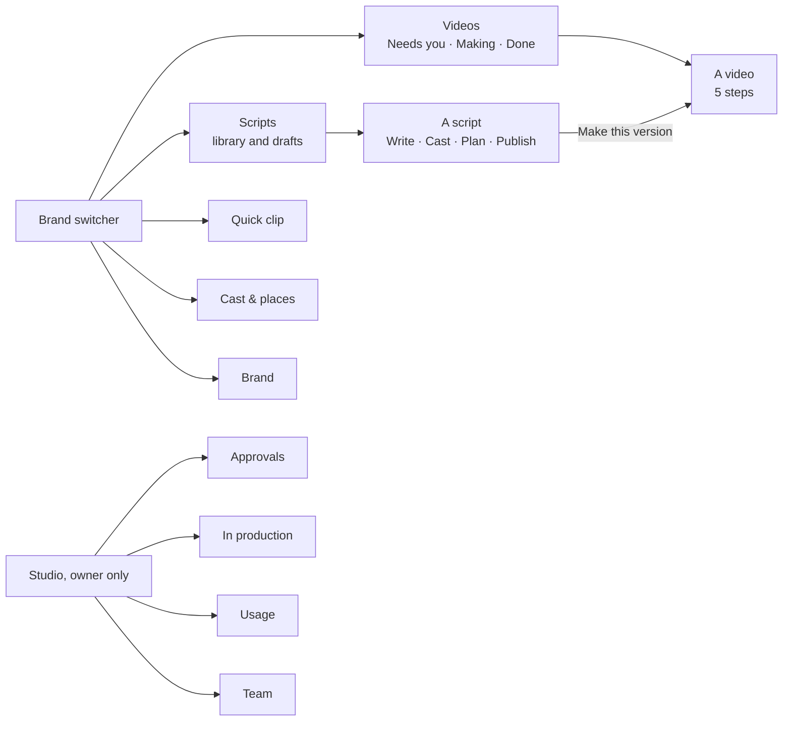
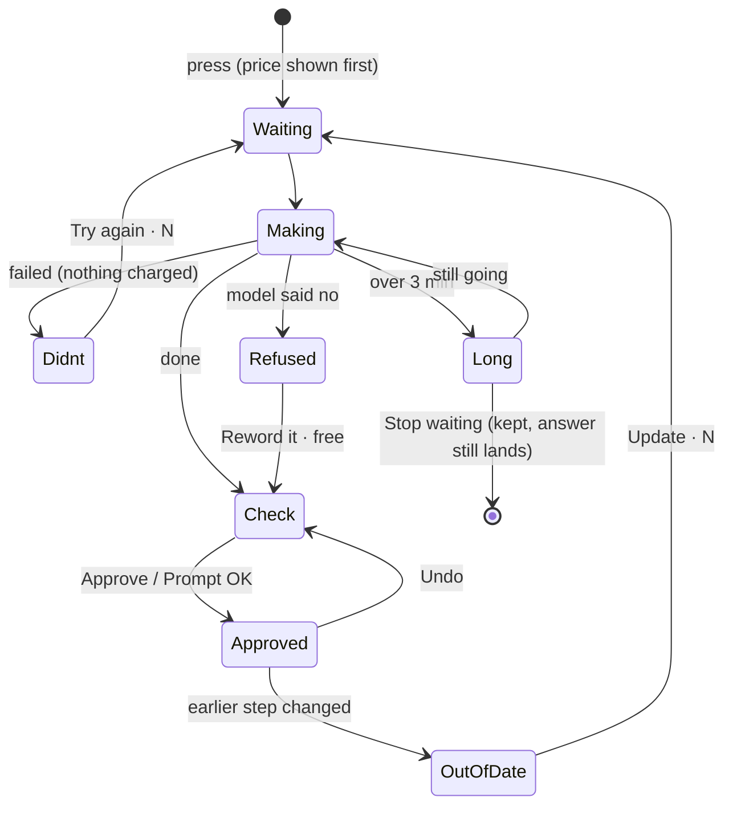
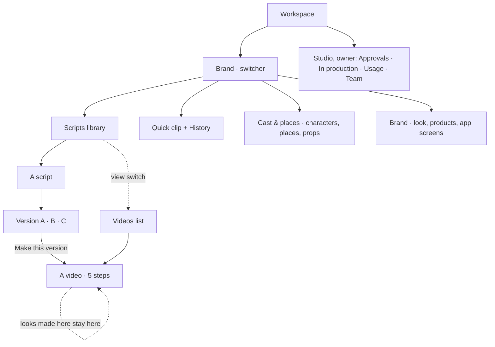
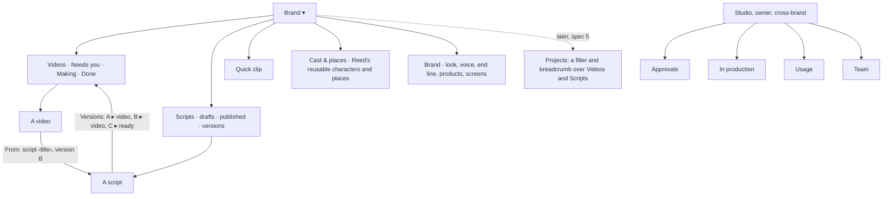

# UX audit: today's flow, and a cleaner order and look

For Reed. Owner: UX-Auditor. Status: **draft for Next-Lead, Next-Screens and Flow-QA to check**. Docs only: nothing here is built yet.

Reed asked (2026-10-28): *"explore reworking the order and look of our current flow, without changing the underlying stuff. Make it make sense, conduct a thorough ux audit on this new site."*

So this is a **re-layout and re-wording**, not new logic. Every rule stays as it is, in particular rule 4 (editors see credits, never dollars), 18 (the end line is Advice), 22 (no dead ends), 26 (lean code), 29 (one scene or action per clip) and 31 (a published script is final). Where a fix needs the server, it says so and goes to Next-Server.

**Sources:** the web app on `next` (`web/src`, read page by page); QA-Live's runs (`docs/qa/live-run-2026-10-27/README.md` on branch `qa/kel-faces-2026-10-27`, runs 1–3); the Starpop study (`docs/research/starpop-2026-10-28/`); `docs/next/flows.md` and `data.md` (Next-Lead, branch `agent/next-lead/flows-2`); `docs/next/screens.md`; the design rules in `docs/design/redesign/phase3/README.md`; and Reed's issues today (#725, #726, #728, #730). Screenshots from a free local walk (stand-ins, `BS_FAKE_PROVIDERS`), with notes, are in [`ux-audit-shots/`](ux-audit-shots/) (§1.8).

---

## The short version

1. **The flow is right; the screens are noisy.** Brief → Script → Breakdown → Assets → Storyboard → Clips → Final cut is the right order, and our rules (price first, Approve all with Undo, no dead ends) are better than Starpop's. What hurts is that each step carries 3–10 buttons, several of them amber, and the same thing has 2–3 names.
2. **Six of Reed's issues today come from four causes:**
   - buttons that grey out without saying why;
   - parts of one screen that load at different times;
   - an old failure that outlives a newer result;
   - prices that change after the page loads.

   All four can be fixed in the screens alone (table in §1.7).
3. **Costs are in five places on a video page** (the meter, each button, the auto-looks banner, the "This week" line, the Approvals card), and the "to finish: about N credits" estimate is only on the *old* video page. Proposal: **one cost bar** at the bottom of the work area, with the step's one amber button and its price in it.
4. **Hidden decisions.** The script's words become final in three places: "Approve the script", which is hidden inside Cast; "Writing variations makes A's words final"; and Publish. The flavour that blocks Next sits at the bottom of Assets.
5. **Proposed order:**
   - Writing: six steps become four: **Write → Cast → Plan → Publish**. Directions and Variations move inside Write.
   - Video: the five steps stay, but Downloads is called **Final cut**, and Clips shows two clear phases (**Prompts**, then **Takes**).
   - Navigation: **Videos** gets its own place in the menu. Today an editor's videos hide behind a switch inside Scripts.
6. **Reed's wider ask** (Part 5): the hierarchy, the script → editor handoff, saving, editing ease, and how much each step shows. The biggest gaps:
   - the script never says the flavour, so every editor is stopped to pick it again;
   - a script and its videos don't link to each other;
   - "kept in History" has no History to open;
   - a late breakdown fix locks the editor out of their own takes;
   - clip cards show the prompt but not the lines they cover.
   - In the local walk, editing a finished video's breakdown locked the editor out of the video she had already finished (§1.8 LW1).
7. **Fastest wins:**
   - every disabled button says why;
   - rename the two different "Looks good" buttons;
   - one word for the breakdown;
   - stable prices.

   These are 14 small (S) changes, listed first in §4.

---

## How to read this

- **Severity:**
  - **Blocker:** an editor can't go on, or can lose work or money without knowing.
  - **Major:** an editor gets stuck, has to guess, or presses the wrong thing.
  - **Minor:** it slows them down or reads oddly.
- **Evidence:**
  - `file:line` is the web code on `next`.
  - **QA r1/r2/r3** are QA-Live's runs 1, 2 and 3 (2026-10-27/28).
  - **Shot** is a screenshot in `ux-audit-shots/`.
  - **#NNN** is a merged PR.
- Every finding has an id (G = everywhere, L = library, W = writing, V = video, O = owner pages). Part 4 points back to them.

---

# Part 1. The audit of today's flow

## 1.1 Everywhere

| Id | What's confusing | Sev | Evidence |
|---|---|---|---|
| **G1** | **A greyed button often doesn't say why.** The design rule is "a disabled button always says why" (phase3 rule 3). The shared `Button` does this, with `reason` shown under it. But Clips, Storyboard and frames still use raw `<button>`s that skip it. "Make clip" can be grey for any of six reasons with no words: the prompt isn't marked OK yet, the budget or week is used up, a take is already being made, a blocking problem, out of date, or a look isn't approved. Some of these are explained elsewhere on the card or page, but never next to the button. | **Blocker** | `projects/ClipCard.tsx:264` (six conditions, no reason); `ClipsPane.tsx:241–250` ("Make the takes": grey while prompts are unread or stale); `StoryboardPane.tsx:219–224, 276–289`; `FrameCard.tsx:139, 161, 174`. Reed today: "greyed Make clip with no reason". |
| **G2** | **More than one amber button per screen.** On Storyboard, "Make all stills" and "Redraw N stills" can both be amber, with "Approve all" and "Redo storyboard" beside them. On a clip with problems, the card has 8–10 controls. The rule is one amber per screen, top right on desktop and in the action bar on a phone. | Major | `StoryboardPane.tsx:270–292`; `ClipCard.tsx` (whole card); phase3 rule 1. |
| **G3** | **One thing, several names.** The editor reads: Breakdown / shots / plan; Assets / looks / sheets / characters / cast; Downloads / final video / Video done; version / video; Library / Cast & places. Worst of all, **"Looks good" means two different things on the same clip card**: "Looks good" marks the prompt as read (rule 21), and "✓ Looks good" approves the picked take. Its undo is just "Undo". | Major | `ClipCard.tsx:250` (✓ Looks good = approve take), `:260` (Looks good / Undo = prompt read); `BreakdownPane.tsx:106, 120, 125` ("Planning shots…", "The shots didn't finish.", "No shots yet · Make shots") on a step called Breakdown; `BreakdownView.tsx:214` ("These shots were made for an older script."); `library/LibraryPage.tsx:58` (heading "Library" under the menu item "Cast & places"). |
| **G4** | **Costs live in five places,** and the most useful one is missing on the new video page. The new page shows "412 / 660 credits · 62%". It doesn't show "To finish: about N credits · M left", which only the old six-step page has. The auto-looks price is in a banner title, each button carries its own price, and editors on their own script see "This week: N of M" instead. None of these says what the *next press* will do to the budget. | Major | `VideoPage.tsx:113–119` (Meter only); `EstimateNote.tsx` is used only by `ProjectPage.tsx:165, 208`; `AutoLooks.tsx`; spec §6 "one cost bar". |
| **G5** | **Prices that change after the page loads.** A price is asked for separately from the card, so the button first shows no price (or a fallback) and then changes. On a look made for this video, "Change it · 1 credit" turns into "Change it · up to 2 credits" once the look's own record arrives. On a clip, the price appears only after the price request returns. Prices are also rounded in two ways: `Math.round` on Clips and Storyboard, and round-up `wholeCredits` elsewhere, so the same cost can read 0 or 1. | Major | `AssetCard.tsx:174, 357` (`changeUpTo ?? price`); `ChangeBox.tsx` (price query); `ClipsPane.tsx:187` and `ClipCard.tsx:95` (`Math.round`) against `components/credits` (round up). QA r2 #6: "Change this… charged 0.48 credits against 3 quoted". Reed today: "Change it prices". |
| **G6** | **A screen built from reads that land at different times.** The page header, the step picker and the Next button work out their counts from one read. The work area waits for its own fresh read. So for a moment the picker says "Approve every asset first (2 left)", the header says "Loading assets…", and the cards are still skeletons. #725 and #726 fixed the counts; the parts still arrive one by one. | Major | `VideoPage.tsx:62–97` (three "Loading assets…" places: the header meta, the Next reason and the pane); `AssetsPane.tsx:99–109`. Reed today: "half-loaded Assets". |
| **G7** | **An old failure outlives a newer result.** A card's status comes from the newest *job*, not from what the card holds now. If the newest take failed but an earlier take is picked, the chip still says "Failed · credits returned" in red. #730 fixed the case after a Change it; the picked-take case remains. The failure text is the server's raw line, which can still read "The service couldn't finish this. Ask the owner for details." (QA r2 #5), against rule 4's spirit. | Major | `ClipCard.tsx:91–93`; QA r2 #5; Reed today: "stale failures on Clips". |
| **G8** | **"Changing…" can spin with no way out.** The note box locks and the button spins while a change runs. The page checks the job only when the change record carries a job id, and treats a finished job as lost only 15 s after it ends. A record with no job id (a fix made in code), or a job the worker never picks up, leaves "Changing…" on screen for good: no timer, no Stop, and the box can't be edited. That's a dead end (rule 22). | **Blocker** | `ChangeBox.tsx:94–105, 150–155`. #710 and #708 covered a failed rewrite, not a missing job. Reed today: "stuck Changing…". The server side goes to Next-Server (§4, N1). |
| **G9** | **Refusals read four different ways.** These are all the same situation: the model said no. Nothing was charged, and the fix is a free reword. Each wording is accurate, but the editor has to learn four patterns. | Major | `FixClip.tsx` ("Reword it to pass · free"); `Soften.tsx` ("Soften it"); QA r2 #5; #648, #728. Reed today: "the refusals". |
| | • A still the image model may refuse: Advice, "Soften it". | | |
| | • A take refused as copyright: "…looks too much like someone else's character or video. Try another look for {name}…", which blamed the wrong character in QA r2. | | |
| | • A take refused as unsafe: "The video model refused this prompt: it read it as sexual…", with "Reword it to pass · free". | | |
| | • "Flagged as sensitive": "making it again may pass". | | |
| **G10** | **Two video pages.** Videos made from the Script Library use the five-step page (`/videos/:id`). Older videos use a six-step page (`/projects/:id`: Brief, Script, Shots, Storyboard, Clips, Final video) with different step names. Many links still point at `/projects/…` and bounce: Make this version, Approvals, In production, Usage. The old "Projects" list and "New video" form are still live, but only reachable by link. | Minor | `App.tsx:39–43`; `ProjectPage.tsx:70` (the bounce); `VersionPanel.tsx:39`; `ApprovalsPage.tsx:210, 272`; `ProductionPage.tsx:233, 272`; `usage/BrandLists.tsx:146, 169, 241`. |
| **G11** | **On a phone, a video page opens with a tall header** before any work shows: the brand bar, "‹ Scripts", the title, the meter, "Step 2 of 5 · Assets", the Script button, then the step heading. The shell is meant to hide the brand bar inside a video, but it only checks the old `/projects/` address. | Minor | `shell/Shell.tsx:72–73, 115`; `VideoPage.tsx:100–141`. |
| **G12** | **"Not started" doesn't say what it's waiting for.** When a step waits for the owner's OK, the video shows a grey "Not started" badge and the Breakdown shows the same. Nothing says it's waiting for the owner, or why. | Minor | `Meter.tsx:19`; `BreakdownPane.tsx:103`. |

## 1.2 Brands and the Script Library (owner and editor)

| Id | Screen | What it's for | What's confusing | Sev | Evidence |
|---|---|---|---|---|---|
| **L1** | Brand switcher, menu | Pick the brand; the brand's home is its Script Library. | Editors have no place for **their videos**. "Videos" is a view switch at the top of Scripts (`?view=videos`), and the back link on every video says "‹ Scripts", not "Videos". An editor's day starts from their videos. | Major | `Shell.tsx:18–23` (four sections: Scripts, Quick clip, Cast & places, Brand); `videos/ViewSwitch.tsx`; `VideoPage.tsx:100–105`. |
| **L2** | Script Library | Find a script and a version to make; owners write and publish. | Too many entrances at the same level: New script, Import a reel, Bulk create, and the filters (status, length, reference, versions left, brand, sort). The lists are "Making now", "Your drafts" and the library, with version chips that each open a panel. The owner and editor views mix writing and making. | Minor | `scripts/ScriptsPage.tsx:213–390`. |
| **L3** | Make this version (panel) | Read a version's words, cast and plan, then start it. | "About 32 credits to make" was far too low in r1 (94 charged). It's better since #679 (r3: 86 shown, ~70 charged). But the panel doesn't say what the number covers, and the video's shape, platform and flavour are chosen later, inside the steps. The press opens the old `/projects/` address. | Minor | `VersionPanel.tsx:39, 85–99`; QA r1 #3, r2 #7, r3. |
| **L4** | Approvals in the top bar *and* the rail | Owner sees what waits for them. | The same link is in two places on desktop; on a phone, In production, Team and Usage live only in the account menu. That's fine for the owner, but worth knowing. | Minor | `Shell.tsx:140–162, 344–347`. |

## 1.3 Writing a script (owner; editors on their own scripts)

Today there are six steps: **Script → Directions → Variations → Cast → Breakdown → Publish**. Three of them are optional.

| Id | Step | What it's for | What's confusing | Sev | Evidence |
|---|---|---|---|---|---|
| **W1** | All | Get the words final, find the roles, optionally plan the shots, publish. | **Half the steps are optional, but the picker shows them as equal.** Directions says "This step is optional. Press Next to skip it." Variations says "Optional. Most scripts go out as one version." An owner walks through two steps just to skip them. | Major | `scripts/flow.ts:5–12`; `DirectionsStep.tsx:22`; `VariationsStep.tsx:200`. |
| **W2** | Script | Write, paste, or have Claude write it from About or a reel. | The About fields sit under the words box, but "Have Claude write it for me" is disabled until they're filled ("Say what it's for in About first"). For a reel, "Read this reel" takes the amber slot and Next disappears until it's read. Both are right, but neither shows the order (reel → words → OK). | Minor | `ScriptStep.tsx:26, 81–83`; `ScriptFlowPage.tsx:89–93`. |
| **W3** | Directions | Claude's camera, movement and reaction suggestions; the words never change. | It's a separate step for what is really a **side panel of suggestions on the words**. Leaving with accepted-but-not-added directions asks a question the owner may not expect. | Minor | `DirectionsStep.tsx:21–28`; `ScriptFlowPage.tsx:192`. |
| **W4** | Variations | 0–2 alternates, approved side by side. | **"Writing variations makes A's words final."** is a one-line note above the button. It's a hidden, one-way decision. | Major | `VariationsStep.tsx:215`. |
| **W5** | Cast | Find roles, lock roles to Cast & places looks, merge duplicates. | **The words become final here, out of sight.** "Find roles in the script" is grey with "Approve the script first", and the "Approve the script" button sits in the Cast step ("Approving makes them final; you can undo it."). The words step is where the owner expects to OK the words. | **Major** | `FindRoles.tsx:16, 30–37`. |
| **W6** | Breakdown (preview) | Optionally plan the shots before publishing; the editor starts from it. | It's called "Breakdown" in the picker, but the screen says "plan" ("Plan saved for version A", "Remove this plan?", "Make it again"). | Minor | `BreakdownStep.tsx:96, 157–158, 237–248`. |
| **W7** | Publish | Publish N versions; they become final (rule 31). | Fine. It says what's final, and the confirm is clear. Keep it. | — | `PublishStep.tsx:37, 109`. |

## 1.4 Making a video (editor; owner too)

There are five steps: **Breakdown → Assets → Storyboard → Clips → Downloads**. Each has a step picker (a row on desktop; "Step 2 of 5 · Assets" opening a sheet on a phone), the meter, a "Script" button, and **Next: {step}** as the amber, placed top right on desktop and in the action bar on a phone. This frame works. The problems are inside the steps.

### Breakdown

**What it's for:** check the shots, fix problems, then go on.

| Id | What's confusing | Sev | Evidence |
|---|---|---|---|
| **V1** | **Shape and "Where will it be posted?" sit on top of Breakdown.** These are video settings, not breakdown work. Changing the shape after stills exist asks "Frames were drawn for 9:16. Changing the shape redraws them." with no price, in a browser pop-up. | Major | `VideoPage.tsx:146`; `ShapeRow.tsx:21`. |
| **V2** | **"Redo · N credits" sits beside the counts line, always.** It's paid and replaces the breakdown. It asks first only if the owner edited it. | Major | `BreakdownView.tsx:221`. |
| **V3** | The step says "shots" everywhere: "No shots yet", "Make shots", "Planning shots…", "These shots were made for an older script.", "Make new shots" (G3). | Minor | `BreakdownPane.tsx:106–125`; `BreakdownView.tsx:214`. |
| **V4** | **Each shot row has 3–4 controls** ("Lines 3–4", Edit, "…"), each clip has an editable seam, and every problem has Go to, a fix and Keep anyway. That's a lot for a step most editors only check. | Minor | `BreakdownView.tsx:262–390`. |
| **V5** | **Kept problems came back after each cast change** (r1 #1: kept 7 four times). That's fixed by #628. The reaction-shot false alarms (r1 #2) are fixed too. Listed so the new layout keeps those fixes. | — | QA r1 #1–2, r2 "No false Check the cast alarms". |

### Assets

**What it's for:** approve every look (rule 8), see the places, products and screens, and pick the product flavour.

| Id | What's confusing | Sev | Evidence |
|---|---|---|---|
| **V6** | **Half-loaded on open (G6).** "Loading assets…" shows in three places, while the step picker already shows a lock reason with a count. | Major | `VideoPage.tsx:87, 97`; `AssetsPane.tsx:99–109`. |
| **V7** | **The flavour that blocks Next is at the bottom.** Next reads "Pick a peanut butter flavour first", but the picker is under Cast, Places and Products, with no jump to it. | Major | `VideoPage.tsx:87`; `AssetsPane.tsx:174–189`. |
| **V8** | **A look card has up to 9 controls:** Approve, Change this… plus Change it, Use a different character, Merge into…, Delete this look, Use its own look again, "Make its look in Cast & places" (which leaves the video), "Fix it with a note", and the role-words "Update to match". | Major | `AssetCard.tsx:190–383`. |
| **V9** | **Auto looks start themselves after a countdown** ("Making looks for Nate and the Boss · up to 17 credits (usually 9)", "Starting in 5 s", Not now). This is right by Reed's rule. But it's the only spend on the site that starts without a press, and its price is only in the banner title. | Minor | `AutoLooks.tsx`; DECISIONS 2026-10-26. |
| **V10** | Roles that no shot of *this* video uses are listed as "Not in this video's shots". That's better than r3 #6 ("missing"), but they still take space. | Minor | `AssetsPane.tsx:158–165`; QA r3 #6. |

### Storyboard

**What it's for:** one still per clip; check the look, then approve every frame.

| Id | What's confusing | Sev | Evidence |
|---|---|---|---|
| **V11** | **Up to four buttons at the top, two of them amber:** Approve all, Make all stills (amber), Redraw N stills (amber), and Redo storyboard (amber when there are no frames yet). "Redo storyboard" drops every still, behind a browser pop-up. | Major | `StoryboardPane.tsx:212–231, 270–292`. |
| **V12** | **Frame buttons grey out without a reason (G1).** The sheet warning ("Mia needs an approved sheet. Open Mia") links into Cast & places, outside the video. For a look made for this video, the way on is Assets, not the library. | Major | `FrameCard.tsx:139, 161, 174`; `sheetBlocks.tsx:41–60`. |
| **V13** | "Soften it" is the still's version of the clip's "Reword it to pass" (G9). | Minor | `Soften.tsx`. |

### Clips

**What it's for:** read each prompt (rule 21), make takes, pick one, approve.

| Id | What's confusing | Sev | Evidence |
|---|---|---|---|
| **V14** | **Three jobs on one card with no order shown:** read the prompt (Looks good), make takes (Make clip / Make another take), pick and approve (radio buttons, "✓ Looks good"). The step heading "Clips · 6 · 2 approved" is repeated under the page's own "Clips" heading. | Major | `ClipsPane.tsx:232–258`; `ClipCard.tsx` (whole card). |
| **V15** | **Greyed Make clip with no reason (G1).** | **Blocker** | `ClipCard.tsx:264`. |
| **V16** | **Stale failure on the card (G7).** | Major | `ClipCard.tsx:91–93`. |
| **V17** | **Two "Looks good" buttons (G3).** | Major | `ClipCard.tsx:250, 260`. |
| **V18** | **Change it price and wording.** "Change it and make a new take · N" includes the take; "Change the prompt · N" is just the rewrite. That's clear since #730. But the number can appear late (G5), and the meter doesn't show what the press will leave. | Minor | `ClipCard.tsx:213–218`; `ChangeBox.tsx`. |
| **V19** | **"Changing…" can stick (G8).** | **Blocker** | `ChangeBox.tsx:94–105`. |
| **V20** | **Out-of-date clips show two lines** saying the same thing: the banner "N clips were made for an older breakdown. Rewrite…", plus "Rewrite the clips made for an older breakdown first (N)." The rewrite button is amber, and "Make the takes" goes grey with no reason. | Minor | `ClipsPane.tsx:256–257`; `RewriteClips.tsx`. |
| **V21** | "Advanced: edit the prompt" opens a box that can't save a prompt over 5,000 characters, even unchanged (r2 #4). | Minor | QA r2 #4 (server limit; Next-Server). |
| **V22** | "Use the real image · Home (shot 4.2)" switches sit on every card with an insert. They're useful, but they're always open. | Minor | `ClipCard.tsx:220–228`. |

### Downloads

**What it's for:** the finished video, put together for free, plus each clip's takes.

| Id | What's confusing | Sev | Evidence |
|---|---|---|---|
| **V23** | **"Video done" happens by downloading.** Pressing "Download all clips (.zip)" (the amber) shows "Video done. Downloads stay here." The finished state is real (it's what Usage counts), but it's a side effect of a download link. | Minor | `DownloadsPane.tsx:96–105`; DECISIONS 2026-10-25 ("Finished"). |
| **V24** | It's called "Downloads" in the steps, "Final video" on the old page, and "Video done" in the library. Rule texts and the mission say **Final cut**. | Minor | `videoSteps.ts:10`; `steps.ts:11`; `ScriptsPage.tsx:39`. |

## 1.5 Owner pages: Approvals, In production, Usage, Team

| Id | Screen | What's confusing | Sev | Evidence |
|---|---|---|---|---|
| **O1** | Approvals | Request kinds use inside words: "Storyboard frames", "Frame still", "Clip prompts", "Clip take", "House-style sheet". Plain names would be "Stills for {video}", "A new take of clip 3", "A look for {role}". Links go to `/projects/…` (G10). The rest is good: dollars only here, Approve all with a total, Decline says nothing was charged. | Minor | `ApprovalsPage.tsx:18–26, 210, 272`. |
| **O2** | In production | Good: a step, the last activity, "Nothing for 2 days", "Close to the budget". Its step names must follow any rename (Downloads → Final cut). | — | `ProductionPage.tsx:15, 38–39`. |
| **O3** | Usage | Older videos are marked "(earlier way)". Brand → videos and scripts lists, plus Charges with "Give credits back". It's clear for Reed. The per-video rows link to the old page (G10). | Minor | `usage/BrandLists.tsx:146–149`; `Charges.tsx`. |
| **O4** | Team | Clear: invite by email or link, roles, credit limits with plain helper text ("Most one video can cost"). Keep it. | — | `team/TeamPage.tsx`; `team/CreditLimits.tsx:81–82`. |

## 1.6 What already works (keep it)

- **A price inside every paid button,** with "up to N · Usually M. Anything not used comes back." Starpop only shows cost in an approval bar.
- **Locked steps say why** ("Fix the 3 problems in Breakdown first", "Approve every asset first (2 left)"), and a link to a locked step lands on the step that blocks it (`videoSteps.ts:31–35`).
- **Approve all with Undo,** skipped items listed with reasons, on Assets, Storyboard and Clips.
- **Out of date is a state, not a dead end:** "Rewrite clip prompts · N credits", and stills redraw themselves after a cast change within budget.
- **Plain failure lines** ("The shots didn't finish. Nothing was charged.") and server-restart wording.
- **On a phone:** the step picker sheet, the problems sheet, the action bar above the tabs, and 44px controls.
- **The script stays the authority** (rules 19, 31). Starpop rewrote finished lyrics; we don't.

## 1.7 Reed's six issues today, and where they come from

| Reed hit | What happens | Cause (finding) | Fix in screens? |
|---|---|---|---|
| Half-loaded Assets | The step picker, header and cards fill in at different moments; "Loading assets…" shows in three places. | G6, V6 | Yes: one skeleton for the whole step until its own read lands (§4 S10). |
| Stale failures on Clips | A red "Failed · credits returned" chip while a good take is picked; the server's raw failure line. | G7, V16 | Yes: the status comes from what the card holds; the failure becomes a line under it that clears on the next try (§4 S7). |
| Greyed Make clip, no reason | Six silent reasons. | G1, V15 | Yes: every paid button uses the shared Button with its reason (§4 S1). |
| "Change it" prices | The price shows late or changes after load; two rounding rules; what the price covers isn't said. | G5, V18 | Yes: a fixed price slot (skeleton until known), one rounding, and "Change it and make a new take · up to N" with the parts under it (§4 S6). |
| Stuck "Changing…" | No timer, no Stop, and it never clears when the change has no job id. | G8, V19 | Partly. The screen shows a timer, after 3 min "Taking longer than usual", and **Stop waiting** (keeps the note). The missing job id goes to Next-Server (§4 M9, N1). |
| The refusals | Four wordings for one situation. | G9, V13 | Yes: one "Refused" card everywhere, with one free fix (§2.5, §4 M8). |

## 1.8 What the free local walk showed

An owner (Reed) and an editor (Maya) on Iron Paws ran one video end to end on the free stand-ins, then Maya edited a shot. Full notes: [`ux-audit-shots/NOTES.md`](ux-audit-shots/NOTES.md). Stand-in text ("INT. TEST — DAY", grey stills) is not counted as a problem. These add to the findings above.

| Id | What happened | Sev | Shot |
|---|---|---|---|
| **LW1** | **Editing a finished video's breakdown cuts off the finished video.** Saving a shot edit gave no warning. Then Storyboard was out of date, Clips and Final cut were locked, and their links sent Maya back to Assets or Storyboard, so the MP4 she already had couldn't be reached. The fix agreed with Next-Lead (M14, out-of-date steps stay viewable read-only) covers it. Saving a breakdown on a finished video should also warn first: "This video is finished. Saving marks 6 stills and 4 clips out of date; the final cut stays downloadable." | **Blocker** | `25-1280-video-breakdown-unsaved-edit`, `26-1280-video-breakdown-after-edit`, `29-390-video-step-picker-locked`, `30-390-video-storyboard-out-of-date` |
| **LW2** | **A locked video still reads "Video done" everywhere else.** Videos shows "✓ Video done", Usage counts it finished, and In production shows "0 videos being made", all while the video was out of date and locked. | Major | `02-390-library-videos-view`, `41-390-in-production`, `42-390-usage` |
| **LW3** | **An out-of-date frame has no button of its own.** The badge says "Breakdown changed: redo this frame", but the card's Change this… is held ("Make the storyboard again first") and Approve is grey with no reason. The only way on is "Redo storyboard" at the top, which drops every still. It's not a dead end, but close to one (rule 22). Proposal: "Redo this frame · N" on the card (today's per-frame Make another, unheld for a stale frame). *To check with Next-Lead, since it unholds a press.* | Major | `30-390-video-storyboard-out-of-date`; `FrameCard.tsx:110, 191` |
| **LW4** | **The retake prices next to each other don't add up.** "Change it and make a new take · 3 credits" sits beside "Make another take · 22 credits". The change price appears to leave out the take, so the button that makes a take reads 7× cheaper than the one beside it. On Storyboard, three "try again" prices sit side by side: "Make another · 1 credit", "Change it · 4 credits" and "Redo storyboard · 4 credits". | **Major** | `23-390-video-clips-takes`, `21-390-video-storyboard-stills`. Server price for "change and make a new take": **N7**. |
| **LW5** | **The version panel shows two prices:** "About 21 credits to make" and "Make this version · 3 credits" (the breakdown). At 390 the button sits on the sheet's bottom edge. The version card (M12) gives one line: "Starting costs 3 (the breakdown) · the whole video about 21." | Minor | `14-390-version-panel-editor`, `14-1280-version-panel-editor` |
| **LW6** | **Many action screens have no amber at all** (Variations written, Storyboard with stills, Clips, Assets with a look to approve, Quick clip, Brand). While Next is disabled, the actual next press (Approve, Approve all, Looks good) is grey-styled secondary. That's G2's other side: §2.3's table gives each state its one amber. | Major | `07`, `21`, `22`, `23`, `28`, `30`, `44`, `46` |
| **LW7** | **Publish offers to publish a variation that Variations says to approve first.** Variations blocks Next with "Approve or remove variation B first", but Publish (through the step picker) offers "Publish 2 versions", listing B as "Words: When you publish". Publishing approves it; that's by design (`PublishStep.tsx:83`), but the two steps disagree about what's required. Proposal: Variations says the same ("B will be approved when you publish"), or Publish asks "B isn't approved yet. Publish it as it is?" | Minor | `11-390-write-publish`; `PublishStep.tsx:80–84` |
| **LW8** | **Auto looks after an edit spend with no press on that visit.** Maya opened Assets by a link after the edit; the countdown ran out and the meter went 31 → 34 → 36. The next screen says "Made 1 look · 2 credits". Per Reed's rule this is allowed, but it needs the cost bar (§2.4) to say it before it starts, and the meter and the note should agree. | Minor | `27-390-video-assets-countdown-after-edit`, `28-390-video-assets-look-to-approve` |
| **LW9** | **The length differs by screen:** "about 11 s" in the library and version panel, and "22 s of 22 s planned" on Breakdown. Assets shows a ✓ in the step picker before it has been opened. | Minor | `14`, `15-390-video-breakdown` |
| **LW10** | **The Brand page's End line example says fomo on Iron Paws** ("Download fomo through the link in my bio."). The placeholder should use the brand's own name. | Minor | `46-390-brand`; `brand/KitPage.tsx:127` |
| **LW11** | **At 390, toasts cover the action bar and its Next button,** for their 8 s with Undo. | Minor | `07-390-write-variations-written`, `22a-390-video-clips-no-prompts` |
| **LW12** | **Greyed Quick clip buttons don't say why:** "Add" and "Improve prompt" (G1). | Minor | `44-390-quick-clip` |

Confirmed by the walk: G1/V15 (`22-390-video-clips-before-looks-good`, `23a-390-video-clips-making`), G3/V17 (the green "✓ Looks good" badge on a clip still "Queued 2s"), G6/V6 (`16-390-video-assets-loading`: "Loading assets…" three times with three grey boxes), V23 (`24-390-video-downloads`: the zip is amber, the MP4 grey), and the three names for Cast & places (`45-390-cast-and-places`).

---

# Part 2. The proposed order and look

## 2.1 Step order

**Writing (owner, or an editor on their own script).** Six steps become four. Nothing is removed: Directions and Variations become panels inside Write.

| Today | Proposed | Why |
|---|---|---|
| Script | **1 Write**: the words, About, the reel. Two panels beside the words: **Suggestions** (today's Directions) and **Versions** (today's Variations, 0–2). Ends with **Approve the words** (moved from Cast). | One place where the words are made and OK'd. The finality press is where the words are (fixes W4, W5). |
| Directions | → a panel in Write | Optional; it was a step to skip (W1, W3). |
| Variations | → a panel in Write | Optional; writing them makes A final, which is now said on the Approve press itself (W4). |
| Cast | **2 Cast** | Unchanged, minus the hidden Approve (W5). |
| Breakdown (preview) | **3 Plan** *(optional, marked "Optional" in the picker)* | Plain name; the editor's step stays "Breakdown" (rule texts use it). Skipping it needs no visit: "Next: Publish" is offered from Cast too. |
| Publish | **4 Publish** | Unchanged (W7). |

A **song script** follows Next-Lead's flows (S1–S7): **Song → Takes → Cast → Plan → Publish**. The Song step is the Write step with the lyrics box. It has **no Suggestions or Versions panels**, because variations would rewrite locked lyrics. Its only writing help is "Write 2 song directions" inside Song (agreed with Next-Lead).

**Editing words that are already approved** (behaviour unchanged): the words show "Approved · words final" with **Edit the words**. Pressing it asks first: "Edit version A? It goes back to draft. Approve the words again before Next. Roles already found are kept." Today an edit already un-approves a version; the question just says so before it happens.

**Making a video (editor).** Same five steps, same locks, same rules. Two renames and one clearer split.

| Today | Proposed | Change |
|---|---|---|
| — | **Video settings** row at the top (not a step) | Shape, "Where will it be posted?" and product flavour move here from Breakdown and Assets. They're asked once in **Make this version** and editable at the top of the video. Each change says its effect in the confirm, as today's behaviour does:
  - **Flavour** stays changeable after start: "Switch to Chicken? 4 stills and 2 clips that show the bag go out of date. They're kept, and you can redo them."
  - **Shape** stays changeable, with the whole redo price: "Change to 1:1? All 6 stills are redrawn · 2 credits. Clips made for 9:16 go out of date." *Decided here; Next-Lead writes it into flows.md.* Locking the shape would be new behaviour, so it isn't proposed.
  - **Song** (song ads, V2a): the video's song ("Song: Take 2 · 0:31 ▾") sits in this same row and opens the "Change song" panel from screens.md S3e. That way every per-video choice lives in one place. Later, spec item 4 (style, video model, picture model, language) lands in the same row. Re-laid out, not new: it's the same PATCH to the video. |
| Breakdown | **1 Breakdown** | One word inside the step ("breakdown", never "shots"). "Make it again · N" moves into a "…" menu (V2, V3). |
| Assets | **2 Assets** | One skeleton until loaded (V6). Each look card keeps one main press; the rest goes in "…" (V8). |
| Storyboard | **3 Storyboard** | One amber at a time (§2.3). "Make it again" in "…" (V11). |
| Clips | **4 Clips**, in two phases on the same step: **Prompts** ("Prompt OK" on each, rule 21) then **Takes** (make, pick, **Approve take**) | The order on the card becomes visible; the two "Looks good" get two names (V14, V17). Not a new step and not a new lock: today's rule (prompts read before takes are paid) decides which phase shows first. |
| Downloads | **5 Final cut** | The name Reed's docs use. **Download MP4** is the amber; the zip and the takes are secondary. "Video done" is said as a state ("Final cut ready · downloaded 14:02"), not as a toast on a zip link (V23, V24). |

No step is merged: each still has its own lock and approval (rules 8, 21). Breakdown and Assets were considered for a merge, but Assets spends money (looks) and Breakdown is free to check, so they stay apart.

## 2.2 Navigation: brand → project → video



- **Videos becomes a menu item** (first for editors, and their home after sign-in). It holds the list that's now behind the Scripts view switch, grouped as **Needs you** (a step waiting on them: looks to approve, prompts to check, takes to pick), **Making** (something running), and **Done**. Each row shows its step in words.
- **Scripts** stays the library (and the owner's home).
- **Projects** (spec item 5, not built yet) slot in **between the brand and its scripts and videos**, as a filter row and a breadcrumb: "fomo › November launch › The altar reel · B". "No project" is the default, so nothing changes until projects exist.
- **Inside a video,** the back link names where it goes: "‹ Videos", or "‹ {script title}" when opened from the script. The breadcrumb doubles as the brand switcher's context.
- **One address per video:** `/b/:brand/videos/:id`. The old `/projects` pages retire (G10). Every old `/projects/…` link redirects to the same video in its new place, never a 404 (rule 22). Older videos open in the five-step page at their furthest step; the server already gives both kinds the same data. *To check with Next-Lead.*
- **Phone tabs:** Videos · Scripts · Quick clip · Cast · Brand (5 × 78 px at 390). The owner's Studio pages stay in the account menu, and Approvals stays as the bell.

## 2.3 One primary action per screen

The amber is always the step's next move. Everything else is secondary, ghost or in a "…" menu.

| Screen | The one amber | Secondary (visible) | In "…" |
|---|---|---|---|
| Videos | **Open** the top "Needs you" row (a row tap) | Filters | — |
| Scripts | **New script** (owner) / **Make this version** in the panel (editor) | Import a reel, Bulk create | — |
| Write | **Approve the words · Next: Cast**, or **Read this reel** while a reel is unread | Have Claude write it · N, Suggestions, Versions | Delete script |
| Cast | **Next: Plan** (or **Next: Publish**) | Find roles · N, Lock to a look, Add a role | Merge into…, Remove |
| Plan | **Next: Publish** | Make the plan · N | Make it again · N, Remove this plan |
| Publish | **Publish N versions** | — | Duplicate |
| Breakdown | **Make the breakdown · N** when there is none, else **Next: Assets** | Fix N problems (free), Put the right cast in each shot (free) | Make it again · N, Edit shots |
| Assets | **Approve all looks** while any is waiting, else **Next: Storyboard** | Per card: Approve, Change this… | Use a different character, Merge into…, Delete this look |
| Storyboard | In this order, the first that applies: **Make the storyboard · N** → **Redraw N out-of-date stills · N** → **Make N stills · N** → **Approve all frames** → **Next: Clips** | Per frame: Change this…, Make another | Make the storyboard again · N, Advanced: edit the prompt |
| Clips · Prompts | **Prompt OK for all ready (N)** → **Make the takes · N** | Per card: Prompt OK, Change the prompt · N | Advanced: edit the prompt |
| Clips · Takes | **Approve all takes** → **Next: Final cut** | Per card: pick a take, Approve take, Change it and make a new take · N, Make another take · N | Download this take, Use the real image |
| Final cut | **Download MP4** | Download all clips (.zip), each clip's takes | Make it again (free) |

"Prompt OK for all ready" is today's per-card press, repeated for each ready card, with one Undo (rule 21 "Approve all" on every per-item list; it was missing in r1 #10). It's a client loop over the existing press, so no new server rule is needed.

## 2.4 Where costs appear: one cost bar

One bar, in the same place on every step: **at the bottom of the work area**, sticky on desktop, and as the action bar above the tabs on a phone. It replaces the meter in the header and carries the step's amber.

```
┌──────────────────────────────────────────────────────────────────────────────┐
│ 412 / 660 credits · 62%  ▓▓▓▓▓▓▓░░░░   To finish: about 140 · 248 left       │
│ This press: Make the takes · 54 credits → leaves 194          [ Make the takes · 54 ] │
└──────────────────────────────────────────────────────────────────────────────┘
```

- **Left:** what's used and the budget, as today's meter. An editor on their own script sees "This week: 40 of 145 credits" instead. Credits only for editors (rule 4); the owner may see "$" only in Approvals and Usage, as now.
- **Middle:** "To finish: about N", from the estimate the server already gives (`/projects/{id}/estimate`, today only on the old page), opening to the per-step list.
- **Right:** the amber, with its price inside (rule 2 design), and above it "This press: … → leaves M". This is the "one cost bar before any paid press" from the spec. Card buttons keep their own prices, but the bar is where the step's main spend is said once.
- **When it can't be pressed,** the bar says why in words, where the amber would be: "That's more than this video's budget." or "You've used this week's 145 credits. It resets on Monday." The free alternatives on the screen stay pressable (rule 22). An editor is never told "Ask Reed" (rule 4).
- **Auto looks** say their price in the bar during the countdown ("Making 3 looks · up to 17 (usually 9) · starting in 5 s · Not now"), not only in a banner (V9).
- **Prices never change after the page shows:** the price slot is a grey placeholder until it's known, then it's set. One rounding everywhere: whole credits, rounded up (phase3 rule 2).

## 2.5 How states read

One vocabulary and one badge set for every card, step and list. Each state says what happened and offers its one press. Words first, colour second (phase3 rule 4).

| State | Badge | The line under it | The one press |
|---|---|---|---|
| Waiting (queued) | **Waiting** (grey) | "Waiting to start · 0:12". After 10 min: "The service that makes it isn't taking work right now. It's charged only if it runs." (flows.md) | Cancel (before it starts) |
| Running | **Making… 0:42** (grey, count-up) | "You can leave this page; it carries on." | — |
| Running too long | **Making… 3:10** | "Taking longer than usual." | **Stop waiting** (the note or work is kept; a late answer still shows) |
| Ready to check | **Check this** (amber outline) | — | Approve / Prompt OK |
| Approved | **Approved** (green) | — | Undo (8 s toast), then "Undo approval" in "…" |
| Failed | **Didn't finish** (red) | "Didn't finish · nothing charged" (or "· credits returned" when they were held) plus the reason in plain words. It clears the moment a new try starts or succeeds, and never sits under a newer good result. | **Try again · N** |
| Refused | **Refused** (red) | "The video model wouldn't make this: it read it as {reason}. Nothing was charged." For copyright, it names the shot, not a guessed character. | **Its free fix**. For a still or a clip prompt that's **Reword it · free** (one name for Soften it and Reword it to pass); for a song it's the style line or another take, never the words (rule 19). Then **Make another take · N** |
| Out of date | **Out of date** (amber) | "Made for an older breakdown. Earlier takes are kept." | **Update · N** (rewrite prompts or redraw stills) |
| Waiting for the owner | **Waiting for the owner's OK** (grey) | "This would go past the video's budget." | — (editor), **Approve** (owner) |
| Locked | Step picker: grey with the reason | "Approve every asset first (2 left)" | the link to the blocking step |
| Loading | skeleton in the final layout | (no counts until this step's own read lands) | — |

## 2.6 Phone (390) and desktop

| | Phone, 390 wide | Desktop, 1024 and up (1280+ adds the right column) |
|---|---|---|
| Frame | Bottom tabs (5); cost bar above them; no brand bar inside a video (fix G11) | Left: the brand rail (icons only inside a video). Centre: the work. Right (≥1280): **Script** or **Media** (this video's stills, takes, looks), switchable |
| Video header | One line: "‹ Videos" · title · "…". Under it: "Step 4 of 5 · Clips ▾" (the sheet, as today) | Breadcrumb · title · "…". Under it: the five steps as a row, with state words ("Assets ✓", "Clips · 2 to check") |
| Cards | One column, media first; the main press full width; the rest in "…" | 2–3 columns; the same card |
| Long lists | Problems and Advice in a sheet (as today) | Problems box above the shots (as today) |
| Script | "Script" in the "…" menu, opens a full-height sheet | Right column |
| Rules kept | No sideways scroll; every control 44px; 8px apart | Amber 44px; secondary may be 36px |

This is Starpop's three columns: the brand and its videos, the work, and the media. Their media column is a shared gallery. Ours is this video's own stills, takes and looks, plus the script, which is what an editor checks against.

## 2.7 Borrowed from Starpop, and what we keep

| Borrow | From | Where |
|---|---|---|
| Three columns: list, work, media | Starpop layout (shots 02, 03) | Video page at ≥1280 (§2.6) |
| One approval or cost bar before a run | Starpop's approval bar (shot 28) | The cost bar (§2.4); ours also shows the budget and what's left |
| Status words on the list ("Running", "Needs approval") | Starpop's project tree | Videos: Needs you · Making · Done |
| "Preferred" mark | Starpop media | Spec item 5. The picked take already works this way; the same badge would go on stills and song takes later |

| Keep (we do it better) | Why |
|---|---|
| A price inside every paid button | Starpop shows cost only in the bar; we do both |
| Named jobs and reasons | Starpop's tasks tray says "Background task" (shot 38) |
| A retry on failure, with "nothing charged" | Starpop's song step failed silently (shot 31) |
| Script-led steps with locks that say why | Starpop is chat-led; the order is the agent's |
| Approve all with Undo; no dead ends (rule 22) | Not in Starpop |

---

# Part 3. Low-fi wireframes

## 3.1 A video at Clips, desktop (1280)

```
┌ fomo ▾ ───────────────────────────────────────────────────── 🔔 Approvals ─ (RP) ┐
│ ▣ │ fomo › November launch › The altar reel · B                           [ … ] │
│ ▣ │ ✓ Breakdown ── ✓ Assets ── ✓ Storyboard ── ● Clips · 2 to check ── Final cut │
│ ▣ │─────────────────────────────────────────────────────┬───────────────────────│
│ ▣ │ Clips      [ Prompts · 2 to check ] [ Takes ]        │ Script │ Media        │
│ ▣ │                                                      │                       │
│   │ ┌ Clip 1 · 8 s ─────────────── Approved ┐ ┌ Clip 2 ┐ │ 1 NATE: Will you…     │
│   │ │ ▶ [ take 2 video        ]              │ │ Check  │ │ 2 LEXI: Hell no.      │
│   │ │ Take 1 ○  Take 2 ●                     │ │ this   │ │ 3 …                   │
│   │ │                                    […] │ │        │ │                       │
│   │ └────────────────────────────────────────┘ │Prompt  │ │ (lines of the clip    │
│   │ ┌ Clip 3 · 6 s ─────────── Didn't finish ┐ │ (5 ln) │ │  you're on are        │
│   │ │ Nothing was charged. The service was   │ │Show all│ │  highlighted)         │
│   │ │ busy.                                  │ │[Prompt │ │                       │
│   │ │ [ Try again · 6 ]                      │ │  OK ]  │ │                       │
│   │ │ Change this… [________] [Change it · 7]│ │  […]   │ │                       │
│   │ └────────────────────────────────────────┘ └────────┘ │                       │
│   ├──────────────────────────────────────────────────────┴───────────────────────│
│   │ 412 / 660 · 62% ▓▓▓▓▓░░  To finish: about 140 ▾   This press → leaves 606     │
│   │                                       [ Prompt OK for all ready (2) ]  (amber)│
└───┴──────────────────────────────────────────────────────────────────────────────┘
```

## 3.2 The same, at 390

```
┌──────────────────────────────┐
│ ‹ Videos   The altar reel · B  … │
│ [ Step 4 of 5 · Clips      ▾ ] │
│ [ Prompts · 2 ][   Takes     ] │
│ ┌ Clip 2 · 6 s ── Check this ┐ │
│ │ [ storyboard still       ] │ │
│ │ NATE: "Will you…"           │ │
│ │ Prompt: The camera holds …  │ │
│ │ (5 lines)        Show all   │ │
│ │ [      Prompt OK        ]  │ │
│ │ Change this… [__________]  │ │
│ │ [ Change the prompt · 1  ] │ │
│ │                        […] │ │
│ └────────────────────────────┘ │
│ ┌ Clip 3 · 6 s ─ Didn't finish┐ │
│ │ Nothing was charged.        │ │
│ │ [     Try again · 6      ] │ │
│ └────────────────────────────┘ │
├──────────────────────────────┤
│ 412/660 · 62%  To finish ~140 ▾│
│ [ Prompt OK for all ready (2) ]│  ← cost bar + the one amber
├──────────────────────────────┤
│ Videos Scripts Quick Cast Brand│
└──────────────────────────────┘
```

## 3.3 Assets, desktop

```
┌───┬──────────────────────────────────────────────────────────────────────────────┐
│ ▣ │ fomo › The altar reel · B          9:16 · Reels · Peanut butter  [Settings]  │
│   │ ✓ Breakdown ── ● Assets · 2 to approve ── Storyboard ── Clips ── Final cut   │
│   │──────────────────────────────────────────────────────────────────────────────│
│   │ Cast                                                                          │
│   │ ┌ [ sheet image ] ┐ ┌ [ sheet image ] ┐ ┌ [ making… ] ┐                       │
│   │ │ Lexi · Goth GF  │ │ The Boss        │ │ Customer    │                       │
│   │ │ Locked          │ │ Check this      │ │ Making… 0:20│                       │
│   │ │ In 6 shots      │ │ 40s, man, boss  │ │             │                       │
│   │ │            […]  │ │ [ Approve ] […] │ │             │                       │
│   │ └─────────────────┘ │ Change this…    │ └─────────────┘                       │
│   │                     │ [__________]    │                                       │
│   │                     │ [Change it · up to 2]                                   │
│   │                     │ Usually 1. Anything not used comes back.                │
│   │                     └─────────────────┘                                       │
│   │ Places · Products · App screens (pictures only, nothing to approve)           │
│   ├──────────────────────────────────────────────────────────────────────────────│
│   │ 18 / 220 · 8%   Making 1 look · up to 4 (usually 2)     [ Approve all looks (1) ] │
└───┴──────────────────────────────────────────────────────────────────────────────┘
```

The flavour is in the Settings row at the top. If it isn't chosen, the amber reads "Pick a flavour first" and pressing the reason opens Settings (V7).

## 3.4 Writing a script, desktop

```
┌───┬──────────────────────────────────────────────────────────────────────────────┐
│ ▣ │ ‹ Scripts   The altar reel        Draft · only you can see it          […]   │
│   │ ● Write ── Cast ── Plan (optional) ── Publish                                │
│   │───────────────────────────────────────────────┬──────────────────────────────│
│   │ The words                                      │ [ Suggestions ] [ Versions ] │
│   │ ┌──────────────────────────────────────────┐  │ Camera, movement, reactions. │
│   │ │ NATE: Will you marry me?                 │  │ Your words never change.     │
│   │ │ LEXI: Hell no.                           │  │ [ Suggest · 3 credits ]      │
│   │ │ …                                        │  │  ─ or ─                       │
│   │ └──────────────────────────────────────────┘  │ Versions: A only              │
│   │ About ▸   Reel: read ✓                         │ [ Write 1–2 variations · 3 ] │
│   ├───────────────────────────────────────────────┴──────────────────────────────│
│   │ Approving makes the words final (Undo is offered).  [ Approve the words · Next: Cast ] │
└───┴──────────────────────────────────────────────────────────────────────────────┘
```

At 390 the side panel becomes two buttons under the words ("Suggestions", "Versions") that open full-height sheets. The bar holds "‹" and the amber, as today.

## 3.5 Videos (editor home), 390

```
┌──────────────────────────────┐
│ fomo ▾                    (KE)│
│ Videos              [ Filters ]│
│ NEEDS YOU                     │
│ ┌ The altar reel · B ─────────┐│
│ │ [poster]  Clips · 2 to check ││
│ │           62% of budget      ││
│ └─────────────────────────────┘│
│ MAKING                        │
│ ┌ Pitbull 1 · A ──────────────┐│
│ │ [poster]  Storyboard ·       ││
│ │           Making… 1:10       ││
│ └─────────────────────────────┘│
│ DONE                          │
│ ┌ Mom's 3 days · C ── Final cut ┐│
│ └─────────────────────────────┘│
├──────────────────────────────┤
│ Videos Scripts Quick Cast Brand│
└──────────────────────────────┘
```

## 3.6 States on one card (any step)



---

# Part 4. Prioritized change list

**Sizes:** S = one small PR, about a day; M = 2–4 PRs; L = 5 or more PRs, or a new screen frame. Each item names its findings. None changes a rule or the server, except the N items at the end (for Next-Server). All are built on `next` by Next-Screens. Flow-QA checks each against flows.md.

### Small wins first

| # | Change | Fixes | Size |
|---|---|---|---|
| S1 | Every paid or blocking button uses the shared `Button` with its `reason`: Clips (Make clip, Make another take, Make the takes, Redo), Storyboard (Make all stills, Redraw, Make storyboard), frame buttons. The reason names the next press ("Press Prompt OK first", "Approve Mia's look in Assets first", "That's more than this video's budget."). | G1, V12, V15, V20 | S |
| S2 | Rename the clip's two "Looks good": the prompt's becomes **Prompt OK** (undo: "Undo Prompt OK"); the take's becomes **Approve take** (undo: "Undo approval"). | G3, V17 | S |
| S3 | One word inside Breakdown: "Make the breakdown", "Making the breakdown… 0:12", "The breakdown didn't finish. Nothing was charged.", "This breakdown was made for older words.", "Make it again". | G3, V3 | S |
| S4 | The video's back link says where it goes ("‹ Videos" or "‹ {script}"); the shell hides the brand bar on `/videos/:id` at 390 too. | L1, G11 | S |
| S5 | When Next is blocked by the flavour, the reason is a link that scrolls to and highlights the flavour picker (until S-row M5 moves it to Settings). | V7 | S |
| S6 | Prices never change after they show: a grey placeholder in the price slot until it's known; one rounding (`wholeCredits`, up) on Clips and Storyboard too; "Change it and make a new take · up to N" with "Rewrite 1 + take 8" in the meta line. | G5, V18 | S |
| S7 | A clip's status chip comes from what the card holds (Approved / Take 2 picked / Not made). A newest-take failure becomes a line under the video ("The last try didn't finish. Nothing was charged.") that clears on the next try. The server's raw "Ask the owner for details." is replaced by "The service couldn't finish this. Nothing was charged; try again." | G7, V16 | S |
| S8 | "Not started" becomes **Waiting for the owner's OK** with "This would go past the video's budget." | G12 | S |
| S9 | Approvals: plain request names ("Stills for {video}", "A new take of clip 3", "A look for {role}", "Clip prompts" → "Prompts for {video}"). | O1 | S |
| S10 | Assets (and every step): one skeleton covers the step picker counts, the header line and the cards until the step's own read lands. "Loading assets…" is said once. | G6, V6 | S |
| S11 | The Cast & places page heading reads "Cast & places", not "Library". | G3 | S |
| S12 | Downloads → **Final cut**: Download MP4 is the amber, the zip is secondary; "Video done" shows as a state line, not a toast on the zip. Same rename in In production and the Videos list. | V23, V24, O2 | S |
| S13 | Shape change after stills: an in-app Dialog with the price ("Changing the shape redraws 6 stills · 2 credits"), not a browser pop-up. Same for "Redo storyboard" ("drops 6 stills"). | V1, V11 | S |
| S14 | The duplicated "Clips · N · M approved" and "Storyboard · N frames" headings fold into the page's own step heading meta line. | V14 | S |

### Medium

| # | Change | Fixes | Size |
|---|---|---|---|
| M1 | **The cost bar** (§2.4): one component on every video step and the writing steps' paid presses, carrying the meter, "To finish: about N" (existing estimate route), "This press → leaves M", and the one amber. It replaces the header meter. | G4, V9 | M |
| M2 | **One state badge and line set** (§2.5) shared by Breakdown, Assets, Storyboard, Clips and Final cut. | G7, G9, G12 | M |
| M3 | **Clips in two phases** (Prompts, Takes) on the same step, with "Prompt OK for all ready (N)" as a loop over the existing press with one Undo. The card's secondary presses go in "…". | V14, V22, G2 | M |
| M4 | **One amber per step**, by the table in §2.3: Storyboard's priority order, Breakdown's "Make it again" into "…", the look card's extra presses into "…". | G2, V2, V8, V11 | M |
| M5 | **Video settings row**: shape, platform, flavour (and, for song ads, the video's song) move into one row at the top, also offered in Make this version. Each change confirms its effect and price. Spec item 4 (VS1 in flows) adds style, models and language here. | V1, V7, L3 | M |
| M6 | **Videos in the menu** (rail and phone tabs), with Needs you / Making / Done; the editor's home after sign-in. | L1 | M |
| M7 | **Writing flow in four steps**: Suggestions and Versions as panels in Write; **Approve the words** moves from Cast to Write's amber; Plan marked Optional. | W1, W3, W4, W5, W6 | M |
| M8 | **One refusal card** for stills, takes and songs, with its free fix ("Reword it · free" for stills and clips; the style line or another take for songs), and the copyright line names the shot, not a guessed character (server text to agree with Next-Server). | G9, V13 | M |
| M9 | **"Changing…" never sticks on screen**: a timer, "Taking longer than usual" after 3 min, and **Stop waiting** (keeps the note; a late answer still lands). | G8, V19 | M |
| M10 | Point every link at `/videos/:id` and retire the old six-step page, Projects list and New video form (deleting code, rule 26). *To agree with Next-Lead: older videos open at their furthest step.* | G10, O1, O3 | M |

### Large

| # | Change | Fixes | Size |
|---|---|---|---|
| L1 | **Three columns on desktop** (§2.6, §3.1): steps in the header row, the work in the centre, **Script / Media** on the right at ≥1280. This is spec item 6, built last and wrapping M1–M5. | G4, G11, spec §6 | L |
| L2 | **Projects in the navigation** (brand → project → video): a filter row on Videos and Scripts and a breadcrumb in the video. It depends on spec item 5's data. | spec §5 | L |

### For Next-Server (not screen work, listed so they're not lost)

| # | What | Why |
|---|---|---|
| N1 | Every change record carries the job that will finish it (or a "done in code" marker), so the screen can always tell "changing" from "lost". | G8 |
| N2 | The take failure line in plain words, never "Ask the owner for details." | G7, rule 4 |
| N3 | The copyright refusal names the shot, not only a guessed character (r2 #5). | G9 |
| N4 | The 5,000-character limit on a saved prompt accepts an unchanged saved prompt (r2 #4). | V21 |

### Added after Reed's wider ask (Part 5)

| # | Change | Fixes | Size |
|---|---|---|---|
| S15 | Clip and frame cards show the script lines they cover and who's in them (from the breakdown already loaded); the prompt collapses to its Summary line with "Read the prompt". | I1, I2 | S |
| S16 | Cast: an unlocked role says "Not locked: each video makes its own look (about N credits each)." | HO2 | S |
| S17 | The Breakdown dirty bar says "Edits wait for Save. Fixes and flips save at once." | SV1 | S |
| S18 | "The words are final. Reed can change them in a new script." where a note touches words and on the Script panel of a video. | §5.4 | S |
| S19 | Cast & places says at the top: "Reed's reusable characters. Looks made for a video stay with that video." | H3, SV5 | S |
| S20 | Final-cut safety: saving a breakdown, a look or the flavour on a finished video warns first with what goes out of date, and the final cut stays downloadable (with M14). Lists say "Out of date" rather than "Video done" while a finished video has out-of-date steps. | LW1, LW2 | S |
| S21 | One price line in the version panel ("Starting costs 3 · the whole video about 21"); Variations and Publish say the same about unapproved variations; the end-line placeholder uses the brand's name; toasts sit above the action bar at 390; Quick clip's grey buttons say why. | LW5, LW7, LW10, LW11, LW12 | S |
| M16 | "Redo this frame · N" on an out-of-date frame card (agreed with Next-Lead). | LW3 | S/M |
| M11 | **Script ⇄ video links**: the version row shows who's making it and at which step, and opens the video; the video's header shows "From: {script} · {version}", linked. | H1, HO5, HO6 | M |
| M12 | **The version card** at Publish and Make this version, with Settings (shape, platform, flavour) confirmed before the first paid press, plus notes from Reed. Needs N5 for flavour and live notes. | HO1, HO3, HO4 | M |
| M13 | **Earlier (N)** on stills, per-video looks and the breakdown, with "Use this one" (free). The breakdown part may need N5b. | SV2, SV3 | M |
| M14 | **Out-of-date steps stay open read-only**, and an "Update everything after this · N" press in the cost bar runs the existing redraw and rewrite presses in order. *Navigation change: agree with Next-Lead and Flow-QA.* | E1, E2 | M |
| M15 | **Edit shot from a frame or clip card**, in a panel, without leaving the step; and fixing a library sheet in a panel over the video. | E3, H5 | M |

**For Next-Server (Part 5):**

| # | What | Why |
|---|---|---|
| N5 | A **flavour per product on the script version**, set by Reed at Publish (default for the video, still changeable per video), and the video reading **notes** live from its script. | HO1, HO3, rule 16 |
| N5b | A read route for a video's earlier breakdowns (if none exists), for "Earlier (N)". | SV2 |
| N6 | When a Cast & places sheet changes, the stills and clip prompts that use it go Out of date, as a cast swap already does. | SV4 (QA r2 #3) |
| N7 | "Change it and make a new take" is priced with the take included (today it reads 3 next to "Make another take · 22"). | LW4 |

### Suggested build order

1. S1–S14, in any order (each touches one or two files).
2. Then M1 (cost bar) and M2 (states): every later item builds on them.
3. Then M3–M10.
4. Then S15–S19 and M11–M15 from Part 5, alongside M3–M10 (M12 waits for N5).
5. L1 last, as the spec says.

This sits beside Next's feature order: song ads first, then styles, brand setup, video settings, organization, layout. M5 is where spec item 4's settings land. L1 is spec item 6.

---

# Part 5. Site hierarchy, the handoff, saving, editing ease and information per step

Added at Reed's request (2026-10-28): *"overall site hierarchy. Does script writing flow → editor handoff make sense, are things stored and saved in a meaningful way, are the flows laid out in a way that makes editing easy, is proper information shown (or too much shown) at each step?"* Same format as above: findings with severity and evidence, then proposals. The new changes are added to Part 4 as S15–S19, M11–M15 and N5–N6.

## 5.1 Site hierarchy and navigation

**What's there today:**



**How Reed and editors think about it:** Reed thinks *brand → script → its versions → the videos made from them*. An editor thinks *my videos → the one I'm on → the step I'm at*. The site is built around Reed's view only.

| Id | Finding | Sev | Evidence |
|---|---|---|---|
| **H1** | **A version and a video are one thing with two names,** and the site never shows the link. A script has versions A–C, and each version makes exactly one video (`script_produce.py:56`). But the video is titled "{script} — {version title}", its back link goes to Scripts (not to its script), and the script page doesn't link to its videos. From a video you can't get to the script it came from; from a script you can't get to its videos, except through the library's version chips. | Major | `server/app/routes/script_produce.py:57, 59`; `VideoPage.tsx:100–105`; `ScriptsPage.tsx:451–475`. |
| **H2** | **Editors have no home.** Their videos sit behind a view switch inside Scripts (L1). Quick clip has its own History, and the two never meet. | Major | `videos/ViewSwitch.tsx`; `clip/ClipPage.tsx:280`. |
| **H3** | **People look for a video's looks in the wrong place.** Looks made for a video live only in that video (rule 12, "This video only"). Cast & places holds only Reed's library characters. An editor who wants "the boss from yesterday's video" looks in Cast & places and finds nothing. There's no place that lists the looks, stills and takes across videos. That's Starpop's Media page, spec item 5. | Minor | `AssetCard.tsx` badge "This video only"; spec §5 "Media". |
| **H4** | **Owner and editor screens share one menu but not one map.** Reed's Studio group (Approvals, In production, Usage, Team) sits under the brand sections, but its pages are cross-brand. On a phone they're only in the account menu. | Minor | `Shell.tsx:325–350`. |
| **H5** | **Cast & places mixes a library with a workshop.** It's both where Reed makes reusable characters and where an editor is sent ("Make its look in Cast & places", "Open Mia") to fix a library character's sheet in the middle of a video. That second trip leaves the video. | Major | `AssetCard.tsx:370`; `sheetBlocks.tsx:41–60`. |

**The proposed map.** It's the same pages, placed where each person looks for them.



- **Script ⇄ video links both ways:** a script's version row says "B · being made by Kel · Clips" and opens that video; a video's header says "From: The altar reel · version B", linked (fixes H1).
- **Videos is its own section** (M6) and includes the editor's quick clips as a filter ("Quick clips"), so all their own work is in one list (H2). The data stays where it is.
- **A video's own looks show in its Media column** (L1). Cast & places says once, at the top: "Reed's reusable characters. Looks made for a video stay with that video." (H3)
- **Fixing a library sheet from inside a video opens a side panel** (a sheet on a phone) over the video, using the same Cast & places page in a panel, so the editor never leaves the step (H5).

## 5.2 The script → editor handoff

**What happens today, from the code:**

| What | Reed sets it in | The editor gets it | Notes |
|---|---|---|---|
| Words | Write (per version) | Yes: the video's script, read-only in the Script panel | Final (rules 19, 31) |
| Title, About, notes | Write | About becomes the video's "goal"; **notes don't show** on the video | `script_produce.py:61` |
| Reference reel | Write | Yes (`reference_breakdown`, `reference_replace`) | |
| Locked roles | Cast | Yes: they arrive as Locked looks at Assets | `cast_ids` |
| Unlocked roles | Cast | A per-video look is made at Assets for each version separately | rule 7 |
| Breakdown preview | Plan | Yes, free, when saved; otherwise paid at start | `script_produce.py:81–103` |
| Planned length | Plan / version | Yes (`target_seconds`) | |
| Brand kit, end line, screens | Brand | Yes, read by every prompt | |
| **Shape and platform** | — (nowhere) | **Defaults (9:16, no platform);** asked on Breakdown | `models/projects.py:56–57` |
| **Product flavour** | — (nowhere) | **Asked at Assets, and blocks Next** | `models/projects.py:62`; MISSION: "the project picks the flavour; Pitbull 1 says peanut butter" |
| Price | — | "About N credits to make" on the version panel | |

| Id | Finding | Sev | Evidence |
|---|---|---|---|
| **HO1** | **The flavour is re-asked, though the script already decides it.** Reed's Pitbull 1 says peanut butter, but the script has nowhere to store it, so every editor is stopped at Assets to pick it again, and could pick wrong (rule 16: the right bag exactly). | **Major** | as above. Fixing it needs a field on the version: **Next-Server item N5**. |
| **HO2** | **Unlocked roles look different in each version.** Each of A, B and C makes its own look for "the boss" (rule 7), so the same script's three videos have three bosses, each paid for separately. That's by the rules, but nothing on Cast says so when Reed leaves a role unlocked. | Minor | rule 7, rule 12; `CastStep.tsx:115` ("Made at Assets"). |
| **HO3** | **Reed's notes for the editor don't reach the editor.** The script's notes field isn't shown on the video. About becomes the video's goal, but it's not shown either; only the Script panel shows the words. | Minor | `script_produce.py:61`; `ScriptPanel.tsx`. |
| **HO4** | **"Make this version" starts spending before the editor has seen the video's settings.** With no saved breakdown, the press runs a paid breakdown at once. Shape and flavour come later, and a shape change later redraws stills. | Minor | `VersionPanel.tsx:31–40, 85–99`. |
| **HO5** | **Release and Archive hide in a "…" next to the title,** and the version panel doesn't say what Release does to the editor's work ("This video and its clips are archived, not deleted" is only in the confirm). It's fine as a rare action, but the version row in the library should show who has it. | Minor | `ReleaseVideo.tsx:57–67`. |
| **HO6** | **The owner can't see the editor's side from the script.** Reed sees videos in In production, but the script page doesn't show "B · Kel · at Clips · 62% of budget". | Minor | `ProductionPage.tsx` vs `ScriptFlowPage.tsx`. |

**Proposal: one clean handoff, the "version card".** One card, written by Reed at Publish and read by the editor at Make this version, holds everything the editor needs:

```
┌ The altar reel · Version B ──────────────── Published · final ┐
│ Words (6 lines) · Show all           Reel: DeiD2HlPrBt          │
│ Cast: Lexi = Goth GF (locked) · The Boss (made per video)      │
│ Plan: 9 clips · 54 s (saved, free to start)                    │
│ Settings: 9:16 · Reels · Peanut butter       [ Change ]        │
│ Notes from Reed: "Keep the ring throw in slow motion."         │
│ About 86 credits to make · 2× budget 172                       │
│                                       [ Make this version ]    │
└────────────────────────────────────────────────────────────────┘
```

- Reed sets the defaults at Publish; the editor confirms or changes them before the first paid press (fixes HO1, HO4). Flavour needs N5; shape and platform already exist on the video and are only moved forward.
- The video's header keeps a one-line "From: The altar reel · B · Notes from Reed ▸" (HO3).
- Cast says under an unlocked role: "Not locked: each video makes its own look (about 2 credits each)." (HO2).
- The library's version row says who's making it and where they are (HO5, HO6). In production already has the data.

## 5.3 Storage and saving

**Where things live:**

| Thing | Lives with | Shared with | Saved how | Versions / Undo |
|---|---|---|---|---|
| Script words | the script version | its videos (copied at start) | **a press**: "Save script" ("Not saved yet"; leaving asks) | Earlier texts in Variations; editing un-approves |
| About, title, notes | the script | — | a press ("Save") | — |
| Directions | the script | — | Accept, then "Add to script" | Cleared when the words change |
| Cast roles | the script | its videos | at once (each lock or merge) | Undo toast (merge, remove) |
| Breakdown preview | the script version | the video made from it | a press ("Save changes") | "Make it again" asks; Remove has Undo |
| A video's breakdown | the video | — | a press ("Save changes"); **free fixes save at once** | "Your edits are kept in History", **but the video page has no History** |
| A per-video look | the video | — (rule 12) | at once | Delete with Undo; Change it keeps no visible earlier sheets |
| A library character | the brand's Cast & places | every script and video that uses it | a press | History with "Restore v3" (`ItemPage.tsx:167–199`) |
| A still | the video | — | at once (Change it) | "The earlier one is kept", **but only an 8 s Undo toast brings it back** |
| A take | the video | — | at once | Every take listed and pickable; downloadable at Final cut |
| Approvals (look, frame, prompt OK, take) | the video | — | at once | Undo toast; "Undo approval" |
| Shape, platform, flavour | the video | — | at once (on change) | — |
| Brand kit | the brand | everything | a press ("Save changes", with Undo) | Undo toast |

| Id | Finding | Sev | Evidence |
|---|---|---|---|
| **SV1** | **Two saving styles on one page.** Breakdown edits wait for "Save changes", but a free fix on the same page saves at once, and so do Sung/B-roll flips (song ads). The dirty bar says "You have unsaved changes" while the fix button beside it has already saved. It's predictable once learned, but not said. | Minor | `BreakdownView.tsx:156–175` (bar), `BreakdownFixes.tsx` (fixes save at once), `removeRef` ("Save your changes first.") |
| **SV2** | **"Kept" without a place to find it.** These say "Your edits are kept in History", "The earlier one is kept" and "Earlier takes are kept", but only takes can be seen again. Breakdown history and earlier stills have no screen on the new video page; after 8 s they can't be reached. | **Major** | `BreakdownView.tsx:221`; `ChangeBox.tsx:138`; `FrameCard.tsx:193` (only the last earlier still, only via the toast). |
| **SV3** | **A look's change history is missing for per-video looks.** Library characters have History with Restore, but a per-video look changed with "Change it" loses its earlier sheet from view, though the server keeps the sheet versions. | Minor | `ItemPage.tsx:167` vs `AssetCard.tsx` |
| **SV4** | **A library change doesn't mark what uses it.** Changing a Cast & places sheet didn't mark the stills or clip prompts that use it as out of date (QA r2 #3); 8 prompts and 5 stills were updated by hand. | Major | QA r2 #3. Server: **N6**. |
| **SV5** | **What's per video vs shared is said only by a small badge.** "This video only" or "This script only" is the only signal. That's right by rule 12, but easy to miss. | Minor | `AssetCard.tsx` |
| **SV6** | **The words are copied into the video at start,** so the owner's later edits to title, about and notes (rule 31) don't reach a running video. That's correct for words, but for notes it means a note added after start never reaches the editor. | Minor | `script_produce.py:77–79` |

**Proposals:**
- **"Versions" on every card that keeps earlier ones** (stills, per-video looks, the breakdown): a small "Earlier (3)" link on the card opens a strip of the earlier ones, with **Use this one** (free). This is spec item 5's "Go back"; the data is already kept for stills and sheets. The breakdown history needs a read route if there isn't one (**N5b**, to check with Next-Server). (SV2, SV3)
- **One saving rule, said once:** on Breakdown, the dirty bar says "Edits wait for Save. Fixes and flips save at once." (SV1)
- **A legend in the Media column:** "This video's looks and stills stay with this video. Reed's characters come from Cast & places." (SV5)
- **Notes from Reed** are read live from the script, not copied (HO3, SV6). Notes are not final under rule 31, so this keeps the rules. It's a server read: N5.

## 5.4 Editing ease: presses for common changes

Counted from the code. A "press" is a click or tap; typing a note counts as one.

| Common change | Where you are | Presses today | Forced backwards? | Proposed |
|---|---|---|---|---|
| Redo one clip with a note | Clips | 3 (type, Change it and make a new take, Approve take) | No | 3, the same |
| Make another take | Clips | 2 (Make another take, Approve take) | No | 2 |
| Redo one still | Storyboard | 3 (type, Change it, Approve) | No | 3 |
| Swap a role to a library character | Assets | 4 (Use a different character, choose, Use this character, Approve) + Storyboard redraws by itself + Clips "Rewrite clip prompts" (1) + Prompt OK (1 per clip) | Partly | 4 + 1 + "Prompt OK for all" (1) |
| Fix a shot's cast after the storyboard | Clips | Back to Breakdown (1 + 1), Edit (1), chips (1–3), Save changes (1), Assets (it may stay approved), Storyboard: Redraw (1) + Approve all (1), Clips: Rewrite (1) + Prompt OK × N + Make takes (1) + Approve × N ≈ **12–20** | **Yes**: Clips is locked until the frames are redrawn, so the existing takes can't even be seen | **≈ 9**: see below |
| Change a spoken line | Clips (editor) | **Not possible** in a video (rules 19, 31). The screen doesn't say so; a note that touches words is refused with "To change the words, edit the script." | — | Say it where the editor looks: "The words are final. Reed can change them in a new script." No dead end, since the note still changes everything else. |
| Change the flavour after stills | Assets | 1 (pick); stills with the bag go out of date with no warning | No | 2 (pick, confirm with what goes out of date) |
| Change the shape after stills | Breakdown | 2 (shape, browser OK); price not said | No | 2, with the price said |

| Id | Finding | Sev | Evidence |
|---|---|---|---|
| **E1** | **A breakdown fix late in the video locks you out of later steps.** After any breakdown change, the step locks send a link to Clips back to Storyboard ("Redo the out of date frames first"), so the editor can't see their own takes while fixing. They walk forward again step by step. | **Major** | `videoSteps.ts:20–28, 31–35`; `steps.ts:33–36`. |
| **E2** | **Common changes are spread over steps:** a cast fix means Breakdown, then Storyboard, then Clips, each with its own amber and its own "approve all". | Major | as above |
| **E3** | **Edits in Breakdown are hidden behind Edit per shot,** with a Sheet on a phone; there's no "edit this shot" from the Storyboard frame or the clip that shows it. | Minor | `BreakdownView.tsx`; `FrameCard.tsx` |

**Proposals:**
- **Out-of-date steps stay open to look at** (read-only, with the Out of date badge), and the step picker says "Clips · out of date" instead of locking. Paid presses stay disabled with their reason until the earlier step is redone, so nothing new runs on old work. *This changes navigation, not the server: to agree with Next-Lead and Flow-QA (rule 22).* (E1)
- **"Fix this shot" from where you see it:** each frame and clip card gets "Edit shot 3.2" in its "…" menu. It opens the shot editor in a panel and saves the breakdown, without leaving the step. The usual out-of-date marks follow. (E2, E3)
- **One "Update everything after this" press:** after a breakdown or cast change, the cost bar offers "Update 3 stills and 2 clip prompts · 4 credits". It runs today's Redraw and Rewrite presses in order, then the editor approves as usual. It's a client sequence of existing presses. (E2)

## 5.5 Information on each step: essential, missing, noise

| Step | Essential (keep, make bigger) | Missing | Noise, or too much (hide or move) |
|---|---|---|---|
| Library | Title, status, versions left, who's making what | Who's making each version and where they are (HO6) | Seven filters open on a phone; reference thumbnails on every card |
| Write | The words, Approve, the reel's kept/rewritten count | "Approving makes the words final" said on the button | About fields under the words; directions on their own step |
| Cast | Roles, locked or made per video, age/gender/job | What "made per video" costs, and that it differs per version (HO2) | "Find roles again" as a peer of the main press |
| Plan | Length, clips, problems | — | Seam and scene-look lines for every clip |
| Make this version | Words, cast, plan, price | Settings, notes from Reed (§5.2) | — |
| Breakdown (editor) | Problems with their fix; counts; the shots' lines | The script line each shot covers, shown next to it (today it's a "Lines 3–4" button) | Camera, reaction and seam on every shot (show on Edit); Shape row (move to Settings) |
| Assets | Each look, Approve, In N shots | The look's earlier sheets (SV3) | Role facts + description + role-words box all open on every card; unused roles listed |
| Storyboard | The still, its shot's line, Approve | The spoken line under each still | The prompt (fine in the lightbox only) |
| Clips | The take, the spoken lines it covers, who's in it, Approve | **The script lines and the characters** on each clip card (today only the prompt shows) | **The full prompt** (5 lines of Courier with picture chips) is shown before every take. Rule 21 needs it reviewable, so it stays, but collapsed to its Summary line with "Read the prompt"; "Use the real image" switches go in "…" |
| Final cut | The MP4, Download | How long it is and what it cost (Reed: dollars in Usage; editors: credits) | Every older take open at once |
| Approvals (owner) | What, which video, credits and $ | — | Internal kind names (O1) |

Owner and editor differ by rule 4 only in money (Reed sees $ in Approvals and Usage). On screens the owner also sees edit controls on published scripts (title, about and notes, rule 31); nothing else needs to differ.

| Id | Finding | Sev | Evidence |
|---|---|---|---|
| **I1** | **Clip cards show the prompt but not the script lines or the characters,** so to check "does this clip say the right line?" the editor opens the Script panel and matches clip ids by eye. | **Major** | `ClipCard.tsx:18–48, 132–137` (PromptText only); `ScriptPanel.tsx` |
| **I2** | **Long prompts shown in full by default to editors** (5 lines, Show all) before every take. They're needed for review (rule 21), but too much on a phone. | Minor | `ClipCard.tsx:33` (`line-clamp-5`) |
| **I3** | **Every shot shows its camera, reaction, seam and scene look,** where the essential lines are hidden behind a "Lines 3–4" button. | Minor | `BreakdownView.tsx:330–386` |
| **I4** | **Assets cards open everything at once** (facts, description, role words, notes box). | Minor | `AssetCard.tsx`; `RoleTextFit.tsx` |

---

## Test site walk

**Pending.** Next-Lead will share the test site's address. Then I'll walk it as owner and editor at 390 and 1280, and add the findings here, with screenshots in `ux-audit-shots/`.

## Questions

1. **Reed:** should the editor's home after sign-in be **Videos** (the proposal) or stay **Scripts**?
2. **Next-Lead:** can older videos (made before the Script Library) open in the five-step page, so the six-step page can be deleted (M10)? Old links redirect either way.
3. **Next-Screens:** does the cost bar replace the action bar component on a phone, or sit inside it? This plan assumes inside it, so one fixed bar stays above the tabs.

**Agreed with Next-Lead (2026-10-28):** flows.md takes the renames and moves in one PR. V6 becomes Final cut; V5 gets Prompts then Takes (Approve all on both lists); owner S6 becomes Plan; story Write → Cast → Plan → Publish and song Song → Takes → Cast → Plan → Publish. flows.md stays the one place for every state and press; this audit gives the order, the look and the reasons.

**Agreed with Next-Lead (Part 5), in flows.md on #743 ("Names and words") and data.md n03:**
- **M14:** an out-of-date step that already has work opens read-only, with a banner, and its paid presses are disabled with the reason. "Update everything after this · N credits" runs today's redraw and rewrite presses in order, priced first. It stops at the first step that's over budget or fails, names it, and offers that step's own press. A step with nothing made yet still redirects to the blocking step.
- **M12/N5:** the owner picks a flavour per product at Publish (`script_drafts.flavours`, n03). It's each new video's default and stays changeable per video in Video settings. A video reads its script's notes live.
- **M15:** Edit shot opens in a panel from a frame or clip card, editing this video's breakdown with the usual effects and Undo. Song split and join stay in Breakdown.

**Agreed with Next-Lead (local walk), in flows.md on #743:**
- **LW1 / S20:** saving a breakdown, look or flavour change on a finished video warns first, and the confirm says the current cut stays downloadable. Afterwards Final cut opens read-only, with the old cut and Download MP4 labelled "Older cut: made before the breakdown changed".
- **LW2:** a new state, **Finished · changes waiting**, in lists and In production; Open goes to the first out-of-date step.
- **LW3 / M16:** "Redo this frame · N credits" on an out-of-date frame card redraws that frame only, keeps the earlier one, and has Undo. "Redo storyboard" stays, and its confirm says it redoes every still.
- **N7** goes to Next-Server through Next-Lead.
