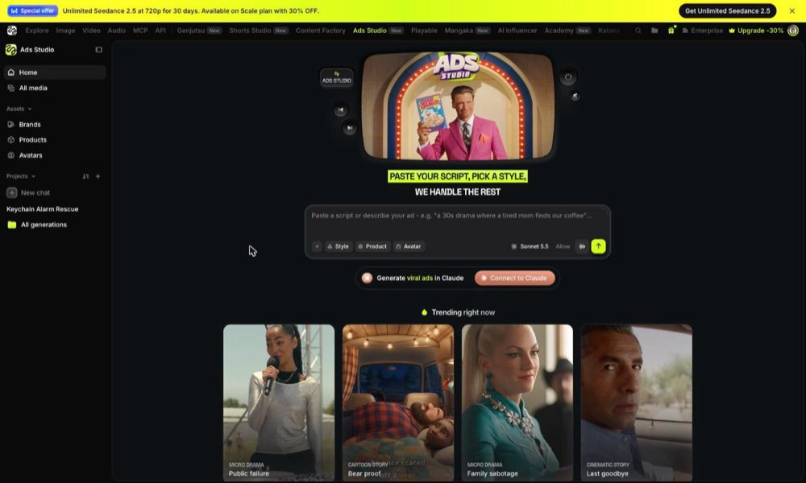
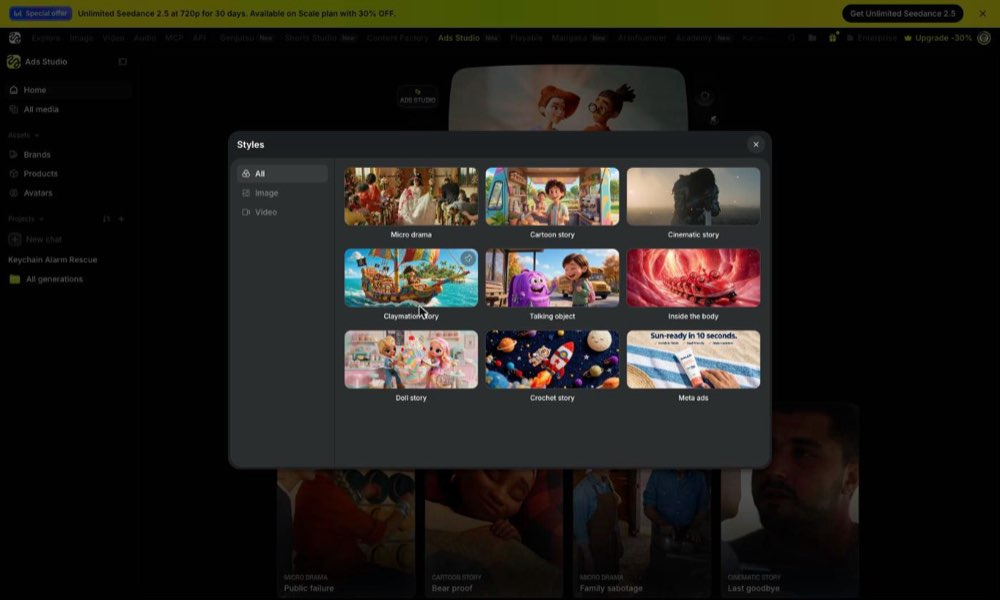
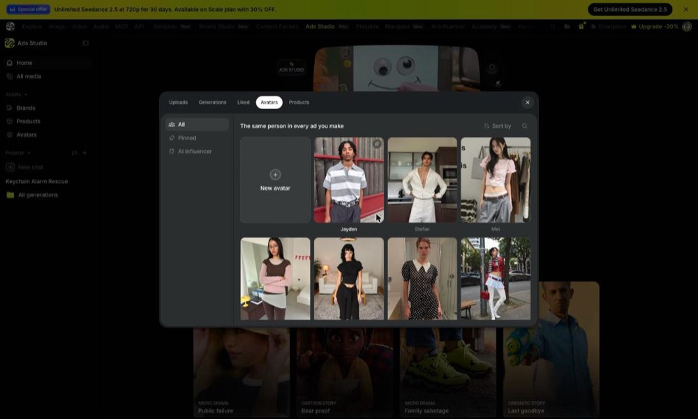
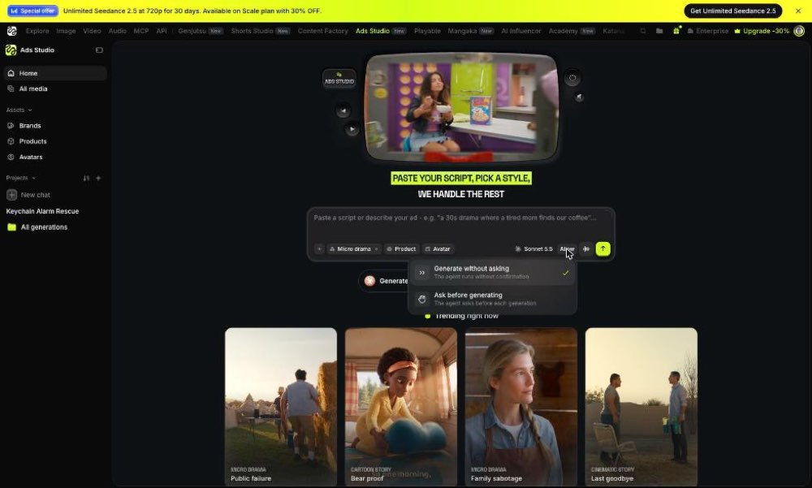
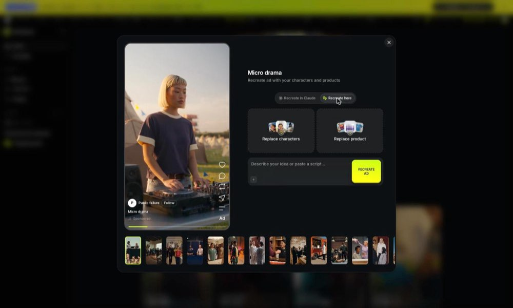
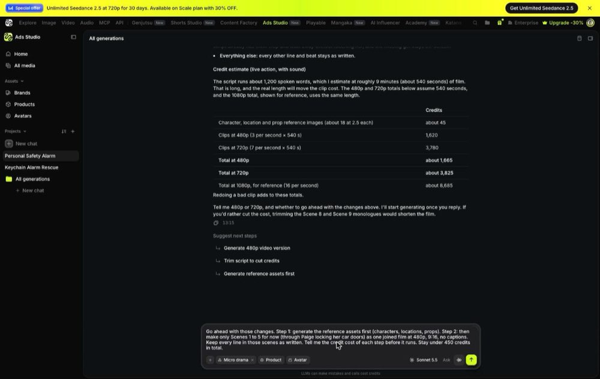

# Higgsfield Ads Studio study (10 Nov 2026)

Reed asked for our front door to work like Higgsfield's Ads Studio (higgsfield.ai/ads-studio), keeping our own styles. This is what was seen in his logged-in account, what its public files show, and what we took. Raw captures (all 44 of their card briefs, their interface text, every screenshot) are in the `skopje` workspace under `.context/higgs/`; only a few screenshots are copied here.

How to read it: **Seen** = on screen in Reed's account. **Public file** = from their public catalogue feed or public script files. **Guess** = our reading, not confirmed.

## What it is
One chat agent makes the whole ad. The home page says "Paste your script, pick a style, we handle the rest". You type an idea or paste a script, pick a Style, a Product and an Avatar, choose whether it may generate without asking, and send. The film arrives in the same chat and in "All media".

## The screens (Seen)

- **Left rail:** Home, All media; Assets (Brands, Products, Avatars); Projects, each holding chats, with "New chat".
- **Home:** a headline, one message box, and a gallery of story cards ("Trending right now"). Under the box: a "+" to attach, three chips (Style, Product, Avatar), the chat model, an "Allow" menu, send.
- **Styles** opens as a window of picture tiles with a filter on the left (All, Image, Video). Eight video styles and one for still ads. The pick becomes a chip with an ×.
  
- **Product and Avatar** open one shared window with tabs (Uploads, Generations, Liked, Avatars, Products). Avatars says "The same person in every ad you make".
  
- **Allow:** "Generate without asking" (their default) or "Ask before generating".
  
- **A story card** opens as a window: the sample film in a phone frame on the left; on the right "Recreate ad with your characters and products", two tiles (Replace characters, Replace product), a box for an idea or script, and one big Recreate button. A strip of the other cards runs along the bottom.
  
- **The chat:** the person's message, then the agent's work folded under "Worked for 31s" with the steps it took named in a line, then its answer, then three "Suggest next steps" presses.

## Story cards (Public file)
- 44 cards in 8 styles. 18 of them are Micro drama, the style Reed rates.
- A card is a title, a one-line plot, a sample film, a target length, and a hidden brief of about 3,000 characters. The page sends only the card's id; the server swaps in the brief.
- Every brief has the same seven parts: the person's inputs (they override the card; only their own claims, offer and call to action are used, none invented), settings (look, format, length, acts, captions off), the product in the film (when it enters, who hands it over, how the label is shown, how often it is named), the structure, the cast, tone/sound/look, and details to invent.
- **The structure is written as shares of the running time** ("0-11% the hero fails in public… 25-43% the mentor hands it over…"), so one card works at any length.
- Micro drama numbers that recur: the product enters at 20-28% of the film; lines of 3-9 words; a cut every 2.5-4 seconds; 120-240 seconds in two or three acts; a hero who matches the buyers, a rival, a mentor, a friend, an authority.
- "Details you invent" tells the model to build names, props and catchphrases from the product, its buyers and where it is used, "not the first stock choice".

## What the agent did with Reed's Palace Guard script (Seen)

- With a card picked, the card's brief and the script travel as one message ("…brief… User input: …script…").
- It read the whole 1,200-word script and kept it: it did not shorten it to the card's length. It estimated 9 minutes (about 133 words a minute).
- Before spending it listed the smallest changes it needed to be allowed to make it (no character under 18, no real shop name on screen, no physical contact in the abduction beat), and kept every product claim as written.
- It quoted before the first paid step: about 18 reference pictures (characters, places, props) at 2.5 credits each, then clips by the second: 3 credits at 480p, 7 at 720p, 16 at 1080p. For 9 minutes: about 1,665 credits at 480p.
- It offered next steps as presses: make it, trim the script to cut the cost, or make the reference pictures first.
- Each agent turn carries about 56,000 tokens of standing instructions (their skill and tools), mostly read from cache.

## How a film is built (Public file, order is a Guess)
The names in their code for what a run makes, in order: master, character, form, location, prop, plate, frame, clip, film. Each keeps its versions and what it was made from. Sound has three layers in the briefs: the clips' own sound (talk, effects, room), narration, and a score laid when the film is joined. Which image and video models make them is not published.

## What we took
1. **The front door.** Home is one box with chips (Style, Product, Cast, Shape, Folder), and Styles, Cast and Products open as windows, as theirs do. Our formats sit in the Styles window beside the looks.
2. **Story cards.** Our own cards, written for our styles (Movie first, then Disney Pixar, UGC and one each for Claymation, Skeleton, Dr Pickle and Zack D), in the same seven parts with the structure as shares of the running time. Files: `server/app/guides/cards/`.
3. **An idea is not a script.** On our site any pasted words were taken as the finished script. Now the box asks which it is; an idea is written into a script first (with the card's structure when one is picked), then made as before.
4. **Two ways to run.** "Ask before making" (our default, as today: the plan and price wait for an OK) and "Make without asking" (the owner's only: the run starts when the plan is ready, inside the price shown).
5. **The product is picked up front**, like the cast, so the real picture is attached wherever it shows.

## What we kept ours
- A pasted script stays word for word (rule 19). Their agent may cut or reword; ours never does.
- Music is added in post (their cards ask for a score at the join; ours describe only the scene's own sound).
- Our prices, our approvals for editors, and our looks' own guides, which win over a card on anything visual.

## Not learned yet
- The body of their `/drama-ads` skill (its rules and checks) is not readable anywhere.
- Their clip length, how shots map to clips, the join, and which models they use: only a finished run shows these. A short run (references, then scenes 1-5 at 480p, about 450 credits) was set up in Reed's account on 10 Nov; add what it shows here.
