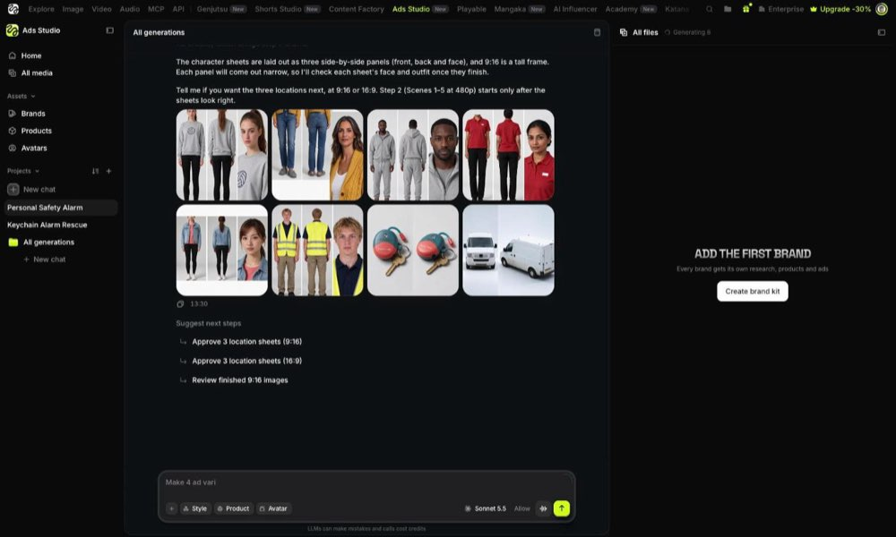
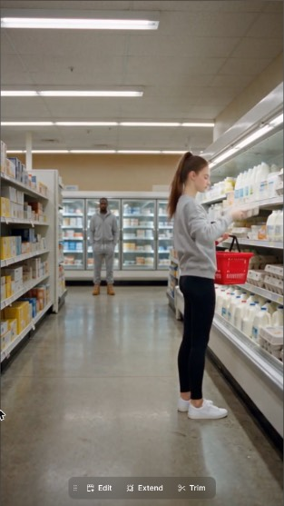
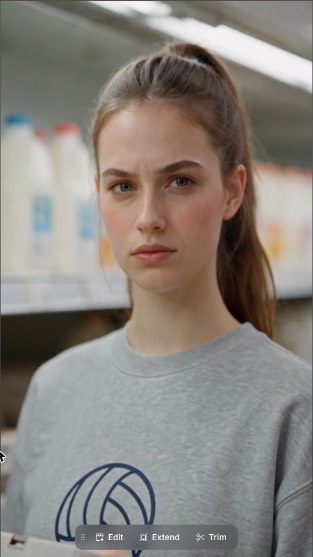
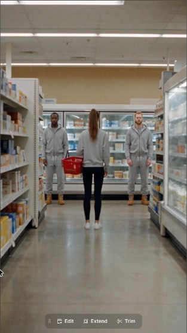

# Higgsfield Ads Studio study (10 Nov 2026)

Reed asked for our front door to work like Higgsfield's Ads Studio (higgsfield.ai/ads-studio), keeping our own styles. This is what was seen in his logged-in account, what its public files show, and what we took. Raw captures (all 44 of their card briefs, their interface text, every screenshot) are in the `skopje` workspace under `.context/higgs/`; only a few screenshots are copied here.

How to read it: **Seen** = on screen in Reed's account. **Public file** = from their public catalogue feed or public script files. **Guess** = our reading, not confirmed.

## What it is
One chat agent makes the whole ad. The home page says "Paste your script, pick a style, we handle the rest". You type an idea or paste a script, pick a Style, a Product and an Avatar, choose whether it may generate without asking, and send. The film arrives in the same chat and in "All media".

## The screens (Seen)

- **Left rail:** Home, All media; Assets (Brands, Products, Avatars); Projects, each holding chats, with "New chat".
- **Home:** a headline, one message box, and a gallery of story cards ("Trending right now"). Under the box: a "+" to attach, three chips (Style, Product, Avatar), the chat model, an "Allow" menu, send.
- **Styles** opens as a window of picture tiles with a filter on the left (All, Image, Video). Eight video styles and one for still ads. The pick becomes a chip with an ×.
  
- **Product and Avatar** open one shared window with tabs (Uploads, Generations, Liked, Avatars, Products). Avatars says "The same person in every ad you make".
  
- **Allow:** "Generate without asking" (their default) or "Ask before generating".
  
- **A story card** opens as a window: the sample film in a phone frame on the left; on the right "Recreate ad with your characters and products", two tiles (Replace characters, Replace product), a box for an idea or script, and one big Recreate button. A strip of the other cards runs along the bottom.
  
- **The chat:** the person's message, then the agent's work folded under "Worked for 31s" with the steps it took named in a line, then its answer, then three "Suggest next steps" presses.

## Story cards (Public file)
- 44 cards in 8 styles. 18 of them are Micro drama, the style Reed rates.
- A card is a title, a one-line plot, a sample film, a target length, and a hidden brief of about 3,000 characters. The page sends only the card's id; the server swaps in the brief.
- Every brief has the same seven parts: the person's inputs (they override the card; only their own claims, offer and call to action are used, none invented), settings (look, format, length, acts, captions off), the product in the film (when it enters, who hands it over, how the label is shown, how often it is named), the structure, the cast, tone/sound/look, and details to invent.
- **The structure is written as shares of the running time** ("0-11% the hero fails in public… 25-43% the mentor hands it over…"), so one card works at any length.
- Micro drama numbers that recur: the product enters at 20-28% of the film; lines of 3-9 words; a cut every 2.5-4 seconds; 120-240 seconds in two or three acts; a hero who matches the buyers, a rival, a mentor, a friend, an authority.
- "Details you invent" tells the model to build names, props and catchphrases from the product, its buyers and where it is used, "not the first stock choice".

## What the agent did with Reed's Palace Guard script (Seen)

- With a card picked, the card's brief and the script travel as one message ("…brief… User input: …script…").
- It read the whole 1,200-word script and kept it: it did not shorten it to the card's length. It estimated 9 minutes (about 133 words a minute).
- Before spending it listed the smallest changes it needed to be allowed to make it (no character under 18, no real shop name on screen, no physical contact in the abduction beat), and kept every product claim as written.
- It quoted before the first paid step: about 18 reference pictures (characters, places, props) at 2.5 credits each, then clips by the second: 3 credits at 480p, 7 at 720p, 16 at 1080p. For 9 minutes: about 1,665 credits at 480p.
- It offered next steps as presses: make it, trim the script to cut the cost, or make the reference pictures first.
- Each agent turn carries about 56,000 tokens of standing instructions (their skill and tools), mostly read from cache.

## How a film is built (Seen, in a short run on Reed's account: references, then scenes 1-5 at 480p)
The agent's steps as the chat names them: "viewed skill, loaded tools", "running command", then batches of generations, each shown with its prompt, model and settings before it runs ("Approve 8 image generations", with Always allow, Stop and Approve and the credit cost on the button).

1. **People, one sheet each** (Seedream 5.5, 2K, 2.5 credits). Three panels on a plain grey backdrop: the outfit from the front and from behind, both cropped at the neck, and one large head-and-shoulders. The prompt calls that "the one face of the sheet". Neutral face and pose, empty hands, every garment named with its colour and material. Nothing about the story.
2. **Props, one sheet each.** Two views, "photographed for real", the label's words stated exactly, and the prop's state at the end of the story (the pin pulled). With no product picture uploaded it invented the product's look.
3. **Places, one sheet each.** Two panels: the master view and the reverse angle of the same room, so both sides of a conversation share one place and one light. The prompt (about 4,700 characters) fixes a film camera and stock, measures the room, names what stands at each end, where the light falls, and one anchor object. Story details are built in (one lamp head dark).
4. **Clips: one per scene, no start picture and no storyboard stills.** Seedance 2.5, 9:16, 24 seconds, "High". The first three clips were 54 seconds. Each clip's prompt (about 4,900 characters) is, in order: one line of look; one paragraph of how it is shot, lit and acted, ending with the room's own sound; each reference picture bound to its role in words, the place first and which way each of its panels faces; the shots back to back, timed to a tenth of a second, each with its shot size, the camera's position by the place's panel, one action, and a count of who is in frame ("alone in frame", "Two people in frame"); then the voice in its own block (who, how the voice sounds, lips open or closed, each line with the second it starts); then a fixed last line (language, exact words, no music, no subtitles).
5. It checks each batch itself before going on ("confirmed generations complete") and reports the running cost in the chat.

Prices seen: 2.5 credits a picture; clips 3 credits a second at 480p, 7 at 720p, 16 at 1080p. The names in their code for what a run makes: master, character, form, location, prop, plate, frame, clip, film.

### Next to ours
- **Same idea:** our clip prompts already bind each picture to its role, time the shots back to back and repeat the no-music line; one clip is one scene (rule 29).
- **Different:** they make no still per clip (we draw and review a storyboard still for each, which is most of our steps and waits); their place picture shows both directions of the room; their person sheet has one large face where ours has three small full-body views; they count the people in every shot; they give the voice its own block with start times; their live-action dramas run on Seedance 2.5 in 24-second scenes where our Movie style runs on Omni in clips up to 15 seconds.
- These change how videos are made, so none is switched on by this study. Each is a small, separate test (see the pull request).

## What we took
1. **The front door.** Home is one box with chips (Style, Product, Cast, Shape, Folder), and Styles, Cast and Products open as windows, as theirs do. Our formats sit in the Styles window beside the looks.
2. **Story cards.** Our own cards, written for our styles (Movie first, then Disney Pixar, UGC and one each for Claymation, Skeleton, Dr Pickle and Zack D), in the same seven parts with the structure as shares of the running time. Files: `server/app/guides/cards/`.
3. **An idea is not a script.** On our site any pasted words were taken as the finished script. Now the box asks which it is; an idea is written into a script first (with the card's structure when one is picked), then made as before.
4. **Two ways to run.** "Ask before making" (our default, as today: the plan and price wait for an OK) and "Make without asking" (the owner's only: the run starts when the plan is ready, inside the price shown).
5. **The product is picked up front**, like the cast, so the real picture is attached wherever it shows.

## What we kept ours
- A pasted script stays word for word (rule 19). Their agent may cut or reword; ours never does.
- Music is added in post (their cards ask for a score at the join; ours describe only the scene's own sound).
- Our prices, our approvals for editors, and our looks' own guides, which win over a card on anything visual.

## How the run ended (Seen)

- Scenes 1-5 of Reed's script came back as one joined film: 110.75 seconds, 9:16, 480p, every line word for word, in 25 minutes from the go-ahead, with no remakes.
- Cost: 357.5 credits (about $17.50 at $49 per 1,000): 27.5 for 11 reference pictures, 330 for 110 seconds of clips. Its estimate before starting was 334.
- Five scenes, one clip each (the last scene took two). Each clip's viewer shows its prompt, the three or four pictures it was given, and "Seedance 2.5, 480p, 480x854".
- Before delivering it listened to the finished film for every line and looked at frames for doubled people, broken faces and on-screen text. It names "script, cut and seam checks" it can run by machine (skipped this time). Sound is levelled to -14 LUFS. It added a 0.4 second black cut after the cold open.
- It reported its own faults plainly: the van has cab windows; one line ends right at its clip's end; the tall 9:16 sheets came out cramped (Reed had asked for 9:16; it had chosen 16:9).
- Frames from the store scene (one 24 second clip): the place matches its sheet from both directions, and Paige and the men match theirs.

  

## What its director does, and why it is quick (Seen: the chat's own step list, `run/04-director-trace.md`)
It ran on Sonnet 5.5 at medium effort, as one conversation with a sandbox (files, a terminal, a picture reader). Its replies took 11 to 32 seconds; the whole film took 25 minutes.

- **One pass of thinking plans the whole film.** Per clip: its length, its pictures, its opening picture, each shot and the second each line starts. No treatment, scene plan, shot list or storyboard as separate documents. It moved lines apart when a first pass ran tight and left quiet seconds at each clip's end.
- **Few, long units.** Six clips for 110 seconds (8 to 24 seconds each), one per scene. A scene longer than one clip is continued by extending the clip, not by starting a new one.
- **Fixed text is assembled, not rewritten.** The look line, the "shot like a feature film" paragraph, the place prompts' camera and forbidden lists and the last line are pieces on file. The model writes only what changes.
- **Work is ordered by what depends on what.** One pilot clip alone ("so I can read back its parameters before batching the rest"), then every clip that depends on nothing at once, then the rest.
- **Voices are kept with samples.** The first clip a person speaks in creates their voice; it cuts 3 seconds of it, and every later clip of that person carries the sample ("@Audio 1 is the voice of @Image 2").
- **Checks are tools first.** A probe (size, length, sound), a transcript (the words and when they land) and one look at a sheet of frames per clip; then one transcript of the finished film. No per-take watch, no automatic remakes: it reports faults and leaves the call to the person.
- **It may skip its own heavier steps and says so.** Here it skipped a structured script file with mechanical checks, start pictures for one scene ("it would only add cost and an edit pass") and a cut-and-seam analysis.

### Ours, on the same job (from the 10 Nov review's measurements)
- Five writing steps in a row (treatment, scenes, shots, storyboard, clip prompts), each re-reading the script and guides; clip prompts are written one call per clip, none seeing the others.
- Clips of 3 to 8 seconds, so a 5-minute script is about 47 clips, each with its own still, prompt, take, listen, watch and join.
- Every take is listened to and watched, and weak ones are remade up to twice on their own (about +50% takes).
- One model call at a time for the whole site, at the largest model and high effort.
- Measured: about 2.5 to 3 hours for 300 seconds; footage about two thirds of the bill, the director and checks about a third.

## Not learned
- The body of their `/drama-ads` skill (its rules and checks) is not readable anywhere.
