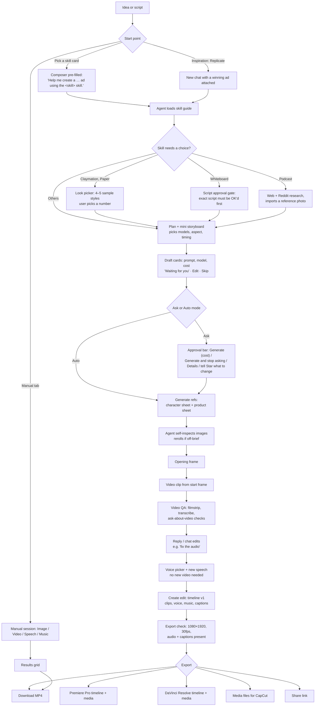

# Starpop research findings (Phase 1, observe only)

For Reed. Researched on 28 Oct 2026, roughly 3:25–4:10 PM, in the built-in browser while you were signed in to Starpop.
Screenshots are in [`shots/`](shots/). File names start with a number, so they sort in the order I took them.

**How I handled prompt text:** I describe each skill's prompts in my own words: the sections they use, what each section asks for, and the rules they enforce. I didn't paste Starpop's preset text word for word. Where the exact wording matters, the screenshot named next to it shows it on screen. Button names, field names, step names and defaults are recorded exactly.

---

## Reed's verdict (read this first)

**Our current flow is better for our use case, and our outputs are better.** Don't rebuild around Starpop. Borrow a few high-level ideas to improve the workflow we already have:

1. **Song ads and how they use Suno** (the main thing worth taking)
   - **Two song "directions" before generating anything.** Each has a concept, lyrics, a one-line style and a visual concept. One is recommended, and the user picks.
   - **Simple vs Custom.** *Simple* takes a short description and Suno writes the lyrics (500 characters max). *Custom* has a Style field (genre, vocal gender, BPM, production feel; 1,000 characters max) and a Lyrics field (5,000 characters max) that is **sung exactly as written**, using [Verse]/[Chorus] tags.
   - **Two takes per request** (Suno returns 2 tracks for 1 credit). The agent marks one preferred, and the user can switch.
   - **Storyboard to the real song timing** *after* the track exists, not before.
   - **The character lip-syncs the hook and chorus lines only**; the rest is silent B-roll under the song.
   - Watch out for: it rewrote finished lyrics when given a screenplay. For us, finished lyrics should be locked by default. Music generation also failed or stalled during testing, so a retry is needed.
2. **Saved brands that lock in.** A brand is imported from a website (logo, primary/secondary colours, auto-written description, products). Projects and chats are tied to a brand, so every generation knows the product, voice and look without re-explaining. Without a brand you get a visible warning ("chats won't know your products, voice or visual identity").
3. **Clean UI.** Three columns (projects / work / media), simple cards, and one approval bar that shows the cost before anything runs.
4. **Model and style choice (later).** Default to "Auto", but let a user override the image or video model per project, with the cost per image or per second shown next to each. A visual look picker (the same scene shown in 4–5 styles, pick a number) is a nice way to choose a style before spending.
5. **Organization ideas**
   - A clear hierarchy: Brand → Project → Session → Assets, plus one org-wide Media library where every asset links back to the chat that made it.
   - A "Preferred" mark on takes and images, so later steps reuse the chosen one.
   - Branch from here / Revert to here on any step.
   - A cost log broken down by project and chat.

Everything below is the full research for reference.

---

## 6. Credit balance (summary first)

| | Credits |
|---|---|
| Starting balance (Settings → Credits, before I touched anything) | **495** (monthly allowance; 0 purchased; renews 28 Nov 2026) |
| Budget (75% of start) | 371 |
| Ask-first limit (~10% of budget) per generation | ~37 |
| **Spent by my tests** (Activity → Transactions, every row tagged with a `TEST - research - …` project) | **20.24** (≈ $2) |
| Spent by your own chats today, running in parallel ("Test" and "IRON PAWS" projects; 5 of these were spent before I started) | 33.31 |
| **Ending balance shown in Starpop** (Settings → Credits, 4:08 PM) | **446** |

495 − 446 = 49 credits gone while I worked. 20.24 of that was mine and the rest was your own Pixar/Iron Paws chats, which were generating at the same time.

No single generation came near the 37-credit ask limit. The biggest was the 8-second Pixar clip at 8 credits. I didn't buy anything, didn't touch billing, and didn't edit, rename or delete anything that already existed.

---

## 1. Feature map: every page and tool

Starpop is a single web app. Everything lives in three columns: a **left sidebar** (navigation, brands, project tree), a **centre** (chat or manual generator) and a **right panel** (Gallery / Actors). Settings opens as a pop-up over any page.

### Left sidebar (shot 02)
| Item | What it does |
|---|---|
| **Workspace** | Home. The composer with "Your next winning ad starts here." |
| **Inspiration** | Ad library (see below). |
| Icon row: **Projects / Media / Sessions** | The three library pages below. |
| **All brands** filter + **Create brand** (+) | Filters everything by brand. Your "Iron Paws" brand shows "1 product imported · Review import". |
| **My projects** tree | Projects → sessions (chats) inside them. Each session shows a status: *Running*, *Needs approval*, or counts like "1 video · 4 images". You can drag a chat to another project. There are also project search, group-by-brand and "Archived items". |
| **Turn on auto top-up** banner | Goes to Settings → Credits. |
| **Tutorials / Browse / News** | Help and content links. |
| Account chip | Org name and live credit balance (this is where 495 showed). |
| **Tasks** tray (bottom bar) | "N tasks running" plus a "Recent tasks" list. Rows are generic ("Background task", "Chat action"), so you can't tell *which* job is which (shot 38). |

### Pages
| Page | What's on it |
|---|---|
| **Workspace / New session** (shots 01, 02, 16) | Composer with 5 tabs: **Chat, Image, Video, Speech, Music**. Brand bar ("No brand — chats won't know your products, voice or visual identity" + **Add brand**). A "start from a skill" strip (4 featured, **See all styles** shows all 13). Below that: Handpicked (135), Animation (21,588) and Realistic (71,474) inspiration rows with **Replicate** buttons. |
| **Chat session** (`/app/chat/<id>`) | The agent conversation. See §2 and §4. |
| **Manual session** (`/app/manual/<id>`) (shots 44, 45) | Results grid on top, generator below (Image/Video/Speech/Music tabs, no agent). Shows up as a "Manual session" in Sessions. |
| **Inspiration → Meta ads** (shots 07, 08) | 137,711 tracked Meta ads. Tabs: All media / Video / Image, Bookmarks, All ads, All time, sort by "Recorded impressions rank". **Format** chips (3D animation 14,780, 2D 5,516, Crochet, Skeleton, Claymation, Paper, Lego, UGC 9,309, Talking head, Podcast, Testimonial, Skit, Static ad 10,516 …) and **Sound** chips (Speech, Song, Instrumental, No audio). Left column: 139 ad accounts with ads/tracked counts. Each card: brand, posted date, days running, all-time and active rank, star rating, tags, headline, text, **Replicate**, **Details**, bookmark. |
| Ad **Details** drawer (shot 08) | **Overview**: status, run dates, last seen, all-time rank (e.g. #1 of 795), active rank, ads using this creative, format, CTA, landing page, visual style, primary format, audio, Ad ID. **Ad copy**: headline, primary text with Copy, CTA. **Replicate this ad** starts a new chat with the ad attached (or "copy it for another chat"). Also: View in Meta Ad Library, Share, prev/next. |
| **Inspiration → Handpicked** (shot 09) | 1,308 curated creatives across 55 pages, tagged by angle (Before & After, Features & Benefits, How To) and funnel stage (Middle of Funnel). |
| **Projects** (shot 10) | Cards with thumbnail mosaic, brand, asset count, owner, creator, last active, star. Filters: All/My projects, Involvement, People, Sort. **New project** asks for a name (optional) and a brand (optional), and notes "Shared with your organization". |
| **Media** (shots 11, 42, 43) | Every asset across the org. Favourites / Images / Videos / Audio; filters for project, creator, source, status. Tiles show project tag, "Preferred" and "Edited" badges, audio duration and live progress for running jobs. |
| **Asset preview** (shots 12, 13, 41) | Lightbox. Image toolbar: **Edit, Crop, Flip, Upscale, Create Video**. Video toolbar: **Extract frame, Cut, Adjust Speed**. Side panel: location (brand, project, **Open project**, **Open chat**), source badge (Uploaded / Generated / Composite), **Reuse inputs**, **Regenerate**, full **PROMPT** with copy button, model, credits, generation time, timeline (for edits), **Download**, Favourite, **Share** (copies a `starpop.ai/generation?id=…` link), Copy ID. |
| **Sessions** (shot 14) | Fuzzy search across chat titles, messages and manual prompts, or paste a session ID. Filters: All / Chats / Manual sessions, brand, project, user. Card: "Chat · 9 messages · 3 media", **View conversation**. |
| **Brand import review** (shot 15) | 2-step wizard: **1 Brand details → 2 Your products**, plus "Review later". Built from a website URL: auto-pulled logo (Replace/Remove), primary and secondary colours with hex codes, brand name, and an auto-written brand description. "Continue to products" goes to step 2. I didn't continue, so I wouldn't change your brand. |
| **Settings** (pop-up, `?settings=…`) (shots 05, 06, 35) | **Workspace:** General (org name/ID, members), **Connected agents** (Starpop MCP · Beta: lets Claude/Codex-type agents connect, with an MCP setup guide and revoke), Members (Solo = 1/1 seats), Invitations. **Billing & usage:** Credits (balance, packs: $20/160, $50/425, $100/900, $500/4,500; auto top-up), **Activity** (dashboard plus a per-transaction log with model, chat, project and running balance), Plan, Billing. |

### Plans and pricing (Settings → Plan)
- **Solo** $50/mo: 500 credits, 1 user. **Teams** $100/mo: 1,000 credits, 2 users, more seats available. 1 credit ≈ $0.10.
- Starpop's own guide to video cost: P-Video ~$2.5 per 60-second ad, MiniMax H3 Max ~$5, Seedance 2.5 ~$25.

### Composer controls (Chat tab) (shots 17, 18)
- **Agent picker:** Star Mini (1× credits, "fast and efficient"), Star (10×), Star Max (50×).
- **Ask / Auto:** Ask means "Star asks before each generation". Auto means "Star generates and continues without asking".
- **Image model** (Auto by default) and **images per draft** (×1). **Video model** (Auto) and **videos per draft** (×1).
- **+** to attach files, a **chat usage** ring ("8% context used"), **Dictate** (mic).
- Image models and credits per image: P-Image 0.25 · Nano Banana 2 Lite 0.5 · Nano Banana 2 0.75–1.75 · Nano Banana / Seedream 4.5 / Seedream 5 Lite / Grok Imagine 1 · Nano Banana 2.1 1–2.5 · GPT Image 1.5 1–2 · Seedream 5 Pro 1.5–2.5 · Nano Banana Pro 2–3 · GPT Image 2 / 2.5 Flare / 2.5 Sunburst 0.25–6.5.
- Video models and credits per second (25 total): cheapest are P-Video 0.25–0.5, P-Video-2 Pro 0.25–0.44, MiniMax H3 Max Turbo 0.25–0.8, Gemini Omni Flash 1.1 0.3–3, P-Video-2 0.375–0.75 (has audio-driven lip sync). Mid: Veo 3.1 Lite 1, Kling 3.0 1.5–2, Veo 3.1 Fast 2. Top: Veo 3.1 4, Seedance 2.5 2.5–12.5. The full list is at the bottom of this doc.

### Manual generator tabs (shots 20–26)
| Tab | Modes and fields | Defaults |
|---|---|---|
| **Image** | *References* (up to 10 reference images + prompt) or *Edit* (required "Main image", up to 9 supporting images, "Describe what you want to change…"). Prompt-enhance wand, dictate. | Nano Banana 2.1, 1K, 9:16, ×1 |
| **Video** | *Omni* (up to 9 images + an **Actor** picker, up to 3 videos, up to 3 audio clips, scene prompt) or *Start / end frames* (start frame required, end frame optional, "Describe the motion or action you want…"). | Seedance 2, 16:9, 5s, 720p, ×1 |
| **Speech** | Up to 4 voices (required), script up to 10,000 characters, **Edit with AI**, **Emotion** tags plus **Auto add emotions**, clips per voice. | — |
| **Music** | *Simple* (Instrumental toggle, song description up to 500 characters; Suno writes the lyrics) or *Custom* (Style up to 1,000 characters, Lyrics up to 5,000, "sung exactly as written"). | Suno V6, 2 tracks, 1 credit |

### Right panel
- **Gallery:** project media, search by media or ID, favourites, filters, upload, an **Organization** shared-assets folder, New folder.
- **Actors (151):** stock "UGC creator" faces labelled by gender and age (e.g. Female / Young Adult). Filters All / Yours / Starpop, plus **Add** for your own. You attach them in Video → Omni.

---

## 2. Workflow: idea to exported video

**How the work is split into steps.** Every chat breaks the job into visible, separately priced units, and each one shows as a card:
1. **Skill load** (a "Skill · <slug> skill ✓" line).
2. **Plan** in plain words, including which models it picked and why.
3. **Reference sheets first.** A character sheet (front/side/back plus face close-ups plus one "signature detail" close-up) and a product sheet on white. These lock consistency for every later shot.
4. **Opening frame**, then the **clip animated from that frame**.
5. **QA steps.** "Inspect images", "View filmstrip (17 shot frames)", "Transcribe", "Ask about video/audio". They show up as collapsible "Worked for 1m 15s · 4 steps · 1 failed".
6. **Edit** (a timeline object) and **Export**.

**Projects and structure:** Org → Brands → Projects → Sessions (Chats or Manual) → Assets. Assets also appear org-wide in Media, and each one links back to its chat.

**Handoffs to editors and collaborators:**
- **Export to another editor:** "Download this edit's cut, with its voiceover and music in sync". Options are **Premiere Pro** (timeline and media), **DaVinci Resolve** (timeline and media) and **Media files** (raw and edited clips "for CapCut or any editor"). Shot 40.
- **Share link** on any asset, **Copy ID**, and **Download**.
- Projects are "Shared with your organization". Teammates need the Teams plan (Solo is 1 seat).
- **Save as document** on any agent message, **Branch from here** (fork the chat) and **Revert to here** (roll back).
- **Connected agents (MCP beta):** outside AI agents can drive Starpop.

**Edit and regenerate loop:**
- Per draft: **Edit**, **Skip**, **Mark preferred / Prefer** ("Future references to this draft use the selected result"), and a **+** slot for more variants.
- Per asset: **Reuse inputs**, **Regenerate**, Edit/Crop/Flip/Upscale/Create Video, Cut/Extract frame/Adjust speed.
- Per message: **Edit message**, Copy, **Branch from here**, **Revert to here**.
- By chat: you just say what's wrong. In my Pixar test I said "make the clean-speech version". The agent re-voiced only the audio (2 tries, 0.25 credits each), muted the original, added captions and built a new edit. **No new video generation, so no 8-credit re-render.**

---

## 3. Skills and styles

Clicking **Use** on a skill drops a pre-written sentence and a skill chip into the composer: *"Help me create a <style> ad using the `<slug>` skill."* (shot 27). The agent then "loads the skill guide" (hidden from users) and follows it.

What all the visual skills have in common: the generated prompts are built from **labelled blocks**: **Style** (a fixed, skill-specific style paragraph) → **Visual** (the subject and the one story moment) → **Composition** (aspect, camera angle, framing, phone legibility, negative space) → **Lighting** (usually "one motivated source") → **Constraints** (no text, logos, watermarks or extra limbs unless asked; exact spelling for any text you do allow). Several end with a fixed "camera inside the scene, fills the frame" line. All 13 skills put the **product as hero** and keep brand text off the image unless asked (they use a sewn tag or emblem instead).

| # | Skill (card) | Slug | Inputs it asked me for | What's special (paraphrased) | Default / chosen model | Screenshot |
|---|---|---|---|---|---|---|
| 1 | **Disney Pixar** | `disney-pixar-animation` | Script/brief; asks for a **real product photo** for packaging accuracy | Fixed preamble: a frame from a high-end stylized-3D animated feature (soft global illumination, warm bounce light, coloured shadows, lived-in set, shallow depth of field, rich but harmonious colour). **Character reference sheet first**: it names an original character, gives it a signature detail (e.g. a notched ear), shows 3 full-body views + 2 face views + a detail close-up on white, no text. Fixed "hero frame" ending. Plans a timed mini storyboard, and suggests songs or dialogue on camera. | Nano Banana 2 Lite (stills) + **Gemini Omni Flash 1.1** (video with spoken line); your own chat used Nano Banana 2.1 + Seedream 4.5 | 28–30, 36, 39–41 |
| 2 | **Chibi 3D** | `chibi-3d-animation` | Brief + hook text | Single 4:5 still with the hook rendered in the image. Self-check caught that the headline duplicated words. | NB2 Lite | 42 |
| 3 | **Comic illustration** | `comic-illustration-animation` | Brief | One panel built on a cold-vs-warm contrast. | NB2 Lite | (stuck) |
| 4 | **Podcast ad** | `ai-podcast-ads` | Brief | **Does real research**: web search (5 Reddit threads on cold feet and wool socks) + web image search (10 images) → imports one real podcast photo (Pexels) as a framing reference → 2-host script (~7s) → realistic 9:16 host frame, no product. Says openly that a fictional brand can't be "validated". | NB2 Lite | 32, 43 |
| 5 | **Whiteboard explainer** | `whiteboard-explainer` | Brief | **Hard script gate**: it won't make visuals until you approve the exact script. Prompt allows a whitelist of on-board words only, spelled exactly; real presenter at the edge of frame; marker points at the diagram. | NB2 Lite | 42 |
| 6 | **Zack D Films** | `zack-d-films` | Brief | Ships a **fixed background "world" reference image** (light-cyan studio with no edges) that the prompt says to preserve exactly. One oversized, playful "body moment" (blue frosty toes vs warm sock glow). Avoids unsupported claims and graphic medical detail. | NB2 Lite | (stuck) |
| 7 | **Claymation** | `claymation-animation` | **Look picker**: 1 Cinematic, 2 Goofy, 3 Clean & simple, 4 Stop-motion puppet (same scene rendered 4 ways) | Adds a **"Physicality" block** (hand-sculpted plasticine, tool marks, real fabric on a miniature set; no real skin, hands or nails). **The skill pins its model**, so it ignored my "cheapest" request. Self-critique: "the pose reads like handling the sock, not putting it on". | **Nano Banana 2.1 · 1K (pinned)** | 33, 42 |
| 8 | **Cinematic 3D** | `cinematic-3d-animation` | Brief | Style block: premium animated-feature design with photographic light and materials (ray-traced reflections, physically accurate textures, filmic grade, anamorphic depth of field). Brand only as a small sewn cuff tab. | NB2 Lite | 42 |
| 9 | **Wool crochet** | `wool-crochet-animation` | Brief | Long style block: everything in frame is hand-knitted yarn, medium gauge, stop-motion still, step-back framing, with rules for which colours stay natural. Negatives: no real humans, no chibi toys or bobbleheads. **Skill recommends GPT Image 2**; I forced the cheap model and it said so. | NB2 Lite (GPT Image 2 recommended) | 43 |
| 10 | **Paper animation** | `paper-animation` | **Look picker** (5): Layered papercraft world, Flat construction-paper cutout, Handmade stop-motion paper, Mixed-media collage, Origami world | Stacked cardstock with visible thickness and layered shadows. **Leaves calm space for later copy** but renders no text. Bans tables, workbenches or any "outside view" of a craft object. | NB2 Lite | 34, 42 |
| 11 | **Skeleton ad** | `skeleton-ads` | Brief | A friendly cartoon-eyed skeleton wearing clothes, doing the product action, in a photoreal cozy set; vertical social frame; no collage. Didn't show the script I asked for. | NB2 Lite | (stuck) |
| 12 | **Talking object** | `animated-talking-character` | Brief + line | Locks a **mascot sheet** (the product becomes the character: eyes and mouth on the product, knitted arms, a single embroidered emblem as the only brand mark), generates the **voice line first** (ElevenLabs "Evelyn", Eleven v4, auto emotion tags), then frame → lip-synced clip. | NB2 Lite + ElevenLabs | 37 |
| 13 | **Song-style ad** | `song-style-ad` | Script or lyrics | Turns a script into 2 song "directions" (concept, lyrics in [Verse]/[Chorus] form, style line, visual concept), recommends one, and keeps claims labelled "unverified". If you give it a screenplay it may **rewrite your lyrics**. Your own chat had to correct it ("Those were finished lyrics"). Makes 2 Suno takes and marks one preferred. Storyboards to the **real song timing**. | Suno V4/V6 + NB2 Lite | 03, 31 |

Other agent skills it loaded on its own: **`speech-drafting`** (voice matching and emotion-tagged lines) during the audio fix. The agent can also "List skills" mid-task.

**Voice picker** (shot 36): "Recommended voices — matched to the speaker, script, audience, and delivery". Each card shows provider (Fish Audio / ElevenLabs), language, gender, age, tags, matched traits and a one-line fit rationale, with **Use voice**, plus **Search all voices** and **My favourites**. ⚠️ Some community voices are named after famous characters (the top match was literally "The Cat in the Hat"), which is a brand-safety risk for client work.

---

## 4. Test log

All tests used a made-up product (**"Sunny Socks"**, bright yellow wool socks), Star Mini, Ask mode, the cheapest settings, and a project named `TEST - research - <skill>`. "Time" runs from submit to the agent's "Took …" stamp. Credits come straight from Activity → Transactions.

| Skill | Input | Output | Credits | Time | Notes |
|---|---|---|---|---|---|
| Disney Pixar | 8s vertical, grumpy cat line "Cold toes again? Not anymore." | Cat character sheet, sock sheet (+1 reroll), opening frame, **8s 720p video with spoken line** | 2.0 images + **8.0 video** + 0.44 agent = **10.44** | **5m 02s** | Agent rerolled the socks on its own ("soft-lemon, not vivid yellow"). Video QA flagged extra "hmm" sounds. One QA step failed ("Ask about audio"). Result looks genuinely Pixar-like (shot 41). |
| Pixar edit loop | "Make the clean-speech version" | 2 voice takes → muted original → captioned **edit v1, 8s, 1080×1920, 30fps** | 0.25 + 0.25 = **0.50** | **4m 49s** | Caught a chuckle in take 1 by itself. No video re-render. Export dialog offers Premiere, Resolve and CapCut files. |
| Chibi 3D | One still with hook text | 4:5 chibi still | 0.5 + 0.13 = **0.63** | 1m 22s | Self-check: hook text duplicated; offered a rerun. |
| Comic illustration | One panel | ❌ stuck | 0.5 + 0.13 = **0.63** | stuck >15 min | Billed but never delivered while I watched. |
| Podcast ad | Host frame + script | 9:16 host still, 7s 2-host script | **0.50** | 1m 44s | Did web and Reddit research and imported a Pexels reference first. |
| Whiteboard explainer | One frame + script | Script (gate) → whiteboard still | 0.5 + 0.14 = **0.64** | 35s script + 42s image | Required script approval before any visuals. |
| Zack D Films | One frame + script | ❌ stuck | **0.50** | stuck >15 min | The prompt was fully drafted (see §3). |
| Claymation | One frame | Look picker → square clay still | **1.00** | 27s picker + 1m 01s | Skill forced Nano Banana 2.1 (1 credit). Honest self-critique of the pose. |
| Cinematic 3D | One hero frame | 4:5 cabin product still | **0.50** | 1m 10s | — |
| Wool crochet | One frame | 1:1 knitted-world still | **0.50** | 37.5s | Agent said the skill prefers GPT Image 2. |
| Paper animation | One frame | 5-look picker → 9:16 papercraft still | **0.50** | 29s picker + 42s | — |
| Skeleton ad | One frame + script | ❌ stuck | **0.50** | stuck >15 min | Script not shown. |
| Talking object | 5s clip, sock speaks | Voice line made (0:02); character sheet ❌ stuck, so no clip | 0.5 + 1.0 = **1.50** | stuck >15 min | Voice first, then visuals. |
| Song-style ad | 10s jingle + 1 image | ❌ **Music: "Couldn't complete this step."** Image stuck | 0.5 + 0.15 = **0.65** | stuck >15 min | No reason given and no retry button. Chat became un-sendable (see errors). |
| Manual Music | Simple mode, 10s jingle description | 2 Suno V6 tracks: ❌ still spinning at 5m38s | **1.00** | >5m38s | Manual session page. Suno was slow or failing for both me and the agent today. |
| Manual Image | P-Image, 9:16 | 1 still | **0.25** | ~16s | Prompt said "a pair" and it drew one sock: the cheap model is weaker. |
| **Total (my tests)** | | | **20.24** | | ≈ $2 of the $50/month plan |

### Error and empty states seen
- **Stuck generations.** Starting ~3:50 PM, many Nano Banana 2 Lite jobs sat at "9:53 / ~33s — Taking longer than estimated" for 15–17 minutes (still stuck when I stopped at 4:08 PM). They were **already charged** (Activity shows them at 3:50–3:52). Your own "Test" project had stuck jobs too ("13:45 / ~2:41"), so this was Starpop-side, not my inputs (shots 37, 42, 43).
- **Chat soft-lock.** While a job is stuck, the composer shows only **Cancel response** (no send button). Cancel did nothing in my test, so you can type but can't send. "1 generation still finishing — Show me" just scrolls to the stuck card.
- **Step failed.** A yellow card says "Music — Couldn't complete this step." with no reason and no retry (shot 31). In the Pixar QA, "Ask about audio — Couldn't complete this step" was skipped quietly and the agent carried on.
- **Infinite loading.** Hard-loading some URLs (`/app`, `/inspiration?library=handpicked`, a chat URL) sits on the Starpop logo with "Loading workspace" for 40+ seconds with no error. Clicking through the app works.
- **Empty states.** Invitations: "No pending invitations — When someone invites you…". Connected agents: "No connected agents — Agent clients such as Codex or Claude will appear here after you approve". Credit top-ups: "No credit top-ups yet." Brand bar: "No brand — chats won't know your products, voice or visual identity."
- **Agent honesty lines:** "I can't verify live credit pricing, so I won't promise it's the absolute cheapest" (repeated in most skills). "I've preserved the product and outcome claims from your script as creative copy; I haven't independently verified them."

---

## 5. For script-led Pixar UGC ads: what Starpop does better, and what's worse or missing

### Starpop does better
1. **Consistency built in.** It always makes a named character sheet and a product sheet first, then anchors every shot to an opening frame. That's the right approach for multi-scene Pixar ads.
2. **The agent checks its own work.** It looks at every image and video (filmstrip, transcript, targeted questions), rerolls off-colour products, and says what's still wrong (stray "hmm" sounds, duplicated text, a pose that doesn't match).
3. **Cheap fixes.** For an audio problem it re-voiced and re-edited instead of re-rendering video: 0.5 credits instead of 8.
4. **Clear cost before you spend.** Every draft shows its model and credit cost, and the Ask-mode bar has per-item Details and lets you untick items. Activity logs every charge per chat and project.
5. **Real editor handoff.** Premiere and DaVinci timelines with voice and music in sync, plus CapCut-ready media. This is rare and valuable for editors.
6. **Timing-aware storyboards.** For song ads it storyboards to the real track length after generating it.
7. **Ad library tied to creation.** 137k ranked Meta ads, filterable by 3D animation and song, with one-click "Replicate" into a chat.
8. **Gates that protect the script.** Whiteboard won't draw until the script is approved, and Claymation and Paper show a visual look picker before spending.
9. **Branch / Revert / Save as document** on any message: safe experimentation without losing a good version.

### Worse or missing (for our use)
1. **Scripts aren't treated as sacred by default.** Song-style rewrote your finished lyrics until you corrected it. There's no "locked script" field. For a script-led studio, script lock should be the default.
2. **Reliability.** Stuck jobs that were charged and never delivered, a silent "couldn't complete" step, no retry button, a Cancel that didn't work, and chats that lock up. No automatic refund seen ("0 refunded").
3. **Opaque task tray.** "Background task / Running…" rows don't say which chat or asset they belong to.
4. **Skills override cost choices.** Claymation pins Nano Banana 2.1, and Crochet wants GPT Image 2. There's no per-skill "budget mode".
5. **No multi-scene script view.** Storyboards live as chat text. There's no scene-by-scene board you can edit next to the script, with per-scene regenerate and approve, before rendering.
6. **The skill guides are hidden.** You can't see or edit the preset prompt rules, so you can't tune "our" Pixar house style. You only see the prompts after they're written.
7. **Voice IP risk.** Community voices named after famous characters (Disney-tagged) show up as "best match".
8. **"Pixar" naming.** The skill is called "Disney Pixar". The agent says it uses "original" characters, but the branding itself may be a legal or brand-safety concern for client-facing work.
9. **Collaboration is thin on Solo.** One seat. Sharing is just links and Copy ID. No comments or approvals on assets for a client or editor.
10. **Product accuracy depends on uploads.** For real packaging it asks for a product photo (it asked for your Iron Paws bag). Without one it invents packaging.

---

## Raw details worth keeping

- **Ask-mode approval bar:** "Generate an image? Star is waiting for your go-ahead. Untick anything you don't want." → **Generate (cost)** · **Generate and stop asking** (switches to Auto) · **Details** (per-item cost) · "Or tell Star what to change…". The session in the sidebar shows **Needs approval** (shot 28).
- **Draft card:** aspect and count chip (e.g. "3:2 · ×1"), title, full prompt, model, cost, status (Waiting for you / Waiting), **Edit**, **Skip**.
- **Progress:** "47s / ~1:43" with model name; "Thinking… 1m 44s"; step names like "Planning video action", "Summarizing storyboard process", "Inspecting video start frame", "Inspecting visual cues".
- **Agent charges** show as "Share of a pooled AI-agent charge" (0.13–0.44 credits per chat burst on Star Mini).
- **Measured costs:** Nano Banana 2 Lite 0.5 · Nano Banana 2.1 (1K) 1 · P-Image 0.25 · Gemini Omni Flash 1.1 video 1 credit/s (8s = 8) · ElevenLabs line 1 · Fish Audio line 0.25 · Suno V6 (2 tracks) 1 · editing/compositing 0.
- **Full video model list (credits/second):** FLUX.3 Max 1.7–2.9 · Kling 4.0 1.57–2.35 · P-Video-2 0.375–0.75 · P-Video-2 Pro 0.25–0.438 · MiniMax H3 Max Turbo 0.25–0.8 · MiniMax H3 0.5–1.6 · Gemini Omni Flash 1.1 0.3–3 · MiniMax H3 Max 0.5–1.6 · Kling 3.0 Turbo 1.5–2 · FLUX.3 1.7–2.9 · Seedance 2.5 2.5–12.5 · Gemini Omni Flash 1.5 · Grok Imagine Video 1–1.5 · Seedance 2 Mini 0.75–1.5 · Seedance 2 Fast 1–2.5 · Kling O3 Pro 1.4–1.68 · Happy Horse 1.5–3 · Seedance 2 1.5–6.5 · Veo 3.1 Lite 1 · P-Video 0.25–0.5 · Kling 3.0 1.5–2 · Veo 3.1 4 · Veo 3.1 Fast 2 · Kling 2.6 Pro 2 · Seedance 1.5 Pro 0.75–1.5.

**Not covered:** I didn't press Download or Export (that would save files to your Mac, which I didn't have your OK for). I didn't step into Brand import step 2 (it would edit your brand). I didn't test the Speech tab manually (it needs a voice picked; speech was covered through the agent). I didn't test the manual Video tab, because the queue was stalling. Video was covered through the Pixar test.

**Ending balance: 446 credits** (4:08 PM). My tests used **20.24**.
