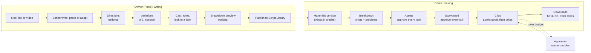

# Brand Studio today: what an editor sees (Phase 1, our side)

Observed 2026-10-28 from the repo (main at aabbf118) and QA-Live's report of 2026-10-27 (`docs/qa/live-run-2026-10-27` on branch `qa/kel-faces-2026-10-27`). Nothing on the live site was changed. This is the "ours" half; the Producer adds the Starpop half and the comparison table.

## Feature map

| Area | Where | What it does |
|---|---|---|
| Script Library | `/b/:brand/scripts` | Drafts, "Making now", filters (brand, length, reference, status), deleted scripts with restore. `?view=videos` lists videos. |
| Reel import | `/b/:brand/scripts/import` | Paste an Instagram link or drop a video; the app transcribes it, breaks it into shots, and pre-fills the script and cast. Bulk create takes many at once. |
| Script writing (owner) | `/b/:brand/scripts/:id?step=…` | Script → Directions (optional) → Variations (optional) → Cast → Breakdown (optional preview) → Publish. |
| Video making (editor) | `/b/:brand/videos/:id?step=…` | Breakdown → Assets → Storyboard → Clips → Downloads. |
| Quick clip | `/b/:brand/clip` | One prompt, model picker, "Improve prompt", Generate with its price, history. Weekly allowance. |
| Brand kit | `/b/:brand/brand?tab=look\|products\|screens` | Logo, look, product bags, app screens; "Always use this screen for" moments. |
| Cast & places | `/b/:brand/library/:kind` | Saved characters (with sheets) and places; search, archive, delete. |
| Team | `/team` | Invite by email or link, owner/editor roles, per-editor credit limits. |
| Approvals | `/approvals` | Spend over a budget or allowance waits here for the owner: Approve, Decline, Approve all. |
| In production, Usage | `/production`, `/usage` | Owner views: what's being made across brands; spend per brand. |

Models behind it: Claude writes everything (script help, breakdowns, prompts, "Change this…" rewrites); Seedance 2.5 makes video (480p); Nano Banana 2.1 (or Pro) makes stills and character sheets; Gemini 3.5 Flash watches reels; a local Whisper transcribes. No voice, music or lip-sync generation, and one video model in the main flow.

## Workflow

## How the steps are separated

- Each step is its own tab in one video page. A step stays locked until the one before it is finished, and says why in plain words: "Fix the 3 problems in Breakdown first", "Approve every asset first (2 left)", "Approve every storyboard frame first", "Approve every clip first". A link to a locked step lands on the step that blocks it.
- If an earlier step changes, later steps show "Out of date". Stills redraw themselves after a cast change if the budget allows; out-of-date clips get "Rewrite clip prompts · N credits", and old takes are kept.
- Review is not its own step: it happens inside Clips (read each prompt, press "Looks good", then pay for takes; pick a take; approve).

## Handoffs

- Owner → editor: the owner publishes a script version; an editor presses "Make this version". Locked characters arrive preloaded.
- Editor → owner: only through money. Anything over the video's budget goes to Approvals. An editor past the weekly allowance is declined with the reason.
- Editor → editor: "Release this version" hands a started version back to "Ready to make".
- Not there: comments, @mentions, review threads, share-for-review links, guest viewers, or handoff to an outside editor (CapCut, Premiere). The way out is downloading files.

## The edit and regenerate loop

| Step | Ways to fix something | Undo? |
|---|---|---|
| Breakdown | Edit a shot; "Keep anyway" on a problem; "Put the right cast in each shot" (free); "Remove X from this shot" (free); "Make it again" | Yes, except Remove |
| Assets | "Change this…" note; Pick another; use a Cast & places character; delete look; Merge roles; Approve all | Yes |
| Storyboard | "Change this…" (rewrites the prompt and redraws; "Changed. The earlier one is kept."); Make another; "Soften it" (free); "Advanced: edit the prompt"; Approve all | Yes |
| Clips | "Change this…"; "Make another take"; "Fix this clip's prompt" (free); "Keep it anyway"; "Rewrite this clip's prompt"; pick a take; Approve all; "Advanced: edit the prompt" | Yes |

Every paid button shows its price first (in credits; "free" when zero). The budget meter says "To finish: about N credits · M left in the budget".

## Export

- Downloads puts the final MP4 together automatically, free, when it opens. "Download MP4", "Download all clips (.zip)", each clip's picked take, and older takes.
- 480p only, by rule. One aspect ratio per project. No captions, no music bed, no voiceover track, no resize for other placements.

## Empty and error states (exact words)

| Where | Empty | Error |
|---|---|---|
| Breakdown | "No shots yet" + Make shots | "The shots didn't finish." + Try again |
| Assets | "Nothing to approve" | — |
| Clips | "Read each prompt and press Looks good before the takes are made (N left)." | "Failed · credits returned"; refusal: "The video model thinks this clip looks too much like someone else's character or video." |
| Downloads | — | "The video couldn't be put together." + Try again; "Out of date." + Make it again |
| Quick clip | "Your first {brand} clip starts here." | "Couldn't load your clips." |
| Approvals | "Nothing waiting." | — |
| Script Library | "No scripts for {brand} yet." | Try again |
| Server jobs | — | "The server restarted while this was being written. Nothing was charged; try again." / "The service couldn't finish this. Nothing was charged; try again." |

## Costs and speed

1 credit = 1 second of 480p Seedance video ($0.1028). A still is about 0.33 credit; a Claude writing call is about 3. A whole video is estimated up front (Claude calls + one still per clip + one look per role + video seconds). QA-Live run 3: 86 credits shown, about 70 charged, for a three-video run of short excerpts; earlier runs were under-quoted (32 shown, 94 charged).

## Where editors got stuck (QA-Live, 2026-10-27)

- False blocks: the cast check flagged reaction shots; a line said twice was "not there once"; roles from other variations showed as missing at Assets.
- Lost work: closing the page stopped "Make all stills"; server restarts killed clip-prompt jobs (since fixed: job time limit and worker lane).
- Look notes barely change a look; there's no "redraw in another sheet's style".
- 23 copyright refusals, all on clips with the Goth GF look; the message first blamed the wrong character.
- Invented screens misspelt the logo ("JOMO"); one take switched to Mandarin after "Change this…".
- Clips: no "Looks good" for all in run 1; a 5,070-character prompt couldn't be edited (5,000 limit).
- What worked: reel import, cast read, auto looks with Approve all, English takes in runs 2 and 3, the free final cut, one scene per clip.

## Screenshots (from QA-Live's run, live site)

- `screenshots/ours-27_video_page.png`: the video page with its step tabs
- `screenshots/ours-29_problems.png`: Breakdown problems
- `screenshots/ours-33_assets_making.png`: Assets making looks
- `screenshots/ours-49_clips_failed.png`: a failed clip
- `screenshots/ours-55_downloads.png`: Downloads

## Also saved: Starpop's public style files

`public-skill-files/` holds the 12 style guides Starpop publishes for free on its site (Disney/Pixar, claymation, paper, Vox-style, song, skeleton, wool, anime, watercolor, Zack D explainer, AI podcast, AI whiteboard). The Pixar one gives their exact prompt blocks (a style paragraph, a character paragraph and a camera paragraph pasted word for word into every still prompt, and one motion line opening every video prompt), Nano Banana 2.1 as the default still model, "reroll the same prompt before rewriting it", and a failure/fix table. From their public pages: plans are Solo $50/month for 500 credits and Teams $100/month for 1,000 credits with 2 users; Seedance 2.5 there costs 2.5–12.5 credits a second; they offer 35 video and 15 image models plus voice and music.
